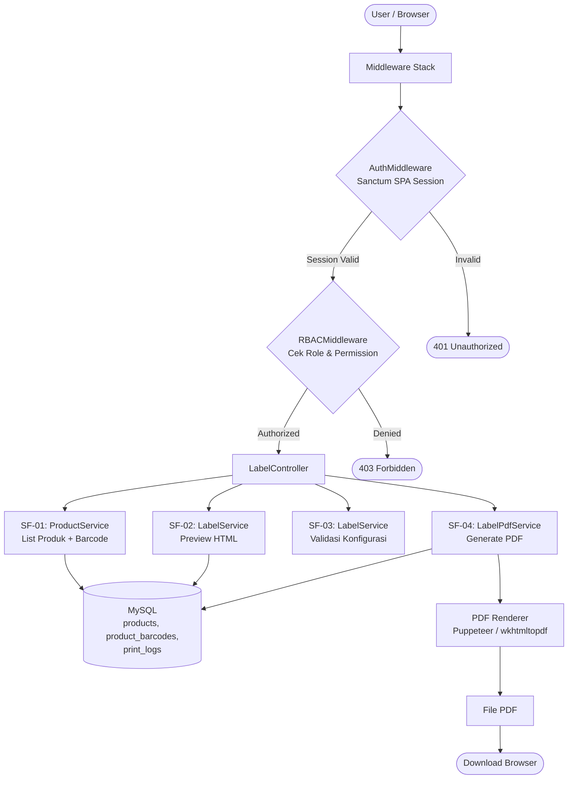
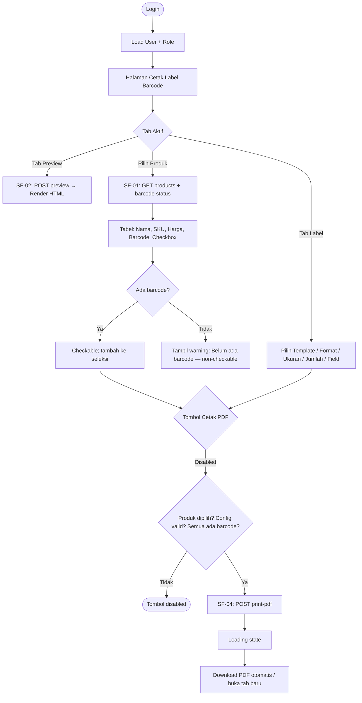
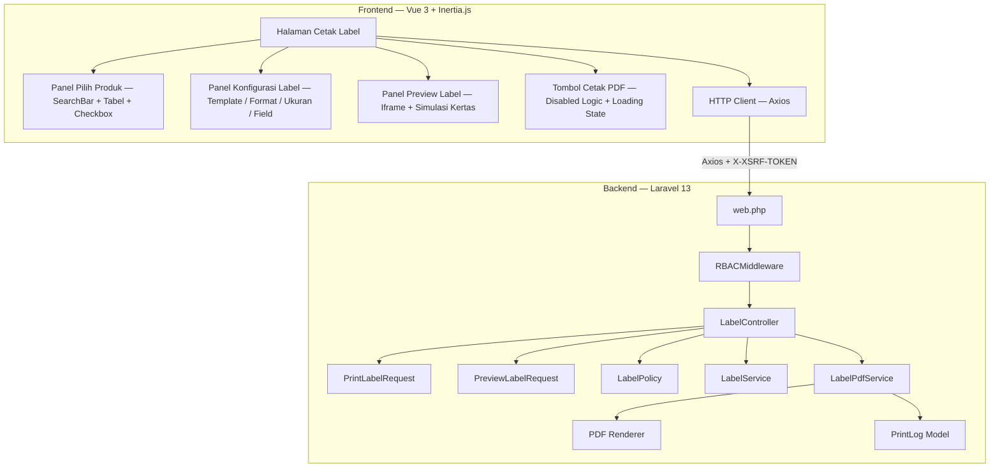
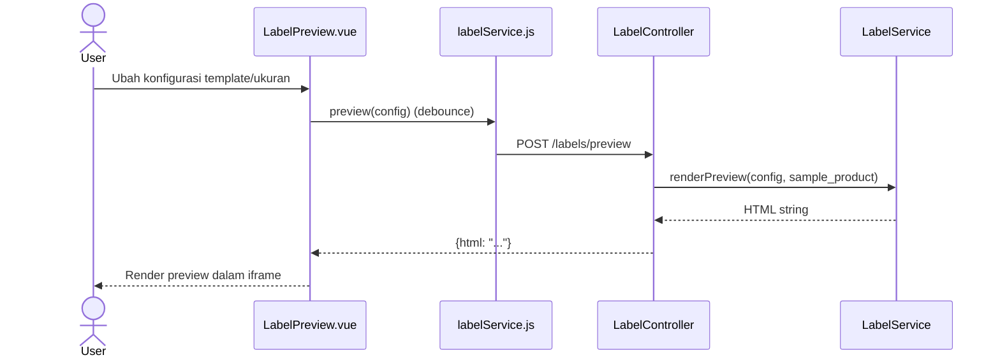
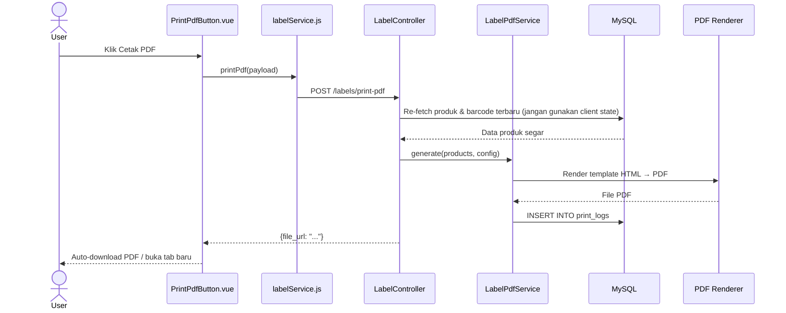
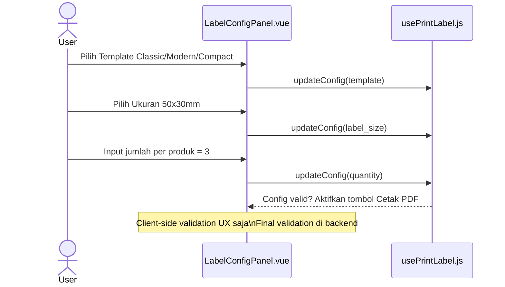
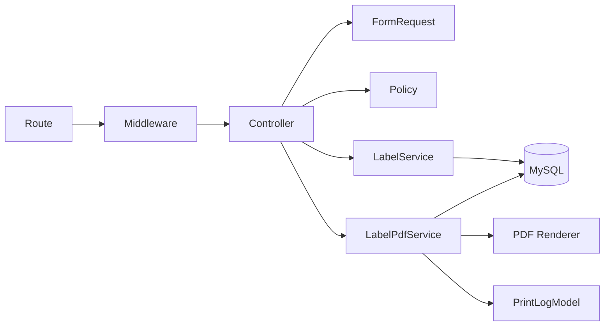

# Fitur - cetak label

<aside>
🏗️

**Software Architecture Document (SAD)** — Dibuat berdasarkan analisis fitur FT-PROD-08 Cetak Label pada sistem Vetail POS **Single-Tenant** (1 toko, 1 owner, tanpa cabang). Dokumen ini menjadi acuan implementasi tim frontend dan backend.

</aside>

---

## 📋 Informasi Umum

| Field | Detail |
| --- | --- |
| **Kode Fitur** | FT-PROD-08 |
| **Nama Fitur** | Cetak Label |
| **Modul Induk** | MOD-PROD — Produk |
| **Arsitektur** | Single-Tenant (store-scoped, tanpa cabang) |
| **Stack Teknologi** | Laravel 13, Vue 3, Inertia.js, Tailwind CSS, MySQL |
| **Autentikasi** | Laravel Sanctum SPA Session (bukan Bearer JWT) |
| **Output Utama** | PDF Label (generate server-side) |
| **Versi Dokumen** | v3.0 |
| **Status** | 🟡 In Review |

<aside>
⚠️

**Read-Heavy + PDF Generate:** Cetak Label mayoritas membaca data (produk, barcode, harga) lalu menghasilkan PDF. Tidak ada perubahan data master produk. Produk yang belum memiliki barcode valid TIDAK bisa dicetak labelnya.

</aside>

---

## 1. 🎯 Tujuan Modul

Fitur **Cetak Label** digunakan untuk membuat dan mencetak label barcode/harga produk agar mudah diidentifikasi dan dipindai saat operasional toko.

**Tujuan utama:**

- Memudahkan pencetakan label produk secara cepat dari aplikasi.
- Menjaga kesesuaian label dengan data produk dan barcode terbaru.
- Mendukung scan kasir, stok opname, dan pengelolaan rak.
- Mendukung kustomisasi label: template, ukuran, jumlah, field yang ditampilkan.

**Hak akses berdasarkan role:**

<aside>
ℹ️

**Sistem RBAC Vetail didefinisikan per-modul.** Fitur Cetak Label berada di bawah **Modul Produk** — yang dapat diakses oleh semua role. Namun, aksi spesifik di dalam fitur Cetak Label dibatasi lebih lanjut per role melalui `LabelPolicy`.

</aside>

**Akses Modul Produk (level modul):**

| Role | Akses Modul Produk |
| --- | --- |
| Owner | ✅ |
| Manajer | ✅ |
| Staf Gudang | ✅ |
| Kasir | ✅ |

**Aksi spesifik Fitur Cetak Label (level fitur — via LabelPolicy):**

| Role | Pilih Produk | Preview | Cetak PDF |
| --- | --- | --- | --- |
| Owner | ✅ | ✅ | ✅ |
| Manajer | ✅ | ✅ | ✅ |
| Staf Gudang | ✅ | ✅ | ✅ |
| Kasir | ❌ | ❌ | ❌ |

---

## 2. 🔄 Data Flow

<aside>
🔑

**Autentikasi:** Seluruh request menggunakan **Sanctum SPA Session** + Cookie. Tidak ada Bearer JWT.

</aside>



| Sub-Fitur | Method | Aksi |
| --- | --- | --- |
| SF-01 Pilih Produk | `getProducts()` | `SELECT products LEFT JOIN product_barcodes` |
| SF-02 Preview | `preview()` | Render template HTML label |
| SF-03 Konfigurasi | Validasi client + server | Whitelist template, ukuran, format |
| SF-04 Cetak PDF | `printPdf()` | Generate PDF + INSERT print_logs |

---

## 3. 🖥️ UI Flow



---

## 4. 🧩 Component Diagram



---

## 5. 🔀 Sequence Diagram

### SF-01 — Pilih Produk

```mermaid
sequenceDiagram
    actor User
    participant Vue as ProductPickerPanel.vue
    participant Svc as labelService.js
    participant Ctrl as LabelController
    participant DB as MySQL
    User->>Vue: Buka halaman / ketik keyword
    Vue->>Svc: getProducts(params) (debounce)
    Svc->>Ctrl: GET /labels/products
    Ctrl->>DB: SELECT products LEFT JOIN product_barcodes WHERE status='active' (Eloquent)
    DB-->>Vue: Array produk {has_barcode, barcode}
    Vue-->>User: Tabel produk; produk tanpa barcode disabled
```

### SF-02 — Preview Label



### SF-04 — Generate PDF



### SF-03 — Konfigurasi Label



---

## 6. 🏛️ Layer Responsibility

| Layer | File | Tanggung Jawab |
| --- | --- | --- |
| **Route** | `routes/web.php` | Group `/labels`, middleware stack |
| **Middleware** | `RBACMiddleware.php` | Cek permission; blokir Kasir |
| **Controller** | `LabelController.php` | `getProducts`, `preview`, `printPdf`, `download` |
| **Form Request** | `PrintLabelRequest.php` | Validasi config: template, ukuran, jumlah, product_ids |
| **Form Request** | `PreviewLabelRequest.php` | Validasi config untuk preview |
| **Policy** | `LabelPolicy.php` | Blokir Kasir dari seluruh endpoint |
| **Service** | `LabelService.php` | Render template HTML, validasi config |
| **Service** | `LabelPdfService.php` | Business logic + Eloquent langsung: re-fetch produk + barcode terbaru, generate PDF, insert print_logs, batas max produk/label |
| **Model** | `PrintLog.php` | Eloquent audit cetak |
| **Halaman Cetak Label** | Inertia Page Component (nama & struktur file bebas) | Halaman utama; state: selected_products, config, print_status |
| **Komponen UI** | Panel pilih produk (searchbar + checkbox + disabled state), panel konfigurasi label (template/format/ukuran/jumlah/field/expired + Tab Kertas), panel preview (iframe + simulasi kertas), tombol cetak PDF — nama & struktur bebas | Elemen UI interaktif; tidak langsung memanggil API |
| **HTTP Client** | Wrapper Axios (nama & lokasi file bebas) | Semua HTTP call ke backend; XSRF token otomatis, debounce preview |

---

## 7. 🔗 Dependency Antar Layer



<aside>
⚠️

**Data Freshness:** Backend selalu re-fetch harga dan barcode dari database saat generate PDF. Jangan gunakan data dari client state untuk konten PDF final.

</aside>

---

## 8. 🔗 Relasi Modul

| Modul Terkait | Jenis Relasi | Keterangan |
| --- | --- | --- |
| **Daftar Produk (FT-PROD-01)** | Sumber Data | Produk dipilih dari master Daftar Produk per cabang |
| **Kelola Barcode (FT-PROD-09)** | Dependensi Wajib | Barcode valid dari `product_barcodes` wajib ada agar label bisa dicetak |
| **Audit Log** | Write (via print_logs) | Aktivitas cetak PDF dicatat di `print_logs` |

---

## 9. 🔌 API Endpoint

<aside>
🔑

**Auth:** Semua endpoint menggunakan **Sanctum SPA Session**. Route prefix: `/labels`.

</aside>

| Method | Endpoint | Controller Method | Sub-Fitur | Keterangan |
| --- | --- | --- | --- | --- |
| `GET` | `/labels/products` | `getProducts()` | SF-01 | List produk yang bisa dicetak (dengan barcode flag) |
| `POST` | `/labels/preview` | `preview()` | SF-02 | Generate HTML preview label |
| `POST` | `/labels/print-pdf` | `printPdf()` | SF-04 | Generate PDF label; return file_url |
| `GET` | `/labels/jobs/{id}/download` | `download()` | SF-04 | Download PDF yang sudah digenerate |

### Error Response Standar

| Kode Error | HTTP | Penyebab | Perilaku UI |
| --- | --- | --- | --- |
| --- | :---: | --- | --- |
| `ERR-AUTH-01` | 401 | Session expired | Redirect ke login |
| `ERR-FORBIDDEN-01` | 403 | Role tidak punya izin (Kasir) | "Akses ditolak" |
| `ERR-SELECTION-01` | 422 | Belum ada produk dipilih | Tombol Cetak PDF disabled |
| `ERR-BARCODE-MISSING` | 422 | Ada produk terpilih tanpa barcode valid | Daftar produk bermasalah |
| `ERR-CONFIG-01` | 422 | Konfigurasi label tidak valid | Inline validasi konfigurasi |
| `ERR-PDF-GENERATE` | 500 | Gagal render PDF | Pesan generik + tombol coba lagi |
| `ERR-SERVER-01` | 500 | Kesalahan internal | Pesan generik |

---

### 9.1 📦 Standar API Request

- **Auth:** Laravel Sanctum SPA Session; `X-XSRF-TOKEN` via Axios

**Body — POST /print-pdf:**

```json
{
  "selected_product_ids": [1, 2, 3],
  "template": "classic",
  "barcode_format": "code_128",
  "label_size": "medium_50x30",
  "quantity_per_product": 1,
  "expired_date": null,
  "fields": {
    "show_name": true,
    "show_price": true,
    "show_sku": true,
    "show_category": false,
    "show_crossed_price": false,
    "show_print_date": true
  },
  "paper": {
    "size": "a4",
    "orientation": "portrait",
    "columns": null,
    "margin_mm": 8
  }
}
```

**Query Params — GET /products:**

| Parameter | Tipe | Keterangan |
| --- | --- | --- |
| `keyword` | string | Cari nama produk, SKU, barcode |
| `select_all` | boolean | Jika `true`, semua produk hasil filter saat ini dianggap terpilih (untuk fitur "Pilih semua") |
| `page` | integer | Nomor halaman |
| `limit` | integer | Item per halaman (max 100) |

---

### 9.2 📤 Standar API Response

**HTTP 200 — GET /products**

```json
{
  "success": true,
  "data": [
    { "id": 1, "name": "Mie Goreng 85gr", "sku": "MG85", "sell_price": 3500, "barcode": "8991234567890", "has_barcode": true },
    { "id": 2, "name": "Indomie Kuah", "sku": "IK100", "sell_price": 3000, "barcode": null, "has_barcode": false }
  ],
  "meta": { "total": 150 }
}
```

**HTTP 200 — POST /print-pdf**

```json
{
  "success": true,
  "message": "PDF berhasil digenerate.",
  "data": { "file_url": "/labels/jobs/abc123/download", "total_labels": 6 }
}
```

---

### 9.3 📑 API Response Contract

| HTTP | Success | Data | Code |
| --- | --- | --- | --- |
| :---: | :---: | :---: | --- |
| 200 | `true` | Object/Array | — |
| 401 | `false` | — | `ERR-AUTH-01` |
| 403 | `false` | — | `ERR-FORBIDDEN-01` |
| 422 | `false` | — | `ERR-SELECTION-01` / `ERR-BARCODE-MISSING` / `ERR-CONFIG-01` |
| 500 | `false` | — | `ERR-PDF-GENERATE` / `ERR-SERVER-01` |

---

### 9.4 🔄 Mapping Laravel Implementation

| Konsep | Implementasi |
| --- | --- |
| Form Request | `PrintLabelRequest` — validasi template, ukuran (whitelist), product_ids, quantity |
| Service | `LabelService` — render HTML template; `LabelPdfService` — generate PDF, batas job |
| Model | `PrintLog` — audit setiap cetak |
| PDF Renderer | Puppeteer (via Node sidecar) atau `wkhtmltopdf`; TTL file sementara |

---

### 9.5 📌 Standar HTTP Status Code

| Status | Digunakan Untuk |
| --- | --- |
| :---: | --- |
| **200** | List produk, preview, download berhasil |
| **403** | Kasir diblokir (LabelPolicy) |
| **422** | Produk belum dipilih, barcode hilang, config tidak valid |
| **500** | Gagal generate PDF / kesalahan internal |

---

## 10. 🗄️ Database Design

### Tabel `print_logs` (Audit Cetak)

| Kolom | Tipe | Null | Default | Keterangan |
| --- | --- | --- | --- | --- |
| `id` | BIGINT UNSIGNED | NO | AUTO_INCREMENT | Primary key |
| `print_job_id` | VARCHAR(100) | NO | — | Unique job identifier |
| `user_id` | BIGINT UNSIGNED | NO | — | FK → `users(id)` |
| `template` | VARCHAR(50) | NO | — | `classic` / `modern` / `compact` |
| `barcode_format` | VARCHAR(50) | NO | — | `code_128` / `qr_code` / `ean_13` |
| `label_size` | VARCHAR(50) | NO | — | `small_40x20` / `medium_50x30` / `large_60x40` |
| `quantity_per_product` | INT | NO | — | Jumlah label per produk |
| `expired_date` | DATE | YES | NULL | Opsional; dari input Tab Label |
| `fields` | JSON | NO | — | Checkbox isi label: `show_name`, `show_price`, `show_sku`, `show_category`, `show_crossed_price`, `show_print_date` |
| `paper_size` | VARCHAR(20) | NO | `'a4'` | Ukuran kertas |
| `paper_orientation` | VARCHAR(20) | NO | `'portrait'` | `portrait` / `landscape` |
| `columns_per_row` | TINYINT UNSIGNED | YES | NULL | NULL = auto dihitung backend |
| `margin_mm` | TINYINT UNSIGNED | NO | 8 | Margin kertas dalam mm |
| `total_products` | INT | NO | — | Total produk dalam job |
| `total_labels` | INT | NO | — | Total label yang digenerate |
| `product_ids` | JSON | NO | — | Array ID produk yang dicetak |
| `file_path` | VARCHAR(500) | YES | NULL | Path file PDF sementara |
| `status` | ENUM | NO | `'generating'` | `generating` / `done` / `failed` |
| `created_at` | TIMESTAMP | NO | CURRENT_TIMESTAMP | — |

**UNIQUE:** `print_job_id` (otomatis membuat index — dipakai untuk lookup download by job ID)
**Index:** `idx_user (user_id)`, `idx_status (status)` · **FK:** `user_id → users(id)`

### Tabel `generated_files` (File PDF Sementara)

| Kolom | Tipe | Null | Default | Keterangan |
| --- | --- | --- | --- | --- |
| `id` | BIGINT UNSIGNED | NO | AUTO_INCREMENT | Primary key |
| `print_job_id` | VARCHAR(100) | NO | — | FK → `print_logs.print_job_id` ON DELETE CASCADE |
| `file_path` | VARCHAR(500) | NO | — | Path file PDF di storage |
| `mime_type` | VARCHAR(100) | NO | `'application/pdf'` | Tipe file |
| `file_size` | BIGINT UNSIGNED | YES | NULL | Ukuran file dalam bytes |
| `expires_at` | TIMESTAMP | YES | NULL | TTL otomatis untuk cleanup; NULL = tidak expire |
| `created_at` | TIMESTAMP | NO | CURRENT_TIMESTAMP | — |

**UNIQUE:** `print_job_id` · **FK:** `print_job_id → print_logs.print_job_id ON DELETE CASCADE`

> `print_logs.file_path` adalah shortcut reference; `generated_files` adalah canonical source untuk manajemen file & TTL.
> 

> **Catatan kolom `fields` (JSON):** menyimpan checkbox isi label saat job dicetak, contoh:
> 

> `json
> 

> { "show_name": true, "show_price": true, "show_sku": true,
> 

> "show_category": false, "show_crossed_price": false, "show_print_date": true }
> 

> `
> 

### Konfigurasi Label (Tab Label)

| Dimensi | Nilai yang Didukung | Keterangan |
| --- | --- | --- |
| **Template** | `classic`, `modern`, `compact` | Classic = barcode di atas, teks di bawah |
| **Barcode Format** | `code_128`, `qr_code`, `ean_13` | Default: `code_128` |
| **Ukuran Label** | `small_40x20`, `medium_50x30`, `large_60x40` | Default: `medium_50x30` (Sedang) |
| **Jumlah per Produk** | Integer ≥ 1 | Stepper; default 1 |
| **Isi Label** | `show_name`, `show_price`, `show_sku`, `show_category`, `show_crossed_price`, `show_print_date` | Default: name ✅, price ✅, sku ✅, tgl_cetak ✅ |
| **Tanggal Expired** | Date (opsional) / `null` | Jika diisi, ditampilkan di label |
| **Max Produk** | 100 per job | — |
| **Max Label** | 500 per job | — |

### Konfigurasi Kertas (Tab Kertas)

| Dimensi | Nilai yang Didukung | Keterangan |
| --- | --- | --- |
| **Ukuran Kertas** | `a4` (210×297 mm) | Default: A4; dapat diperluas |
| **Orientasi** | `portrait`, `landscape` | Default: portrait |
| **Kolom per Baris** | Integer / `null` (auto) | Auto dihitung dari ukuran kertas & label; stepper manual tersedia |
| **Margin** | Integer mm (slider) | Default: 8 mm |

### Query Kunci

**List produk untuk cetak:**

```sql
SELECT p.id, p.name, p.sku, p.sell_price,
  pb.barcode,
  CASE WHEN pb.barcode IS NULL THEN 0 ELSE 1 END AS has_barcode
FROM products p
LEFT JOIN product_barcodes pb ON pb.product_id = p.id AND pb.status = 'active'
WHERE p.status     = 'aktif'
  AND p.deleted_at IS NULL
ORDER BY p.name ASC;
```

**Re-fetch saat generate PDF:**

```sql
SELECT p.id, p.name, p.sku, p.sell_price, pb.barcode
FROM products p
JOIN product_barcodes pb ON pb.product_id = p.id AND pb.status = 'active'
WHERE p.id IN (:selected_ids) AND p.status = 'aktif' AND p.deleted_at IS NULL;
```

---

## 11. 📁 Folder Structure

```jsx
app/
├── Http/
│   ├── Controllers/Product/LabelController.php
│   ├── Requests/Product/
│   │   ├── PrintLabelRequest.php
│   │   └── PreviewLabelRequest.php
│   └── Resources/Product/LabelProductResource.php
├── Models/PrintLog.php
├── Policies/LabelPolicy.php
├── Services/Product/
│   ├── LabelService.php
│   └── LabelPdfService.php

routes/web.php

// resources/js/ — Struktur dan nama file bebas, sesuai konvensi tim.
// Wajib menyediakan: Halaman Cetak Label (Inertia Page), Panel Pilih Produk
// (searchbar + checkbox + disabled state), Panel Konfigurasi Label
// (template/format/ukuran/jumlah/field/expired + Tab Kertas), Panel Preview
// (iframe + simulasi kertas), Tombol Cetak PDF (disabled + loading), HTTP Client.
```

---

## 12. 📋 Struktur Implementasi

| Layer | File | Keterangan |
| --- | --- | --- |
| Route | `routes/web.php` | Group `/labels`; middleware stack |
| Controller | `LabelController.php` | getProducts, preview, printPdf, download |
| Form Request | `PrintLabelRequest.php` | Whitelist template, ukuran, format, paper.size, paper.orientation; validasi product_ids, quantity, fields, paper config |
| Service | `LabelService.php` | Render HTML template label |
| Service | `LabelPdfService.php` | Business logic + Eloquent langsung: re-fetch produk + barcode terbaru, generate PDF; INSERT print_logs; batas 100 produk / 500 label |
| Model | `PrintLog.php` | Eloquent audit cetak |
| Halaman Cetak Label | Inertia Page Component (nama & struktur file bebas) | Halaman utama; state selected_products, config, print_status |
| Komponen UI | Panel pilih produk, panel konfigurasi label, panel preview, tombol cetak PDF (nama & struktur bebas) | Elemen UI interaktif; tidak langsung memanggil API |
| HTTP Client | Wrapper Axios (nama & lokasi file bebas) | Semua HTTP call ke backend; XSRF token otomatis |

---

## 13. 🔒 Standar Keamanan

<aside>
⚠️

Seluruh item bersifat **WAJIB** sebelum fitur dinyatakan siap produksi.

</aside>

| Kategori | Standar | Implementasi |
| --- | --- | --- |
| **Config Whitelist** | Template, ukuran, format dari whitelist saja | Jangan terima nilai bebas dari client |
| **Data Freshness** | PDF harus pakai data terbaru | Backend re-fetch dari DB sebelum render |
| **DoS Prevention** | Batasi beban PDF generator | Max 100 produk / 500 label per job |
| **File Cleanup** | File sementara jangan menumpuk | TTL otomatis atau hapus setelah download |
| **Session Security** | Sanctum SPA Session | Cookie `HttpOnly`, `SameSite=Lax` |
| **Role Guard** | Kasir tidak boleh akses | `LabelPolicy`  • Route middleware |

---

## 📌 Catatan Arsitektur

<aside>
📄

**Output = PDF:** Cetak Label tidak menyimpan atau mengubah data master. Output satu-satunya adalah file PDF yang di-generate server-side lalu di-download client.

</aside>

<aside>
⚠️

**Wajib Barcode Valid:** Tombol Cetak PDF HARUS disabled jika ada produk terpilih yang belum punya barcode. Validasi dilakukan di frontend (UX) DAN backend (final guard).

</aside>

<aside>
🔄

**Data Freshness:** Backend selalu re-fetch harga dan barcode dari database saat generate PDF, bukan dari client state.

</aside>

<aside>
🔑

**Autentikasi Stack:** Menggunakan **Sanctum SPA Session** (bukan Bearer JWT). Axios mengirim cookie sesi + `X-XSRF-TOKEN` secara otomatis.

</aside>

---

## 📎 Lampiran: Implementation Checklist

### Task Frontend

- [ ]  Panel pilih produk: fetch dari `GET /labels/products`; produk tanpa barcode non-checkable + warning
- [ ]  SearchBar real-time debounce 300ms; cari nama, SKU, barcode
- [ ]  Total produk terpilih ditampilkan secara dinamis
- [ ]  Panel konfigurasi label: Template / Barcode Format / Ukuran / Jumlah / Checkbox field / Tab Kertas (ukuran/orientasi/kolom/margin)
- [ ]  Panel preview: debounce POST preview setiap config berubah; render dalam iframe + simulasi kertas
- [ ]  Tombol "Cetak PDF" disabled jika: produk belum dipilih, ada produk tanpa barcode, config invalid
- [ ]  Loading state saat POST berlangsung; auto-download PDF setelah sukses
- [ ]  Total label = jumlah produk terpilih × jumlah per produk; tampilkan sebelum cetak
- [ ]  CSRF: `X-XSRF-TOKEN` auto; Role Guard: sembunyikan halaman dari Kasir

### Task Backend

- [ ]  `auth:sanctum`, `RBACMiddleware` di semua route
- [ ]  Whitelist `template`, `label_size`, `barcode_format` — jangan terima nilai bebas
- [ ]  Validasi semua produk punya barcode sebelum generate PDF
- [ ]  Re-fetch data produk & barcode terbaru dari DB sebelum render PDF (jangan pakai client state)
- [ ]  Batasi max 100 produk / 500 label per job
- [ ]  INSERT `print_logs` setelah PDF berhasil digenerate
- [ ]  Hapus file PDF sementara setelah download (TTL otomatis)

---