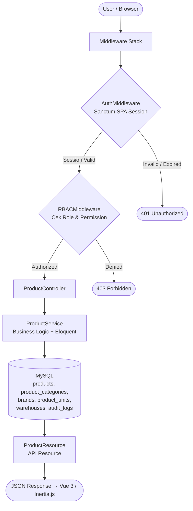
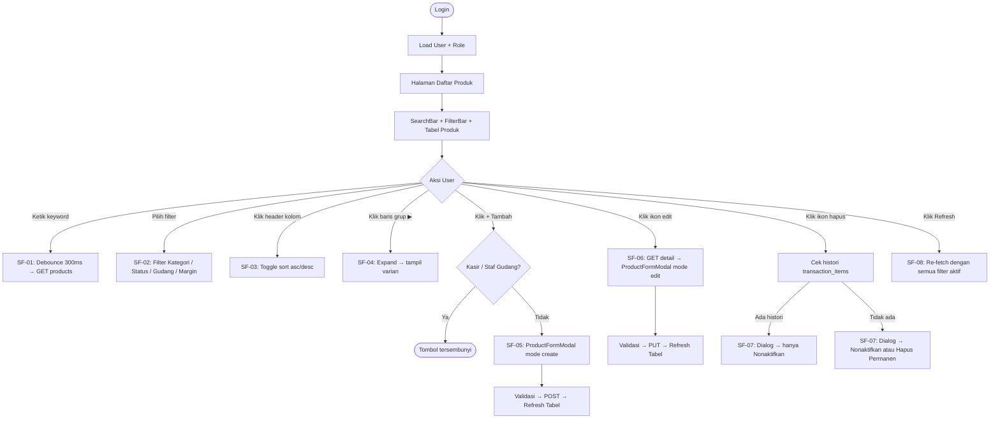
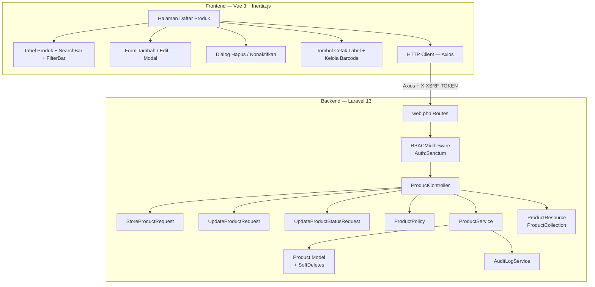
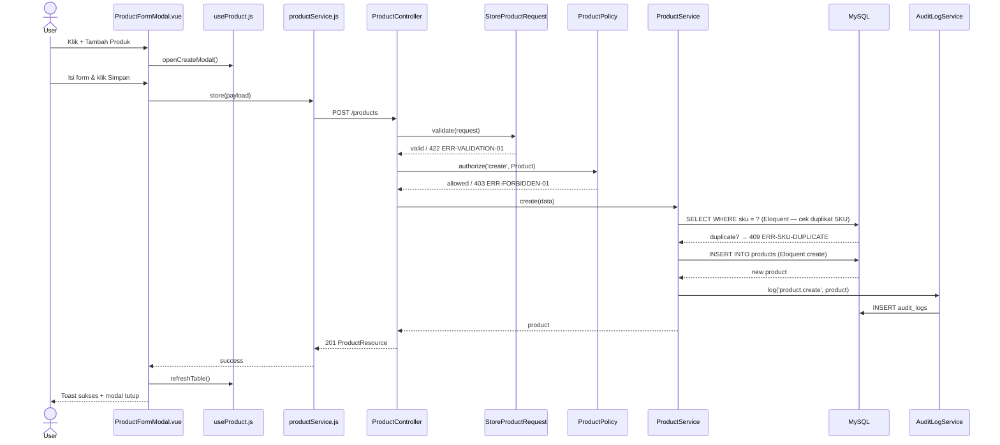
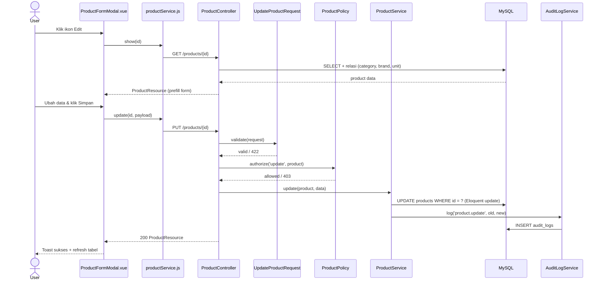
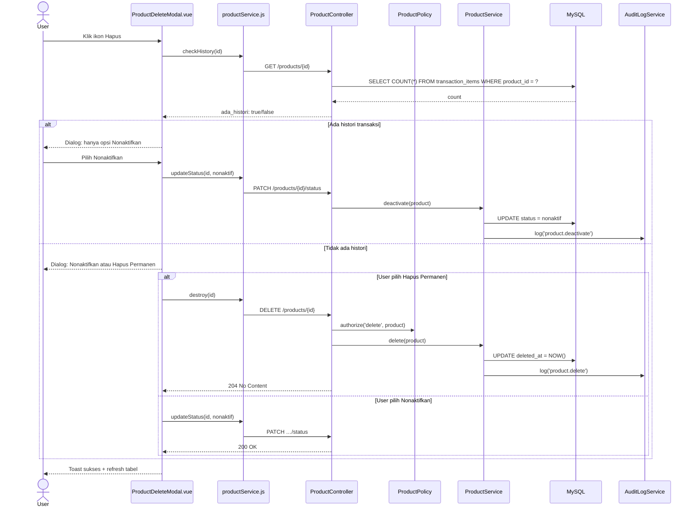
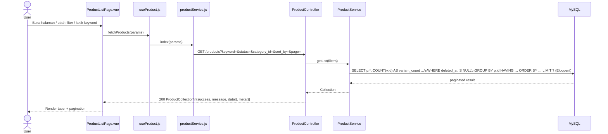
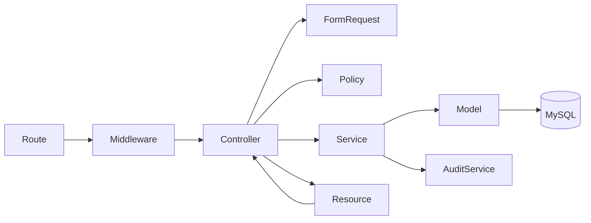

# Fitur - daftar produk

<aside>
🏗️

**Software Architecture Document (SAD)** — Dibuat berdasarkan analisis fitur FT-PROD-01 Daftar Produk pada sistem Vetail POS **Single-Tenant** (1 toko, 1 owner, tanpa cabang). Dokumen ini menjadi acuan implementasi tim frontend dan backend.

</aside>

---

## 📋 Informasi Umum

| Field | Detail |
| --- | --- |
| **Kode Fitur** | FT-PROD-01 |
| **Nama Fitur** | Daftar Produk |
| **Modul Induk** | MOD-PROD — Produk |
| **Arsitektur** | Single-Tenant (store-scoped, tanpa cabang) |
| **Stack Teknologi** | Laravel 13, Vue 3, Inertia.js, Tailwind CSS, MySQL |
| **Autentikasi** | Laravel Sanctum SPA Session (bukan Bearer JWT) |
| **Versi Dokumen** | v4.0 |
| **Status** | 🟡 In Review |

<aside>
⚠️

**Fitur Terkompleks di Modul Produk:** FT-PROD-01 adalah halaman utama Modul Produk dengan **8 sub-fitur** dan **3 role** berbeda. Sistem **single-tenant** — tidak ada `branch_id` pada tabel `products`, tidak ada `CheckBranchAccess` middleware. Produk memiliki relasi ke Kategori, Merek, Satuan, Gudang, serta Pemasok (via junction table `supplier_products`).

</aside>

---

## 1. 🎯 Tujuan Modul

Fitur **Daftar Produk** adalah pusat pengelolaan master data produk dalam sistem Vetail. Semua modul lain (Transaksi, Stok, Laporan, Pengadaan) bergantung pada data yang dihasilkan oleh fitur ini.

**Tujuan utama:**

- Menyediakan satu tampilan terpusat untuk memantau seluruh produk dalam satu toko.
- Memungkinkan Owner mengelola master data produk (tambah, edit, nonaktif/hapus).
- Memungkinkan Kasir dan Staf Gudang mencari dan memantau produk untuk kebutuhan operasional.
- Mendukung pencarian cepat berdasarkan nama, SKU, dan barcode.
- Menyediakan filter (Kategori, Status, Gudang, Margin) dan sorting agar pengelolaan skala besar tetap efisien.
- Menampilkan produk varian/grup dengan expand/collapse.

**Hak akses berdasarkan role (RBAC):**

<aside>
ℹ️

**Sistem RBAC Vetail didefinisikan per-modul.** Fitur Daftar Produk berada di bawah **Modul Produk** — yang dapat diakses oleh semua role. Namun, aksi spesifik di dalam fitur dibatasi lebih lanjut per role melalui `ProductPolicy`.

</aside>

**Akses Modul Produk (level modul):**

| Role | Akses Modul Produk |
| --- | --- |
| Owner | ✅ |
| Manajer | ✅ |
| Staf Gudang | ✅ |
| Kasir | ✅ |

**Aksi spesifik Fitur Daftar Produk (level fitur — via ProductPolicy):**

| Role | Lihat | Tambah | Edit | Nonaktifkan | Hapus Permanen |
| --- | --- | --- | --- | --- | --- |
| Owner | ✅ Semua status | ✅ | ✅ | ✅ | ✅ (jika tanpa histori) |
| Manajer | ✅ Semua status | ✅ | ✅ | ✅ | ✅ (jika tanpa histori) |
| Staf Gudang | ✅ Semua status | ❌ | ❌ | ❌ | ❌ |
| Kasir | ✅ Hanya aktif | ❌ | ❌ | ❌ | ❌ |

> Semua user yang berwenang mengakses seluruh produk dalam satu toko. Tidak ada pembatasan per cabang.
> 

---

## 2. 🔄 Data Flow

<aside>
🔑

**Autentikasi:** Seluruh request menggunakan **Sanctum SPA Session** + Cookie. Tidak ada Authorization Bearer JWT.

</aside>



**Alur sub-fitur di ProductController:**

| Sub-Fitur | Method | Query |
| --- | --- | --- |
| SF-01 Pencarian | `index()` | `SELECT … LIKE keyword` |
| SF-02 Filter | `index()` | `SELECT … WHERE filter` |
| SF-03 Tabel & Sort | `index()` | `SELECT … ORDER BY` |
| SF-04 Grup/Expand | `index()` | `SELECT … WHERE parent_id`  • `children[]` |
| SF-05 Tambah | `store()` | `INSERT products` |
| SF-06 Edit | `show()` / `update()` | `SELECT` / `UPDATE products` |
| SF-07 Hapus/Nonaktif | `destroy()` / `updateStatus()` | cek histori → `UPDATE` / `DELETE` |
| SF-08 Refresh | `index()` | Re-query dengan filter tersimpan |

---

## 3. 🖥️ UI Flow



> **Kasir:** tidak melihat tombol +, ikon edit, ikon hapus. Filter Status hanya tersedia nilai "Aktif". Kolom Harga Beli & Margin disembunyikan.
**Staf Gudang:** lihat semua status, tetapi tidak ada tombol mutasi.
> 

---

### 3.1 📋 Format Tampilan Detail Kolom

**Kolom Stok:**

Kolom Stok menampilkan tiga baris informasi dalam satu sel:

- Baris 1: Jumlah stok saat ini (dapat bernilai negatif jika stok minus)
- Baris 2: Minimum stok — `Min –` jika belum dikonfigurasi di modul stok
- Baris 3: Estimasi stok habis — `Est. stok habis: –` jika tidak dapat dihitung

**Label Satuan sebagai Prefix Nama Produk (Baris Varian):**

Pada baris varian di dalam grup, nama produk ditampilkan dengan format `{nama_satuan} {nama_produk}`. Contoh: `Lembar Amplas Fuji Star - Amplas 10...`, `Pcs Korek`. Satuan diambil dari relasi `unit` pada produk.

**Nilai `type_label` per Tipe Produk:**

| Nilai `type` | `type_label` Ditampilkan di UI |
| --- | --- |
| `single` | `Barang` |
| `variant` | `variant` |
| `bundle` | `bundle` |

---

## 4. 🧩 Component Diagram



---

## 5. 🔀 Sequence Diagram

### SF-05 — Create Product



### SF-06 — Update Product



### SF-07 — Delete / Deactivate Product



### SF-01/02/03 — List, Search & Filter Product



---

## 6. 🏛️ Layer Responsibility

| Layer | File | Tanggung Jawab |
| --- | --- | --- |
| **Route** | `routes/web.php` | Definisi endpoint, group middleware |
| **Middleware** | `RBACMiddleware.php` | Cek permission berdasarkan role |
| **Controller** | `ProductController.php` | Terima request, delegasi ke Service, return response |
| **Form Request** | `StoreProductRequest.php` | Validasi & otorisasi input create |
| **Form Request** | `UpdateProductRequest.php` | Validasi & otorisasi input update |
| **Form Request** | `UpdateProductStatusRequest.php` | Validasi input patch status |
| **Policy** | `ProductPolicy.php` | Gate authorization per aksi & role |
| **Service** | `ProductService.php` | Business logic + Eloquent langsung: filter, sort, pagination, relasi, buat, update, cek histori, soft delete, audit |
| **Model** | `Product.php` | Eloquent model + SoftDeletes + relasi (category, brand, unit, supplier) |
| **API Resource** | `ProductResource.php` | Serialisasi single product; sembunyikan field sensitif per role |
| **API Resource** | `ProductCollection.php` | Serialisasi list + meta pagination |
| **Audit Service** | `AuditLogService.php` | Catat semua mutasi ke `audit_logs` |
| **Halaman Produk** | Inertia Page Component (nama & struktur file bebas) | Halaman utama; kelola state filter, sorting, pagination, grup/expand varian |
| **Komponen UI** | Tabel produk, searchbar, filterbar, modal form tambah/edit, dialog hapus/nonaktif, tombol Cetak Label (shortcut FT-PROD-08), tombol Kelola Barcode (shortcut FT-PROD-09) (nama & struktur bebas) | Elemen UI interaktif; tidak langsung memanggil API |
| **HTTP Client** | Wrapper Axios (nama & lokasi file bebas) | Semua HTTP call ke backend; XSRF token otomatis |

---

## 7. 🔗 Dependency Antar Layer



<aside>
⚠️

**Aturan Dependency:** Controller mendelegasikan ke Service. Service menjalankan query Eloquent langsung ke Model. Service tidak boleh memanggil Controller. Resource hanya untuk serialisasi output.

</aside>

---

## 8. 🔗 Relasi Modul

| Modul Terkait | Jenis Relasi | Keterangan |
| --- | --- | --- |
| **Kategori (FT-PROD-04)** | Wajib | `products.category_id` → `product_categories.id`; form tambah/edit wajib pilih kategori aktif |
| **Satuan (FT-PROD-06)** | Wajib | `products.unit_id` → `product_units.id`; form tambah/edit wajib pilih satuan aktif |
| **Merek (FT-PROD-05)** | Opsional | `products.brand_id` → `brands.id`; nullable, bisa dikosongkan |
| **Pemasok (FT-PROD-07)** | Many-to-Many | `supplier_products` junction table; satu produk bisa punya banyak pemasok |
| **Gudang** | Filter | Dropdown filter gudang dari `warehouses`; gudang bersifat global dalam satu toko |
| **Transaksi / Penjualan** | Konsumen Wajib | `transaction_items.product_id`; histori ini dicek sebelum izin hapus permanen |
| **Stok** | Konsumen Data | Kolom Stok di tabel produk menampilkan stok saat ini dari modul stok |
| **Laporan** | Konsumen Data | Laporan penjualan dikelompokkan per produk |
| **Audit Log** | Write | Setiap mutasi produk dicatat ke `audit_logs` |

---

## 9. 🔌 API Endpoint

<aside>
🔑

**Auth:** Semua endpoint menggunakan **Sanctum SPA Session** + Session Cookie + `X-XSRF-TOKEN`. **Tidak menggunakan** `Authorization: Bearer JWT`.

</aside>

| Method | Endpoint | Controller Method | Sub-Fitur | Keterangan |
| --- | --- | --- | --- | --- |
| `GET` | `/products` | `index()` | SF-01, SF-02, SF-03, SF-04 | List produk + filter + sort + pagination + variant_count |
| `GET` | `/products/{id}` | `show()` | SF-06 | Detail produk untuk form edit (include relasi: category, brand, unit) |
| `POST` | `/products` | `store()` | SF-05 | Buat produk baru |
| `PUT` | `/products/{id}` | `update()` | SF-06 | Update data produk |
| `PATCH` | `/products/{id}/status` | `updateStatus()` | SF-07 | Ubah status aktif/nonaktif |
| `DELETE` | `/products/{id}` | `destroy()` | SF-07 | Hapus produk (soft delete atau hard delete, cek histori) |

### Query Parameters — GET /products

| Parameter | Tipe | Default | Keterangan |
| --- | --- | --- | --- |
| `keyword` | string | — | Cari di nama, SKU, barcode |
| `category_id` | integer | — | Filter per kategori |
| `status` | enum | `aktif` | `aktif` / `nonaktif` / `semua` |
| `warehouse_id` | integer | — | Filter per gudang |
| `margin_max` | decimal | — | Filter margin < nilai (%) |
| `sort_by` | string | `name` | Whitelist: `name`, `sku`, `stock`, `sell_price`, `buy_price`, `margin`, `status` |
| `sort_direction` | enum | `asc` | `asc` / `desc` |
| `page` | integer | `1` | Nomor halaman |
| `limit` | integer | `20` | Jumlah item per halaman (maks 100) |

### Error Response Standar

| Kode Error | HTTP | Penyebab | Perilaku UI |
| --- | --- | --- | --- |
| --- | :---: | --- | --- |
| `ERR-AUTH-01` | 401 | Session tidak ada / expired | Redirect ke halaman login |
| `ERR-FORBIDDEN-01` | 403 | Role tidak punya permission | Tampilkan "Akses ditolak" |
| `ERR-VALIDATION-01` | 422 | Input tidak valid (nama kosong, harga ≤ 0, dll.) | Inline error per field |
| `ERR-PRODUCT-NOT-FOUND` | 404 | Produk tidak ditemukan / sudah dihapus | Tampilkan error data tidak ada |
| `ERR-PRODUCT-IN-USE-01` | 409 | Produk punya histori transaksi, tidak bisa hapus permanen | Tolak hapus + saran nonaktifkan |
| `ERR-REF-INACTIVE-01` | 422 | Kategori/Satuan/Merek yang dipilih tidak aktif | Inline error di field terkait |
| `ERR-SKU-DUPLICATE-01` | 409 | SKU sudah dipakai produk lain di toko ini | Inline error di field SKU |
| `ERR-BARCODE-DUPLICATE-01` | 409 | Barcode sudah dipakai produk lain di toko ini | Inline error di field Barcode |
| `ERR-SERVER-01` | 500 | Kesalahan internal server | Tampilkan pesan generik + tombol retry |

---

### 9.1 📦 Standar API Request

Seluruh endpoint FT-PROD-01 menggunakan:

- **Laravel Sanctum SPA Session Authentication**
- **Session Cookie** (`laravel_session`) dikirim otomatis oleh browser
- **X-XSRF-TOKEN** header dikirim otomatis oleh Axios
- **Tidak menggunakan** `Authorization: Bearer {JWT}`

#### Request Header

| Header | Wajib | Nilai | Keterangan |
| --- | --- | --- | --- |
| --- | :---: | --- | --- |
| `Accept` | ✅ | `application/json` | Wajib agar Laravel return JSON error |
| `Content-Type` | ✅ (POST/PUT/PATCH) | `application/json` | Wajib pada request dengan body |
| `X-XSRF-TOKEN` | ✅ (POST/PUT/PATCH/DELETE) | Nilai dari cookie `XSRF-TOKEN` | Dikirim otomatis oleh Axios |
| `X-Requested-With` | Opsional | `XMLHttpRequest` | Tambahan identifier AJAX request |

#### Path Parameter

| Nama | Tipe | Wajib | Keterangan |
| --- | --- | --- | --- |
| --- | --- | :---: | --- |
| `id` | integer | ✅ (show/update/delete) | ID produk yang ditargetkan |

#### Query Parameter

| Parameter | Tipe | Default | Validasi | Keterangan |
| --- | --- | --- | --- | --- |
| `page` | integer | `1` | min:1 | Nomor halaman |
| `limit` | integer | `20` | min:1, max:100 | Item per halaman |
| `keyword` | string | null | max:255 | Cari di nama, SKU, barcode |
| `status` | string | `aktif` | in:aktif,nonaktif,semua | Filter status produk |
| `category_id` | integer | null | exists:product_categories,id | Filter per kategori |
| `warehouse_id` | integer | null | exists:warehouses,id | Filter per gudang |
| `margin_max` | decimal | null | numeric,min:0 | Filter margin < nilai (%) |
| `sort_by` | string | `name` | in:name,sku,stock,sell_price,buy_price,margin,status | Kolom sorting (allow-list) |
| `sort_direction` | string | `asc` | in:asc,desc | Arah sorting |

#### Request Body

**Create (POST)**

```json
{
  "name": "Aqua Botol 600ml",
  "category_id": 3,
  "brand_id": 1,
  "unit_id": 2,
  "type": "single",
  "sell_price": 5000,
  "buy_price": 3500,
  "initial_stock": 100,
  "sku": "AQB-600",
  "barcode": "8990123456789",
  "status": "aktif"
}
```

**Update (PUT)**

```json
{
  "name": "Aqua Botol 600ml",
  "category_id": 3,
  "brand_id": 1,
  "unit_id": 2,
  "type": "single",
  "sell_price": 5500,
  "buy_price": 3800,
  "sku": "AQB-600",
  "barcode": "8990123456789",
  "status": "aktif"
}
```

**Patch Status (PATCH)**

```json
{
  "status": "nonaktif"
}
```

---

### 9.2 📤 Standar API Response

Seluruh endpoint wajib menggunakan format response yang konsisten via `ProductResource` dan `ProductCollection`.

**HTTP 200 OK — Single Product**

```json
{
  "success": true,
  "message": "Data produk berhasil dimuat.",
  "data": {
    "id": 42,
    "name": "Aqua Botol 600ml",
    "sku": "AQB-600",
    "barcode": "8990123456789",
    "type": "single",
    "type_label": "Barang",
    "category": { "id": 3, "name": "Minuman" },
    "brand": { "id": 1, "name": "Aqua" },
    "unit": { "id": 2, "name": "Botol" },
    "sell_price": 5000,
    "buy_price": 3500,
    "margin": 30.00,
    "status": "aktif",
    "status_label": "Aktif",
    "variant_count": 0,
    "children": [],
    "created_at": "2026-07-28T10:00:00Z",
    "updated_at": "2026-07-28T10:00:00Z"
  }
}
```

> `buy_price` dan `margin` hanya disertakan jika role user **bukan** Kasir (ditangani di `ProductResource`).
> 

**HTTP 201 Created**

```json
{
  "success": true,
  "message": "Produk berhasil ditambahkan.",
  "data": { "id": 43, "name": "Aqua Botol 600ml", "..." }
}
```

**HTTP 204 No Content** — *(Tidak ada body; digunakan untuk DELETE berhasil)*

**Collection Response (HTTP 200)**

```json
{
  "success": true,
  "message": "Daftar produk berhasil dimuat.",
  "data": [
    { "id": 1, "name": "Aqua Botol 600ml", "variant_count": 0, "children": [], "..." },
    { "id": 2, "name": "Teh Botol Sosro", "variant_count": 3, "children": ["..."] }
  ],
  "meta": {
    "total": 85,
    "per_page": 20,
    "current_page": 1,
    "last_page": 5,
    "from": 1,
    "to": 20
  }
}
```

**Error Responses**

```json
// 400 Bad Request
{ "success": false, "code": "ERR-QUERY-01", "message": "Parameter tidak valid." }

// 401 Unauthorized
{ "success": false, "code": "ERR-AUTH-01", "message": "Sesi tidak valid atau sudah berakhir." }

// 403 Forbidden
{ "success": false, "code": "ERR-FORBIDDEN-01", "message": "Anda tidak memiliki izin untuk mengakses fitur ini." }

// 404 Not Found
{ "success": false, "code": "ERR-PRODUCT-NOT-FOUND", "message": "Produk tidak ditemukan." }

// 409 Conflict — SKU duplikat
{ "success": false, "code": "ERR-SKU-DUPLICATE-01", "message": "SKU sudah digunakan produk lain di toko ini." }

// 409 Conflict — Produk in-use
{ "success": false, "code": "ERR-PRODUCT-IN-USE-01", "message": "Produk tidak dapat dihapus karena memiliki histori transaksi. Nonaktifkan produk sebagai gantinya." }

// 422 Unprocessable Entity
{
  "success": false,
  "code": "ERR-VALIDATION-01",
  "message": "Data yang dikirim tidak valid.",
  "errors": {
    "name": ["Nama produk wajib diisi."],
    "sell_price": ["Harga jual harus lebih dari 0."]
  }
}

// 500 Internal Server Error
{ "success": false, "code": "ERR-SERVER-01", "message": "Terjadi kesalahan pada server. Silakan coba lagi." }
```

---

### 9.3 📑 API Response Contract

| HTTP | Success | Message | Data | Meta | Errors | Code |
| --- | --- | --- | --- | --- | --- | --- |
| :---: | :---: | --- | :---: | :---: | :---: | --- |
| 200 | `true` | Pesan deskriptif | Object / Array | Saat collection | — | — |
| 201 | `true` | "Produk berhasil ditambahkan." | Object | — | — | — |
| 204 | — | — | — | — | — | — |
| 400 | `false` | Pesan error | — | — | — | `ERR-QUERY-01` |
| 401 | `false` | Sesi tidak valid | — | — | — | `ERR-AUTH-01` |
| 403 | `false` | Akses ditolak | — | — | — | `ERR-FORBIDDEN-01` |
| 404 | `false` | Tidak ditemukan | — | — | — | `ERR-PRODUCT-NOT-FOUND` |
| 409 | `false` | Konflik bisnis | — | — | — | `ERR-SKU-DUPLICATE-01` / `ERR-PRODUCT-IN-USE-01` |
| 422 | `false` | Data tidak valid | — | — | Object per field | `ERR-VALIDATION-01` |
| 500 | `false` | Kesalahan server | — | — | — | `ERR-SERVER-01` |

---

### 9.4 🔄 Mapping Laravel Implementation

| Konsep | Implementasi Laravel 13 |
| --- | --- |
| **Form Request** | `StoreProductRequest`, `UpdateProductRequest`, `UpdateProductStatusRequest` — validasi + authorize |
| **API Resource** | `ProductResource` — serialisasi single product, sembunyikan `buy_price`/`margin` untuk Kasir |
| **Resource Collection** | `ProductCollection` — bungkus `data[]`  • `meta{}` pagination |
| **Exception Handler** | `app/Exceptions/Handler.php` — tangkap `ModelNotFoundException` → 404, `ValidationException` → 422, `AuthorizationException` → 403 |
| **Service** | `ProductService` — Business logic + Eloquent langsung: filter, sort, pagination, relasi eager load, create, update, cek duplikat SKU/barcode, cek histori, soft delete |
| **Model** | `Product`  • `SoftDeletes`  • scopes: `scopeActive()` |
| **Pagination** | `ProductService::getList()` → `LengthAwarePaginator` → `ProductCollection` |
| **Validation** | Rule `exists:product_categories,id`  • custom Rule `ActiveCategory`; rule duplikat SKU global dalam satu toko |

---

### 9.5 📌 Standar HTTP Status Code

| Status | Method | Digunakan Untuk |
| --- | --- | --- |
| :---: | --- | --- |
| **200** | GET, PUT, PATCH | Request berhasil; return data single atau collection |
| **201** | POST | Resource baru berhasil dibuat; return data produk baru |
| **204** | DELETE | Produk berhasil dihapus; tidak ada body response |
| **400** | GET | Query parameter tidak valid (format atau tipe salah) |
| **401** | Semua | Session tidak ada, expired, atau tidak valid |
| **403** | Semua | User terautentikasi tetapi tidak punya izin (RBAC) |
| **404** | GET, PUT, PATCH, DELETE | Produk tidak ditemukan atau sudah dihapus |
| **409** | POST, PUT, DELETE | Konflik bisnis: SKU/barcode duplikat, produk punya histori transaksi |
| **422** | POST, PUT, PATCH | Validasi input gagal; return `errors` per field |
| **500** | Semua | Kesalahan internal server yang tidak terduga |

<aside>
ℹ️

**Aturan penting:** Gunakan **422** untuk error validasi (bukan 400). Gunakan **409** untuk konflik bisnis (bukan 422). Gunakan **403** untuk authorization (bukan 401). Gunakan **401** hanya untuk authentication gagal.

</aside>

---

## 10. 🗄️ Database Design

### 10.1 🗃️ Tabel `products`

| Kolom | Tipe Data | Null | Default | Keterangan |
| --- | --- | --- | --- | --- |
| `id` | `BIGINT UNSIGNED` | ❌ | AUTO_INCREMENT | Primary key |
| `category_id` | `BIGINT UNSIGNED` | ❌ | — | FK → `categories.id`; ON DELETE RESTRICT |
| `brand_id` | `BIGINT UNSIGNED` | ✅ | NULL | FK → `brands.id`; ON DELETE SET NULL; opsional |
| `unit_id` | `BIGINT UNSIGNED` | ❌ | — | FK → `units.id`; ON DELETE RESTRICT |
| `parent_id` | `BIGINT UNSIGNED` | ✅ | NULL | Self-ref FK → `products.id`; NULL = produk induk/tunggal |
| `name` | `VARCHAR(255)` | ❌ | — | Nama produk; FULLTEXT indexed |
| `description` | `TEXT` | ✅ | NULL | Deskripsi produk; opsional |
| `sku` | `VARCHAR(100)` | ✅ | NULL | Stock Keeping Unit; unik per toko |
| `barcode` | `VARCHAR(100)` | ✅ | NULL | Barcode produk; unik per toko |
| `type` | `ENUM` | ❌ | `single` | Tipe produk: `single` / `variant` / `bundle` |
| `sell_price` | `DECIMAL(15,2)` | ❌ | — | Harga jual |
| `buy_price` | `DECIMAL(15,2)` | ❌ | — | Harga beli; tidak ditampilkan ke Kasir |
| `initial_stock` | `INTEGER` | ❌ | `0` | Stok awal saat produk pertama dibuat |
| `status` | `ENUM` | ❌ | `aktif` | Status produk: `aktif` / `nonaktif` |
| `created_by` | `BIGINT UNSIGNED` | ❌ | — | FK → `users.id`; user yang membuat |
| `updated_by` | `BIGINT UNSIGNED` | ✅ | NULL | FK → `users.id`; user yang terakhir mengubah |
| `created_at` | `TIMESTAMP` | ✅ | CURRENT_TIMESTAMP | Waktu dibuat (otomatis) |
| `updated_at` | `TIMESTAMP` | ✅ | CURRENT_TIMESTAMP ON UPDATE | Waktu diubah (otomatis) |
| `deleted_at` | `TIMESTAMP` | ✅ | NULL | Soft delete; NULL = belum dihapus / masih aktif |

**DDL Lengkap:**

```sql
CREATE TABLE products (
    id            BIGINT UNSIGNED AUTO_INCREMENT PRIMARY KEY,
    category_id   BIGINT UNSIGNED NOT NULL,
    brand_id      BIGINT UNSIGNED NULL,
    unit_id       BIGINT UNSIGNED NOT NULL,
    parent_id     BIGINT UNSIGNED NULL,         -- self-ref: produk induk untuk varian
    name          VARCHAR(255)    NOT NULL,
    description   TEXT            NULL,
    sku           VARCHAR(100)    NULL,
    barcode       VARCHAR(100)    NULL,
    type          ENUM('single','variant','bundle') NOT NULL DEFAULT 'single',
    sell_price    DECIMAL(15,2)   NOT NULL,
    buy_price     DECIMAL(15,2)   NOT NULL,
    initial_stock INTEGER         NOT NULL DEFAULT 0,
    status        ENUM('aktif', 'nonaktif') NOT NULL DEFAULT 'aktif',
    created_by    BIGINT UNSIGNED NOT NULL,
    updated_by    BIGINT UNSIGNED NULL,
    created_at    TIMESTAMP DEFAULT CURRENT_TIMESTAMP,
    updated_at    TIMESTAMP DEFAULT CURRENT_TIMESTAMP ON UPDATE CURRENT_TIMESTAMP,
    deleted_at    TIMESTAMP NULL,

    INDEX idx_category       (category_id),
    INDEX idx_status         (status),
    INDEX idx_sku            (sku),
    INDEX idx_barcode        (barcode),
    INDEX idx_parent         (parent_id),
    INDEX idx_deleted_at     (deleted_at),
    FULLTEXT idx_name_ft     (name),

    FOREIGN KEY (category_id) REFERENCES product_categories(id) ON DELETE RESTRICT,
    FOREIGN KEY (brand_id)    REFERENCES brands(id)              ON DELETE SET NULL,
    FOREIGN KEY (unit_id)     REFERENCES product_units(id)       ON DELETE RESTRICT,
    FOREIGN KEY (parent_id)   REFERENCES products(id)   ON DELETE CASCADE,
    FOREIGN KEY (created_by)  REFERENCES users(id),
    FOREIGN KEY (updated_by)  REFERENCES users(id)
);
```

**Catatan desain:**

- Status menggunakan nilai **Indonesia**: `aktif` / `nonaktif`.
- `parent_id` null = produk tunggal; `parent_id` tidak null = varian dari produk induk.
- `buy_price` dan `sell_price` disimpan per produk; Margin dihitung di query: `((sell_price - buy_price) / sell_price) * 100`.
- `deleted_at` → soft delete agar histori transaksi tetap dapat ditelusuri.
- `initial_stock` adalah stok saat produk pertama dibuat; stok aktual dikelola di modul Stok.

### 10.2 🖼️ Tabel `product_images`

| Kolom | Tipe Data | Null | Default | Keterangan |
| --- | --- | --- | --- | --- |
| `id` | `BIGINT UNSIGNED` | NO | AUTO_INCREMENT | Primary Key |
| `product_id` | `BIGINT UNSIGNED` | NO | — | FK → `products.id`; ON DELETE CASCADE |
| `url` | `VARCHAR(500)` | NO | — | Path/URL gambar produk |
| `is_primary` | `TINYINT(1)` | NO | `0` | `1` = gambar utama/thumbnail |
| `sort_order` | `SMALLINT` | NO | `0` | Urutan tampil gambar |
| `created_at` | `TIMESTAMP` | YES | CURRENT_TIMESTAMP | Waktu upload |

```sql
CREATE TABLE product_images (
    id          BIGINT UNSIGNED AUTO_INCREMENT PRIMARY KEY,
    product_id  BIGINT UNSIGNED NOT NULL,
    url         VARCHAR(500)    NOT NULL,
    is_primary  TINYINT(1)      NOT NULL DEFAULT 0,
    sort_order  SMALLINT        NOT NULL DEFAULT 0,
    created_at  TIMESTAMP DEFAULT CURRENT_TIMESTAMP,

    INDEX idx_product_id (product_id),
    INDEX idx_is_primary (product_id, is_primary),
    FOREIGN KEY (product_id) REFERENCES products(id) ON DELETE CASCADE
);
```

### 10.3 💰 Tabel `product_special_prices`

| Kolom | Tipe Data | Null | Default | Keterangan |
| --- | --- | --- | --- | --- |
| `id` | `BIGINT UNSIGNED` | NO | AUTO_INCREMENT | Primary Key |
| `product_id` | `BIGINT UNSIGNED` | NO | — | FK → `products.id`; ON DELETE CASCADE |
| `unit_id` | `BIGINT UNSIGNED` | NO | — | FK → `units.id`; satuan yang berlaku |
| `min_qty` | `DECIMAL(10,2)` | NO | — | Minimum kuantitas untuk harga ini berlaku |
| `max_qty` | `DECIMAL(10,2)` | YES | NULL | Maksimum kuantitas; NULL = tidak ada batas atas |
| `special_price` | `DECIMAL(15,2)` | NO | — | Harga spesial yang ditawarkan |
| `customer_group_id` | `BIGINT UNSIGNED` | YES | NULL | FK → `customer_groups.id`; NULL = semua pelanggan |
| `valid_from` | `DATE` | YES | NULL | Tanggal mulai berlaku; NULL = langsung berlaku |
| `valid_until` | `DATE` | YES | NULL | Tanggal akhir berlaku; NULL = tidak ada batas |
| `is_active` | `TINYINT(1)` | NO | `1` | Toggle aktif/nonaktif harga spesial |
| `created_by` | `BIGINT UNSIGNED` | NO | — | FK → `users.id`; user yang membuat |
| `created_at` | `TIMESTAMP` | YES | CURRENT_TIMESTAMP | Waktu dibuat |

```sql
CREATE TABLE product_special_prices (
    id                BIGINT UNSIGNED AUTO_INCREMENT PRIMARY KEY,
    product_id        BIGINT UNSIGNED NOT NULL,
    unit_id           BIGINT UNSIGNED NOT NULL,
    min_qty           DECIMAL(10,2)   NOT NULL,
    max_qty           DECIMAL(10,2)   NULL,
    special_price     DECIMAL(15,2)   NOT NULL,
    customer_group_id BIGINT UNSIGNED NULL,
    valid_from        DATE            NULL,
    valid_until       DATE            NULL,
    is_active         TINYINT(1)      NOT NULL DEFAULT 1,
    created_by        BIGINT UNSIGNED NOT NULL,
    created_at        TIMESTAMP DEFAULT CURRENT_TIMESTAMP,

    INDEX idx_product_unit   (product_id, unit_id),
    INDEX idx_valid_period   (valid_from, valid_until),
    INDEX idx_active         (is_active),
    FOREIGN KEY (product_id)        REFERENCES products(id)        ON DELETE CASCADE,
    FOREIGN KEY (unit_id)           REFERENCES product_units(id)   ON DELETE RESTRICT,
    FOREIGN KEY (customer_group_id) REFERENCES customer_groups(id) ON DELETE SET NULL,
    FOREIGN KEY (created_by)        REFERENCES users(id)
);
```

**Catatan desain:**

- `min_qty` dan `max_qty` mendefinisikan rentang kuantitas untuk harga berlaku (contoh: beli ≥ 10 pcs → harga spesial).
- `customer_group_id = NULL` berarti harga berlaku untuk **Semua Pelanggan**.
- `valid_from = NULL` berarti harga langsung berlaku sejak dibuat; `valid_until = NULL` berarti tidak ada batas kadaluarsa.
- `is_active` digunakan untuk toggle on/off tanpa menghapus data.

### Tabel `supplier_products` (Junction)

```sql
CREATE TABLE supplier_products (
    id          BIGINT UNSIGNED AUTO_INCREMENT PRIMARY KEY,
    supplier_id BIGINT UNSIGNED NOT NULL,
    product_id  BIGINT UNSIGNED NOT NULL,
    created_at  TIMESTAMP DEFAULT CURRENT_TIMESTAMP,

    UNIQUE KEY uq_supplier_product (supplier_id, product_id),
    INDEX idx_supplier (supplier_id),
    INDEX idx_product  (product_id),
    FOREIGN KEY (supplier_id) REFERENCES suppliers(id) ON DELETE CASCADE,
    FOREIGN KEY (product_id)  REFERENCES products(id)  ON DELETE CASCADE
);
```

> **📌 Catatan Lintas SAD:** Tabel `supplier_products` dan `suppliers` dikelola secara kanonikal oleh **FT-PROD-07 Pemasok**. Urutan migration wajib diikuti: `users` → `categories/brands/units` → `suppliers` *(FT-PROD-07)* → `products` *(FT-PROD-01)* → `supplier_products`.
> 

### Tabel `audit_logs` (nilai `action` untuk produk)

| Action | Keterangan |
| --- | --- |
| `product.create` | Produk baru dibuat |
| `product.update` | Data produk diubah |
| `product.update_status` | Status diubah |
| `product.deactivate` | Produk dinonaktifkan via aksi hapus |
| `product.delete` | Produk dihapus permanen (soft delete) |
| `product.delete_rejected` | Upaya hapus ditolak karena ada histori transaksi |

### Query Kunci

**List produk dengan filter + hitung margin:**

```sql
SELECT
  p.id,
  p.name,
  p.sku,
  p.barcode,
  p.type,
  c.name                              AS category_name,
  p.sell_price,
  p.buy_price,
  ROUND(
    ((p.sell_price - p.buy_price) / p.sell_price) * 100, 2
  )                                   AS margin,
  p.status,
  p.parent_id,
  COUNT(v.id)                         AS variant_count
FROM products p
JOIN product_categories c ON c.id = p.category_id AND c.deleted_at IS NULL
LEFT JOIN products v ON v.parent_id = p.id AND v.deleted_at IS NULL
WHERE p.deleted_at  IS NULL
  AND p.parent_id   IS NULL
  AND (:status = 'semua' OR p.status = :status)
  AND (:category_id IS NULL OR p.category_id = :category_id)
  AND (
    :keyword IS NULL OR :keyword = ''
    OR p.name    LIKE :keyword_like
    OR p.sku     LIKE :keyword_like
    OR p.barcode LIKE :keyword_like
  )
GROUP BY p.id
HAVING (:margin_max IS NULL OR margin <= :margin_max)
ORDER BY p.name ASC;
```

**Cek histori sebelum hapus permanen:**

```sql
SELECT COUNT(*) AS transaction_count
FROM transaction_items
WHERE product_id = :product_id;
```

---

---

---

## 13. 🔒 Standar Keamanan

<aside>
⚠️

Seluruh item pada seksi ini bersifat **WAJIB** dan menjadi syarat minimum sebelum fitur dinyatakan siap produksi.

</aside>

### 13.1 Frontend Security

| Kategori | Standar | Implementasi |
| --- | --- | --- |
| **XSS Prevention** | Jangan gunakan `v-html` atau `innerHTML` untuk output data user | Gunakan `v-text` atau Vue binding; `DOMPurify` jika render HTML |
| **CSRF Protection** | Semua request state-changing wajib CSRF token | Axios membaca cookie `XSRF-TOKEN` dan mengirim header `X-XSRF-TOKEN` otomatis |
| **Secure Storage** | Token sensitif tidak boleh di `localStorage`/`sessionStorage` | Gunakan `HttpOnly` cookie (dikelola Sanctum) |
| **Data Filtering** | Jangan expose field sensitif ke role yang tidak berhak | Harga Beli & Margin disembunyikan dari Kasir di UI (`v-if`) **dan** di `ProductResource` |
| **Layered Defense** | Frontend validation = UX saja, bukan keamanan | Backend adalah satu-satunya sumber kebenaran validasi |
| **SRI** | Aset CDN eksternal wajib dilindungi | Gunakan atribut `integrity="sha384-…"` dan `crossorigin="anonymous"` |
| **Clickjacking** | Cegah halaman di-embed di iframe pihak ketiga | Aktifkan `X-Frame-Options: SAMEORIGIN` |

### 13.2 Backend Security

| Kategori | Standar | Implementasi |
| --- | --- | --- |
| **SQL Injection** | Dilarang konkatenasi string dengan input user | Wajib parameterized query / prepared statement |
| **Input Validation** | Zero-Trust: semua input eksternal berbahaya | Schema validator (Laravel Form Request) di awal controller |
| **IDOR Prevention** | Validasi kepemilikan resource sebelum operasi | Setiap query by `{id}` wajib `AND deleted_at IS NULL` |
| **Password Hashing** | Dilarang plaintext, MD5, SHA1 | Gunakan **Argon2id** atau **bcrypt** rounds ≥ 12 |
| **Session Security** | Sanctum SPA Session; bukan Bearer JWT | Cookie `HttpOnly`, `SameSite=Lax`, `Secure` di production |
| **Error Handling** | Stack trace tidak boleh bocor ke production | Pesan generik ke client; detail ke log internal |
| **Rate Limiting** | Cegah brute force dan scraping | Token Bucket via Redis; maks 60 GET / 30 POST per menit/user |
| **Secrets Management** | Dilarang hardcode credentials | `.env` lokal; Secrets Manager production |
| **DB Least Privilege** | Akun DB bukan `root`/superuser | Hanya SELECT, INSERT, UPDATE pada tabel terkait |

---

## 📌 Catatan Arsitektur

<aside>
🏢

**Produk adalah Data Toko:** Single-tenant, tidak ada `branch_id`. RBAC mengontrol akses berdasarkan role. Kasir hanya melihat produk aktif; Staf Gudang dapat melihat semua status.

</aside>

<aside>
👥

**3 Role, 3 Level Akses:** Owner/Manajer = full CRUD; Staf Gudang = read semua status; Kasir = read hanya aktif, tanpa Harga Beli dan Margin. Backend wajib enforce semua perbedaan ini di `ProductResource` dan `ProductPolicy`.

</aside>

<aside>
🔗

**Parent-Child Varian:** Produk dengan `parent_id = NULL` adalah produk induk. Produk dengan `parent_id != NULL` adalah variannya. Query list hanya ambil produk induk di level atas, varian dikembalikan dalam `children[]`.

</aside>

<aside>
⚠️

**Proteksi Histori Transaksi:** Sebelum hapus permanen, sistem **wajib** mengecek `transaction_items`. Jika ada histori, hapus ditolak dengan `ERR-PRODUCT-IN-USE-01`. Produk hanya bisa dinonaktifkan. Histori penjualan tidak boleh hilang.

</aside>

<aside>
📊

**Margin = Kalkulasi, Bukan Kolom:** Margin tidak disimpan di database. Selalu hitung di query: `((sell_price - buy_price) / sell_price) * 100`. Filter margin menggunakan HAVING clause.

</aside>

<aside>
🔑

**Autentikasi Stack:** Menggunakan **Sanctum SPA Session** (bukan Bearer JWT). Axios mengirim cookie sesi + header `X-XSRF-TOKEN` secara otomatis. Tidak ada token di `localStorage`.

</aside>

---

## 📎 Lampiran: Implementation Checklist

### Task Frontend

#### Checklist

**SF-01 — Pencarian Produk:**

- [ ]  Debounce 300ms pada input keyword
- [ ]  Param: `keyword`; cari di nama, SKU, barcode
- [ ]  Sinkronisasi dengan semua filter aktif dalam satu request
- [ ]  Reset ke halaman 1 saat keyword berubah
- [ ]  Skeleton loading saat request berlangsung
- [ ]  Empty state: "Produk tidak ditemukan" saat hasil = 0

**SF-02 — Filter Produk:**

- [ ]  Dropdown Kategori: load dari `GET /categories?status=aktif`
- [ ]  Dropdown Status: Semua / Aktif / Nonaktif; **Kasir: sembunyikan opsi "Semua" dan "Nonaktif"**
- [ ]  Dropdown Gudang: load dari `GET /warehouses`
- [ ]  Input Margin: numerik saja; validasi client-side ≥ 0
- [ ]  Default saat buka halaman: Status = Aktif
- [ ]  Reset ke halaman 1 saat filter berubah
- [ ]  Teks dinamis: `Total data yang ditemukan: {total}`

**SF-03 — Tabel & Sorting:**

- [ ]  Kolom: Produk, SKU, Tipe, Kategori, Stok, Harga Jual, Harga Beli, Margin, Status, Aksi
- [ ]  **Harga Beli dan Margin: sembunyikan dari Kasir** via `v-if` role check
- [ ]  Klik header kolom → toggle asc/desc; param: `sort_by` + `sort_direction`
- [ ]  Kolom Aksi: Owner/Manajer tampil ikon Edit + Hapus; Kasir dan Staf Gudang tidak

**SF-04 — Grup & Expand/Collapse:**

- [ ]  Produk dengan `variant_count > 0` ditampilkan sebagai baris grup dengan badge jumlah
- [ ]  Klik expand → load/tampilkan baris varian (state lokal)
- [ ]  `expandedGroups` state: Set of product IDs yang sedang expand
- [ ]  Produk tanpa varian: tampil sebagai baris tunggal biasa

**SF-05 — Tambah Produk:**

- [ ]  Modal form mode **tambah**: form kosong; POST ke `POST /products`; refresh tabel setelah berhasil
- [ ]  Field: Nama (required), Kategori (required), Merek (optional), Satuan (required), Harga Jual (required, > 0), Harga Beli (required, > 0), Stok Awal (optional, ≥ 0), Barcode (optional), SKU (optional), Tipe (required), Status (default: aktif)
- [ ]  Sembunyikan tombol jika role bukan Owner/Manajer
- [ ]  Disable tombol Simpan saat in-flight
- [ ]  Inline error per field (response 422)
- [ ]  Refresh tabel setelah simpan berhasil

**SF-06 — Edit Produk:**

- [ ]  Modal form mode **edit**: prefill dari `GET /products/{id}`; PUT ke `PUT /products/{id}`; refresh tabel setelah berhasil
- [ ]  Pre-fill dari `GET /products/{id}`
- [ ]  Loading spinner saat load data ke form
- [ ]  Ikon edit hanya tampil untuk Owner/Manajer
- [ ]  Inline error per field + toast error untuk server error

**SF-07 — Hapus / Nonaktifkan Produk:**

- [ ]  Klik ikon hapus → panggil cek histori dulu
- [ ]  Jika ada histori transaksi → dialog hanya tampil opsi "Nonaktifkan" + pesan penjelasan
- [ ]  Jika tidak ada histori → dialog tampil pilihan: "Nonaktifkan" atau "Hapus Permanen"
- [ ]  Spinner pada tombol konfirmasi saat proses
- [ ]  Update tabel secara reaktif setelah aksi berhasil
- [ ]  Ikon hapus hanya tampil untuk Owner/Manajer

**SF-08 — Refresh Data:**

- [ ]  Tombol Refresh: re-trigger fetch dengan state filter aktif yang tersimpan
- [ ]  Pertahankan semua filter (keyword, status, category, warehouse, margin) saat refresh
- [ ]  Skeleton loading saat refresh berlangsung

**Keamanan Frontend:**

- [ ]  **XSS** — Hindari `innerHTML`/`v-html`; gunakan `v-text` atau text interpolation Vue
- [ ]  **CSRF** — Axios dikonfigurasi `withCredentials: true`; `X-XSRF-TOKEN` dikirim otomatis
- [ ]  **Secure Storage** — Tidak ada token di `localStorage`/`sessionStorage`; gunakan `HttpOnly` cookie (Sanctum)
- [ ]  **Layered Defense** — Validasi frontend = UX saja; validasi final ada di backend
- [ ]  **Data Filtering** — Sembunyikan Harga Beli & Margin dari tampilan Kasir
- [ ]  **SRI** — Aset CDN eksternal wajib `integrity` attribute
- [ ]  **Headers** — `X-Frame-Options: SAMEORIGIN` via Laravel FrameGuard

---

### Task Backend

**Middleware:**

- [ ]  `auth:sanctum` — validasi Sanctum SPA Session, return 401 jika invalid
- [ ]  `RBACMiddleware` — cek permission per endpoint, return 403 jika ditolak
- [ ]  Kasir: backend **paksa** filter `status = aktif` walaupun param dikirim lain

**SF-01, SF-02, SF-03, SF-04 — List Produk:**

- [ ]  `GET /products` dengan semua query params
- [ ]  Trim dan sanitasi `keyword` sebelum LIKE query
- [ ]  Parameterized query (cegah SQL injection)
- [ ]  Whitelist `sort_by`: `['name', 'sku', 'stock', 'sell_price', 'buy_price', 'margin', 'status']`
- [ ]  Hitung margin: `((sell_price - buy_price) / sell_price) * 100`
- [ ]  Hitung `variant_count` via COUNT(products WHERE parent_id = p.id AND deleted_at IS NULL)
- [ ]  Semua query wajib `WHERE deleted_at IS NULL`
- [ ]  Return `ProductCollection` dengan `data[]` + `meta{}`
- [ ]  Response menyertakan data varian dalam `children[]` untuk SF-04

**SF-05 — Tambah Produk:**

- [ ]  `POST /products` — validasi `StoreProductRequest` + Policy
- [ ]  Validasi: nama wajib max 255, kategori/satuan aktif, harga > 0, stok awal ≥ 0
- [ ]  `brand_id` nullable; validasi aktif jika diisi
- [ ]  Cek duplikasi SKU dan barcode (scope global dalam satu toko)
- [ ]  Tulis `audit_logs` action `product.create`
- [ ]  Return `201 Created` dengan `ProductResource`

**SF-06 — Edit Produk:**

- [ ]  `GET /products/{id}` — load detail + relasi
- [ ]  `PUT /products/{id}` — update data
- [ ]  Policy cek: produk valid dan tidak dihapus
- [ ]  Validasi sama dengan create; semua field bersifat `sometimes`
- [ ]  Tulis `audit_logs` action `product.update` dengan `old_values` dan `new_values`

**SF-07 — Hapus / Nonaktifkan:**

- [ ]  `PATCH /products/{id}/status` — ubah status
    - Validasi nilai: hanya `aktif` atau `nonaktif`
    - Tulis `audit_logs` action `product.update_status`
- [ ]  `DELETE /products/{id}` — hapus produk
    - Query `SELECT COUNT(*) FROM transaction_items WHERE product_id = ?`
    - Jika ada histori → return 409 (`ERR-PRODUCT-IN-USE-01`); catat `product.delete_rejected`
    - Jika tidak ada histori → soft delete (`deleted_at = NOW()`); catat `product.delete`
    - Gunakan **database transaction** saat delete + insert audit log

**Keamanan Backend:**

- [ ]  **SQL Injection** — Wajib parameterized query; dilarang konkatenasi input user
- [ ]  **Zero-Trust Input** — Validasi via Laravel Form Request
- [ ]  **IDOR Prevention** — Setiap query by `{id}` sertakan `AND deleted_at IS NULL`
- [ ]  **Error Handling** — Jangan kembalikan stack trace ke response production
- [ ]  **Log Masking** — Masking otomatis nilai sensitif di log handler
- [ ]  **Secrets Management** — Kredensial dari `.env`; dilarang hardcode
- [ ]  **Session Security** — Cookie `HttpOnly`, `SameSite=Lax`, `Secure` di production
- [ ]  **DB Least Privilege** — Akun DB bukan `root`; hanya SELECT, INSERT, UPDATE pada tabel terkait
- [ ]  **API Resource** — Gunakan Laravel API Resources; jangan pass raw DB object ke frontend

---