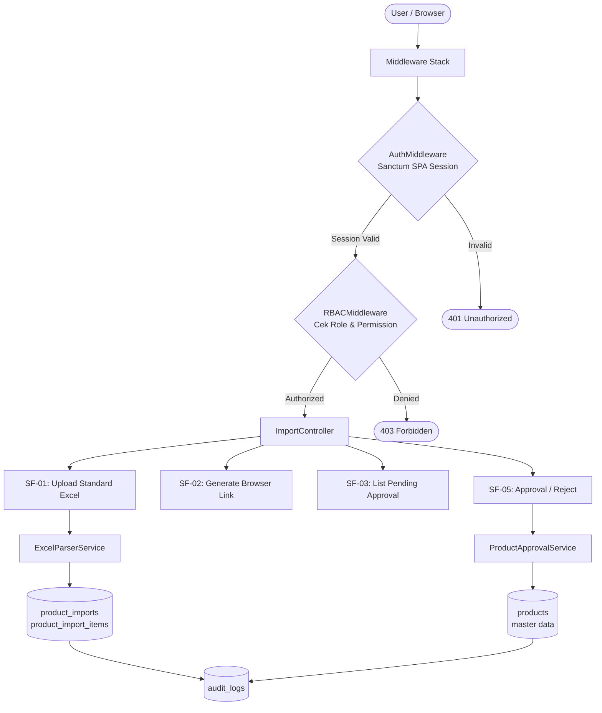
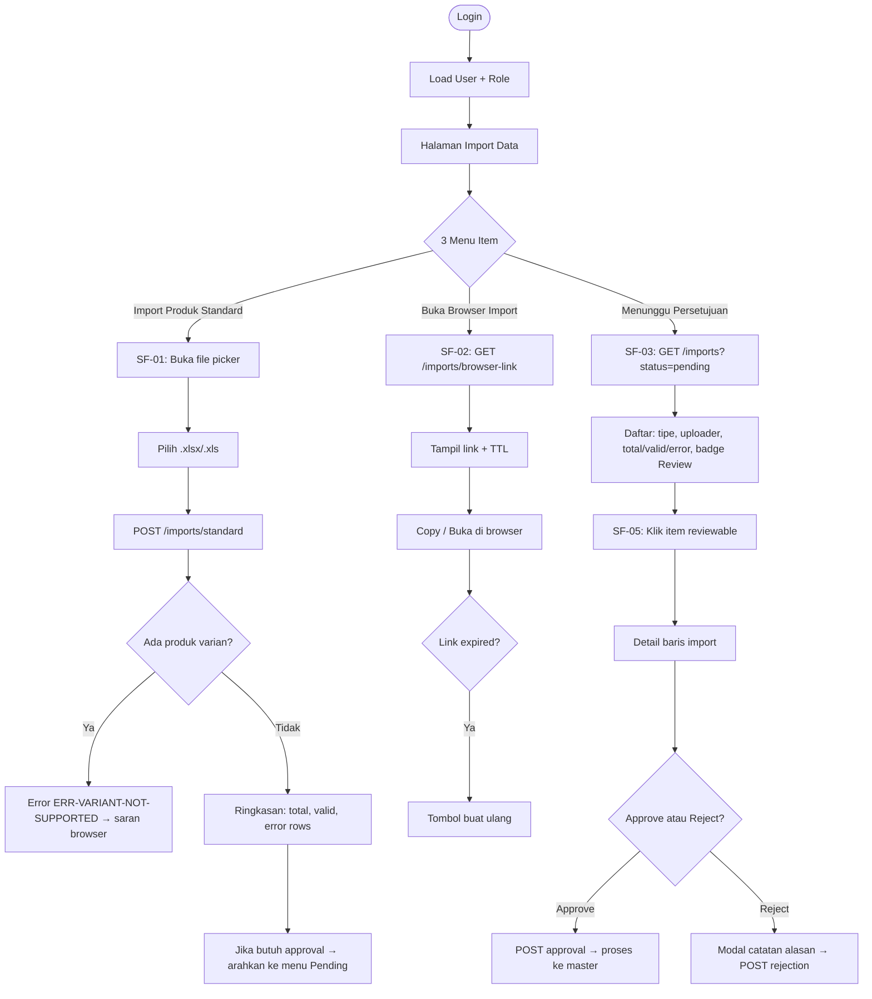
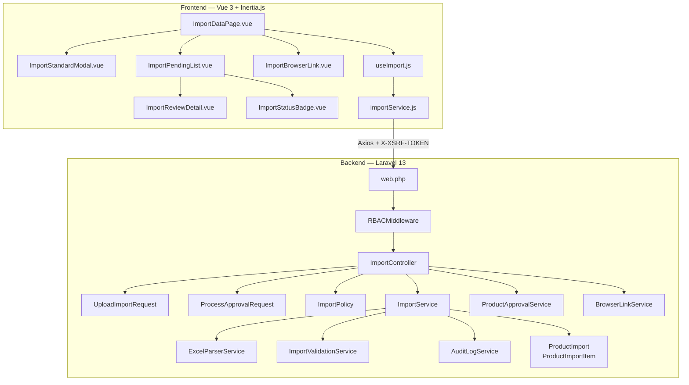
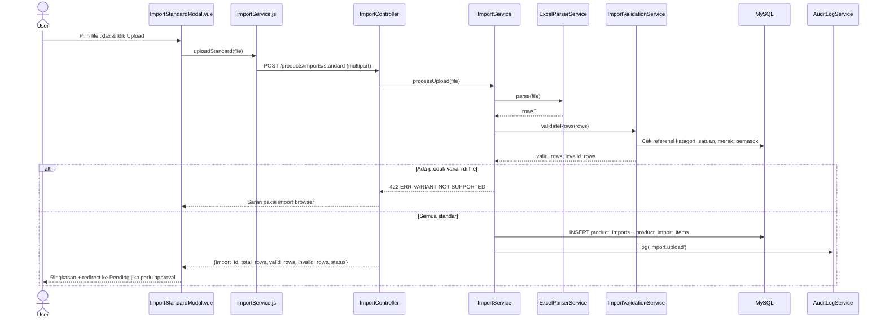
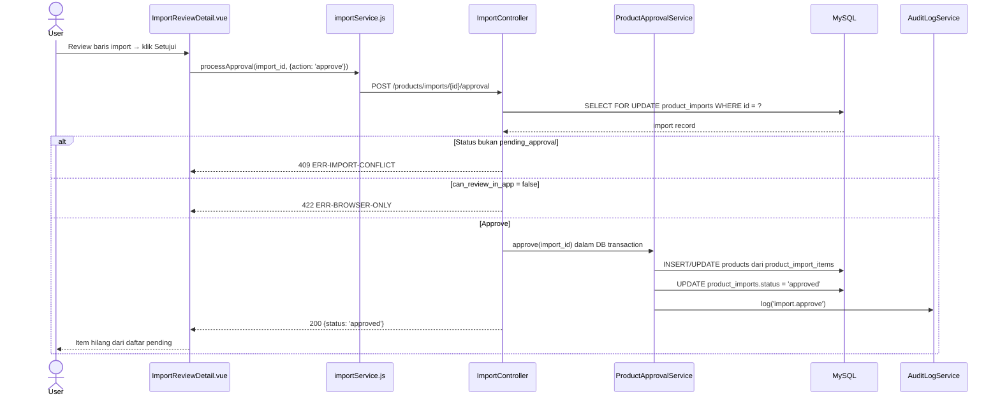
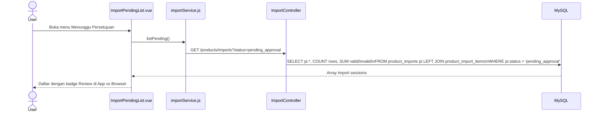
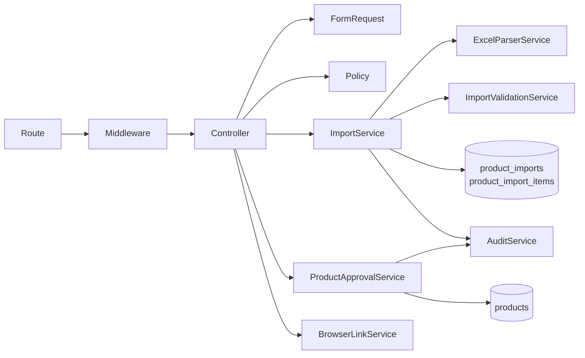

# Fitur - import data produk

<aside>
🏗️

**Software Architecture Document (SAD)** — Dibuat berdasarkan analisis fitur FT-PROD-02 Import Data Produk pada sistem Vetail POS **Single-Tenant** (1 toko, 1 owner, tanpa cabang). Dokumen ini menjadi acuan implementasi tim frontend dan backend.

</aside>

---

## 📋 Informasi Umum

| Field | Detail |
| --- | --- |
| **Kode Fitur** | FT-PROD-02 |
| **Nama Fitur** | Import Data Produk |
| **Modul Induk** | MOD-PROD — Produk |
| **Arsitektur** | Single-Tenant (store-scoped, tanpa cabang) |
| **Stack Teknologi** | Laravel 13, Vue 3, Inertia.js, Tailwind CSS, MySQL |
| **Autentikasi** | Laravel Sanctum SPA Session (bukan Bearer JWT) |
| **Versi Dokumen** | v3.0 |
| **Status** | 🟡 In Review |

<aside>
⚠️

**Dual-Mode + Staging Workflow:** FT-PROD-02 memiliki dua jalur import: langsung di app (produk standar) dan via browser (semua tipe, termasuk varian). Data import melalui staging `product_imports` → `product_import_items` → validasi → approval → baru ke master produk. Tidak ada data yang langsung masuk ke `products`. Sistem **single-tenant** — tidak ada `branch_id`/`store_id` di tabel staging.

</aside>

---

## 1. 🎯 Tujuan Modul

Fitur **Import Data Produk** menyediakan jalur massal untuk memasukkan data produk dari Excel ke dalam sistem Vetail, dengan kontrol kualitas melalui validasi dan approval workflow.

**Tujuan utama:**

- Upload data produk standar dari Excel langsung di app.
- Menyediakan jalur browser untuk import semua tipe (termasuk varian).
- Menampilkan antrian import yang menunggu persetujuan.
- Mencegah data rusak dengan tahapan: upload → validasi → staging → approval → master produk.

**Hak akses:**

| Role | Upload Import | Lihat Pending | Approve/Reject |
| --- | --- | --- | --- |
| --- | :---: | :---: | :---: |
| Owner | ✅ | ✅ | ✅ |
| Manajer | ✅ | ✅ | ✅ |
| Staf Gudang | ❌ | ✅ (baca) | ❌ |
| Kasir | ❌ | ❌ | ❌ |

---

## 2. 🔄 Data Flow

<aside>
🔑

**Autentikasi:** Seluruh request menggunakan **Sanctum SPA Session** + Cookie. Tidak ada Bearer JWT.

</aside>



| Sub-Fitur | Method | Aksi |
| --- | --- | --- |
| SF-01 Upload | `uploadStandard()` | Parse Excel → INSERT staging |
| SF-02 Browser Link | `generateBrowserLink()` | Generate HMAC signed URL (TTL) |
| SF-03 List Pending | `listPending()` | SELECT WHERE status = 'pending_approval' |
| SF-05 Approval | `processApproval()` | SELECT FOR UPDATE → INSERT/UPDATE products |

---

## 3. 🖥️ UI Flow



---

## 4. 🧩 Component Diagram



---

## 5. 🔀 Sequence Diagram

### SF-01 — Upload Standard Excel



### SF-02 — Generate Browser Link

```mermaid
sequenceDiagram
    actor User
    participant Vue as ImportBrowserLink.vue
    participant Svc as importService.js
    participant Ctrl as ImportController
    participant BLS as BrowserLinkService
    participant Audit as AuditLogService
    User->>Vue: Klik menu Buka Browser Import
    Vue->>Svc: generateBrowserLink()
    Svc->>Ctrl: GET /products/imports/browser-link
    Ctrl->>BLS: generateSignedUrl(user_id, ttl=900s)
    BLS-->>Ctrl: {url: "...", expires_at: "..."}
    Ctrl->>Audit: log('import.browser_link_generated')
    Ctrl-->>Vue: {url, expires_at}
    Vue-->>User: Tampil link + TTL; tombol Copy + Buka Browser
```

### SF-05 — Approve Import



### SF-03 — List Pending Approval



---

## 6. 🏛️ Layer Responsibility

| Layer | File | Tanggung Jawab |
| --- | --- | --- |
| **Route** | `routes/web.php` | Group `/products/imports`, middleware stack |
| **Middleware** | `RBACMiddleware.php` | Cek permission upload/approve |
| **Controller** | `ImportController.php` | `uploadStandard`, `generateBrowserLink`, `listPending`, `showDetail`, `processApproval`, `listItems` |
| **Form Request** | `UploadImportRequest.php` | Validasi file .xlsx/.xls, ukuran |
| **Form Request** | `ProcessApprovalRequest.php` | Validasi action (approve/reject) + catatan |
| **Policy** | `ImportPolicy.php` | Gate: upload (Owner/Manajer); approve (Owner/Manajer) |
| **Service** | `ImportService.php` | Koordinasi upload, parse, validate, staging |
| **Service** | `ExcelParserService.php` | Parse file Excel → array rows |
| **Service** | `ImportValidationService.php` | Validasi baris: referensi master data (kategori, satuan, merek, pemasok) |
| **Service** | `ProductApprovalService.php` | INSERT/UPDATE master `products` dalam DB transaction |
| **Service** | `BrowserLinkService.php` | Generate & validate HMAC signed URL TTL |
| **Model** | `ProductImport.php` | Eloquent staging header |
| **Model** | `ProductImportItem.php` | Eloquent staging rows |
| **Audit Service** | `AuditLogService.php` | Catat semua aksi import |
| **Vue Page** | `ImportDataPage.vue` | 3 menu item: Upload, Browser Link, Pending |
| **Vue Component** | `ImportStandardModal.vue` | File picker + ringkasan validasi |
| **Vue Component** | `ImportReviewDetail.vue` | Tabel baris + tombol Setujui/Tolak |
| **Composable** | `useImport.js` | uploadFile, generateLink, fetchPending, processApproval |
| **Service FE** | `importService.js` | Axios wrapper |

---

## 7. 🔗 Dependency Antar Layer



<aside>
⚠️

**Alur Staging Wajib:** Data Excel tidak boleh langsung masuk ke `products`. Selalu melalui `product_imports` → `product_import_items` → validasi → approval → baru ke `products`.

</aside>

---

## 8. 🔗 Relasi Modul

| Modul Terkait | Jenis Relasi | Keterangan |
| --- | --- | --- |
| **Daftar Produk (FT-PROD-01)** | Tujuan Data | Import yang di-approve menjadi produk di master |
| **Kategori (FT-PROD-04)** | Referensi Validasi | Kolom kategori di Excel divalidasi ke master kategori |
| **Satuan (FT-PROD-06)** | Referensi Validasi | Kolom satuan divalidasi ke master satuan |
| **Merek (FT-PROD-05)** | Referensi Validasi | Kolom merek divalidasi (opsional) |
| **Pemasok (FT-PROD-07)** | Referensi Validasi | Kolom pemasok divalidasi ke master pemasok |
| **Kelola Gudang (FT-PROD-03)** | Referensi Validasi | Kolom gudang divalidasi bila import membawa stok awal |
| **Audit Log** | Write | Upload, approve, reject dicatat |

---

## 9. 🔌 API Endpoint

<aside>
🔑

**Auth:** Semua endpoint menggunakan **Sanctum SPA Session** + Cookie + `X-XSRF-TOKEN`. Route prefix: `/products/imports`.

</aside>

| Method | Endpoint | Controller Method | Sub-Fitur | Keterangan |
| --- | --- | --- | --- | --- |
| `POST` | `/products/imports/standard` | `uploadStandard()` | SF-01 | Upload file Excel produk standar (multipart/form-data) |
| `GET` | `/products/imports/browser-link` | `generateBrowserLink()` | SF-02 | Generate time-limited URL untuk import di browser |
| `GET` | `/products/imports` | `listPending()` | SF-03 | List import pending approval |
| `GET` | `/products/imports/{id}` | `showDetail()` | SF-03 | Detail satu sesi import + ringkasan baris |
| `GET` | `/products/imports/{id}/items` | `listItems()` | SF-03 | List baris hasil parsing + status validasi per baris |
| `POST` | `/products/imports/{id}/approval` | `processApproval()` | SF-05 | Approve atau reject import |

### Error Response Standar

| Kode Error | HTTP | Penyebab | Perilaku UI |
| --- | --- | --- | --- |
| --- | :---: | --- | --- |
| `ERR-AUTH-01` | 401 | Session tidak ada / expired | Redirect ke login |
| `ERR-FORBIDDEN-01` | 403 | Role tidak punya permission import | "Akses ditolak" |
| `ERR-FILE-REQUIRED` | 400 | File belum dipilih saat upload | Validasi file picker |
| `ERR-INVALID-FORMAT` | 400 | File bukan Excel / kolom tidak sesuai template | Inline error format |
| `ERR-VARIANT-NOT-SUPPORTED` | 422 | File berisi produk varian (hanya via browser) | Saran pakai import browser |
| `ERR-IMPORT-NOT-FOUND` | 404 | Import tidak ditemukan | Error data |
| `ERR-IMPORT-CONFLICT` | 409 | Import sudah diproses user lain | Refresh + tampilkan status terbaru |
| `ERR-BROWSER-ONLY` | 422 | Tipe import tidak bisa di-approve di app | Arahkan ke browser |
| `ERR-LINK-EXPIRED` | 422 | Link browser import sudah kedaluwarsa | Info + tombol buat link baru |
| `ERR-SERVER-01` | 500 | Kesalahan internal | Pesan generik |

---

### 9.1 📦 Standar API Request

- **Auth:** Laravel Sanctum SPA Session; Cookie `HttpOnly`; `X-XSRF-TOKEN` via Axios
- **Upload:** `Content-Type: multipart/form-data`; semua lainnya `application/json`

**Request Body — POST /approval:**

```json
{ "action": "approve" }
```

```json
{ "action": "reject", "reject_note": "Data kategori tidak valid." }
```

---

### 9.2 📤 Standar API Response

**HTTP 200 — Upload Standard**

```json
{
  "success": true,
  "message": "File berhasil diupload dan divalidasi.",
  "data": {
    "import_id": 55,
    "import_type": "standard_product",
    "status": "pending_approval",
    "can_review_in_app": true,
    "total_rows": 120,
    "valid_rows": 115,
    "invalid_rows": 5
  }
}
```

**HTTP 200 — Browser Link**

```json
{ "success": true, "data": { "url": "https://app.vetail.id/import/browser?token=abc...", "expires_at": "2026-07-28T23:00:00Z" } }
```

**HTTP 200 — Approval berhasil**

```json
{ "success": true, "message": "Import berhasil disetujui dan diproses ke master produk.", "data": { "import_id": 55, "status": "approved" } }
```

**Error 409 (Conflict):** `{ "success": false, "code": "ERR-IMPORT-CONFLICT", "message": "Import ini sudah diproses oleh user lain. Refresh halaman untuk melihat status terbaru." }`

---

### 9.3 📑 API Response Contract

| HTTP | Success | Data | Code |
| --- | --- | --- | --- |
| :---: | :---: | :---: | --- |
| 200 | `true` | Object/Array | — |
| 201 | `true` | Object | — |
| 400 | `false` | — | `ERR-FILE-REQUIRED` / `ERR-INVALID-FORMAT` |
| 401 | `false` | — | `ERR-AUTH-01` |
| 403 | `false` | — | `ERR-FORBIDDEN-01` |
| 404 | `false` | — | `ERR-IMPORT-NOT-FOUND` |
| 409 | `false` | — | `ERR-IMPORT-CONFLICT` |
| 422 | `false` | — | `ERR-VARIANT-NOT-SUPPORTED` / `ERR-BROWSER-ONLY` / `ERR-LINK-EXPIRED` |
| 500 | `false` | — | `ERR-SERVER-01` |

---

### 9.4 🔄 Mapping Laravel Implementation

| Konsep | Implementasi |
| --- | --- |
| Form Request | `UploadImportRequest` — whitelist .xlsx/.xls, ukuran file |
| Form Request | `ProcessApprovalRequest` — validasi action + reject_note |
| Service | `ImportService` — koordinasi upload, parse, validate, staging |
| Service | `ExcelParserService` — parse sheet pertama, map kolom |
| Service | `ImportValidationService` — cek referensi master data per baris |
| Service | `ProductApprovalService` — INSERT/UPDATE products dalam DB transaction |
| Service | `BrowserLinkService` — HMAC signed token TTL 15-30 menit |
| Model | `ProductImport`  • `ProductImportItem`  • SoftDeletes |
| Race Condition | `SELECT FOR UPDATE`  • DB transaction pada approval |
| File Upload | Multipart; max size config; strip Excel formula prefix |

---

### 9.5 📌 Standar HTTP Status Code

| Status | Digunakan Untuk |
| --- | --- |
| :---: | --- |
| **200** | List, detail, approval berhasil |
| **400** | File tidak valid / format salah |
| **403** | Branch forbidden / role tidak izin |
| **404** | Import tidak ditemukan |
| **409** | Import sudah diproses user lain |
| **422** | Varian tidak didukung / browser-only / link expired |
| **500** | Kesalahan internal |

---

## 10. 🗄️ Database Design

### Tabel `product_imports` (Staging Header)

```sql
CREATE TABLE product_imports (
    id              BIGINT UNSIGNED AUTO_INCREMENT PRIMARY KEY,
    store_id        BIGINT UNSIGNED NOT NULL,  -- = branch_id di route
    import_type     ENUM('standard_product','variant_product','bundle','update_price') NOT NULL,
    status          ENUM('processing','pending_approval','approved','rejected','failed') NOT NULL DEFAULT 'processing',
    can_review_in_app TINYINT(1) NOT NULL DEFAULT 0,
    file_name       VARCHAR(255)  NOT NULL,
    file_path       VARCHAR(500)  NULL,
    total_rows      INT           NOT NULL DEFAULT 0,
    valid_rows      INT           NOT NULL DEFAULT 0,
    invalid_rows    INT           NOT NULL DEFAULT 0,
    uploaded_by     BIGINT UNSIGNED NOT NULL,
    approved_by     BIGINT UNSIGNED NULL,
    rejected_by     BIGINT UNSIGNED NULL,
    approved_at     TIMESTAMP NULL,
    rejected_at     TIMESTAMP NULL,
    reject_note     TEXT NULL,
    review_source   ENUM('app','browser') NULL,
    created_at      TIMESTAMP DEFAULT CURRENT_TIMESTAMP,
    updated_at      TIMESTAMP DEFAULT CURRENT_TIMESTAMP ON UPDATE CURRENT_TIMESTAMP,

    INDEX idx_store_status (store_id, status),
    INDEX idx_status (status),
    FOREIGN KEY (store_id)    REFERENCES branches(id),
    FOREIGN KEY (uploaded_by) REFERENCES users(id),
    FOREIGN KEY (approved_by) REFERENCES users(id),
    FOREIGN KEY (rejected_by) REFERENCES users(id)
);
```

### Tabel `product_import_items` (Staging Rows)

```sql
CREATE TABLE product_import_items (
    id                BIGINT UNSIGNED AUTO_INCREMENT PRIMARY KEY,
    import_id         BIGINT UNSIGNED NOT NULL,
    row_number        INT NOT NULL,
    raw_data          JSON NOT NULL,
    validation_status ENUM('valid','invalid','skipped') NOT NULL DEFAULT 'valid',
    validation_errors JSON NULL,
    product_id        BIGINT UNSIGNED NULL,
    created_at        TIMESTAMP DEFAULT CURRENT_TIMESTAMP,

    INDEX idx_import  (import_id),
    INDEX idx_status  (import_id, validation_status),
    FOREIGN KEY (import_id)  REFERENCES product_imports(id) ON DELETE CASCADE,
    FOREIGN KEY (product_id) REFERENCES products(id)
);
```

### Tabel `audit_logs` (nilai `action` untuk import)

| Action | Keterangan |
| --- | --- |
| `import.upload` | File berhasil diupload dan di-staging |
| `import.validate` | Validasi selesai dijalankan |
| `import.approve` | Import disetujui, produk diproses ke master |
| `import.reject` | Import ditolak |
| `import.browser_link_generated` | Link browser import dibuat |

### Query Kunci

**Ringkasan sesi import pending:**

```sql
SELECT
  pi.id, pi.import_type, pi.status, pi.can_review_in_app,
  COUNT(pii.id) AS total_rows,
  SUM(CASE WHEN pii.validation_status = 'valid'   THEN 1 ELSE 0 END) AS valid_rows,
  SUM(CASE WHEN pii.validation_status = 'invalid' THEN 1 ELSE 0 END) AS invalid_rows
FROM product_imports pi
LEFT JOIN product_import_items pii ON pii.import_id = pi.id
WHERE pi.store_id = :store_id
  AND pi.status   = 'pending_approval'
GROUP BY pi.id
ORDER BY pi.created_at DESC;
```

---

## 11. 📁 Folder Structure

```
app/
├── Http/
│   ├── Controllers/Product/ImportController.php
│   ├── Requests/Product/
│   │   ├── UploadImportRequest.php
│   │   └── ProcessApprovalRequest.php
│   └── Resources/Product/
│       ├── ImportResource.php
│       └── ImportItemResource.php
├── Models/
│   ├── ProductImport.php
│   └── ProductImportItem.php
├── Policies/ImportPolicy.php
├── Services/Product/
│   ├── ImportService.php
│   ├── ExcelParserService.php
│   ├── ImportValidationService.php
│   ├── ProductApprovalService.php
│   └── BrowserLinkService.php
└── Repositories/Product/ImportRepository.php

routes/web.php

resources/js/
├── Pages/Product/Import/ImportDataPage.vue
├── Components/Product/Import/
│   ├── ImportStandardModal.vue
│   ├── ImportPendingList.vue
│   ├── ImportReviewDetail.vue
│   ├── ImportBrowserLink.vue
│   └── ImportStatusBadge.vue
├── Composables/useImport.js
└── Services/importService.js
```

---

## 12. 📋 Struktur Implementasi

| Layer | File | Keterangan |
| --- | --- | --- |
| Route | `routes/web.php` | Group `/products/imports`; middleware stack |
| Controller | `ImportController.php` | uploadStandard, generateBrowserLink, listPending, showDetail, processApproval, listItems |
| Form Request | `UploadImportRequest.php` | Whitelist .xlsx/.xls; validasi ukuran file |
| Form Request | `ProcessApprovalRequest.php` | Validasi action (approve/reject) + reject_note |
| Service | `ImportService.php` | Koordinasi upload → parse → validate → staging |
| Service | `ExcelParserService.php` | Parse Excel → array rows |
| Service | `ImportValidationService.php` | Cek referensi master data per baris (kategori, satuan, merek, pemasok) |
| Service | `ProductApprovalService.php` | INSERT/UPDATE products dalam DB transaction |
| Service | `BrowserLinkService.php` | HMAC signed token, TTL validation |
| Model | `ProductImport.php` | Eloquent staging header; relasi items |
| Model | `ProductImportItem.php` | Eloquent staging rows; JSON raw_data |
| Vue Page | `ImportDataPage.vue` | 3 menu item: Upload, Browser Link, Pending |
| Vue Component | `ImportReviewDetail.vue` | Tabel baris + tombol Setujui/Tolak |
| Composable | `useImport.js` | uploadFile, generateLink, fetchPending, processApproval |

---

## 13. 🔒 Standar Keamanan

<aside>
⚠️

Seluruh item bersifat **WAJIB** sebelum fitur dinyatakan siap produksi.

</aside>

| Kategori | Standar | Implementasi |
| --- | --- | --- |
| **File Upload** | Whitelist ekstensi + MIME | Hanya .xlsx/.xls; validasi server-side |
| **Excel Injection** | Sanitasi cell output | Strip formula prefix (`=`, `+`, `-`, `@`) dari nilai cell |
| **SQL Injection** | Parameterized query | Semua data Excel via bind parameter |
| **Race Condition** | Row locking | `SELECT FOR UPDATE`  • DB transaction saat approval |
| **IDOR** | Scope validation | Setiap `import_id` divalidasi `store_id` milik user |
| **Session Security** | Sanctum SPA Session | Cookie `HttpOnly`, `SameSite=Lax`, `Secure` production |
| **Rate Limit** | Token Bucket | 5 upload/menit per user |
| **Link Security** | Signed token TTL | HMAC signed token; expire < 30 menit |

---

## 📌 Catatan Arsitektur

<aside>
🔄

**Alur Staging Wajib:** Data Excel tidak boleh langsung masuk ke `products`. Selalu melalui `product_imports` → `product_import_items` → validasi → approval → baru ke `products`. Ini mencegah data kotor masuk ke master.

</aside>

<aside>
🌐

**Dual-Mode Import:** Import di app hanya untuk produk standar (`standard_product`, tanpa varian). Semua tipe lain wajib via browser. Flag `can_review_in_app` di `product_imports` mengontrol ini.

</aside>

<aside>
⏰

**Browser Link TTL:** Link browser import bersifat time-limited (15–30 menit). Setelah expire, user harus generate ulang. Implementasikan dengan HMAC signed token, bukan ID database biasa.

</aside>

<aside>
🔑

**Autentikasi Stack:** Menggunakan **Sanctum SPA Session** (bukan Bearer JWT). Sistem single-tenant — tidak ada `branch_id` atau `store_id` di tabel `product_imports`.

</aside>

---

## 📎 Lampiran: Implementation Checklist

### Task Frontend

- [ ]  `ImportStandardModal.vue` dengan file picker; validasi client-side: hanya .xlsx/.xls
- [ ]  `Content-Type: multipart/form-data`
- [ ]  Loading state saat upload; tampilkan ringkasan total/valid/invalid rows
- [ ]  Jika file berisi varian → tampilkan error + saran import via browser
- [ ]  `ImportBrowserLink.vue`: loading state + tampilkan link + TTL; tombol salin + buka
- [ ]  Jika link kedaluwarsa → tampilkan pesan + tombol buat ulang
- [ ]  `ImportPendingList.vue`: fetch GET /imports?status=pending_approval; badge Review di App vs Browser
- [ ]  `ImportReviewDetail.vue`: tabel baris; tombol Setujui disabled jika ada error blocking
- [ ]  Modal konfirmasi Tolak + field catatan alasan
- [ ]  Handle 409 (conflict) → refresh daftar
- [ ]  Setelah approve/reject → item hilang dari daftar pending
- [ ]  CSRF: `X-XSRF-TOKEN` auto; sanitasi konten cell Excel sebelum dirender

### Task Backend

- [ ]  `auth:sanctum`, `RBACMiddleware` di semua route
- [ ]  Whitelist tipe file (.xlsx/.xls); validasi server-side
- [ ]  `ExcelParserService`: parse sheet pertama; map kolom ke field produk; strip formula prefix
- [ ]  `ImportValidationService`: validasi referensi kategori/satuan/merek/pemasok aktif per baris
- [ ]  Jika ada baris varian → return 422 `ERR-VARIANT-NOT-SUPPORTED`
- [ ]  `can_review_in_app = true` untuk tipe `standard_product`
- [ ]  `SELECT FOR UPDATE` pada record `product_imports` saat approval (cegah double-approve)
- [ ]  Jika status bukan `pending_approval` → return 409 `ERR-IMPORT-CONFLICT`
- [ ]  Jika `action = approve` → INSERT/UPDATE products dalam **DB transaction**
- [ ]  `BrowserLinkService`: HMAC signed token; TTL 15-30 menit; validate sebelum digunakan
- [ ]  Rate limit upload: 5/menit per user

---