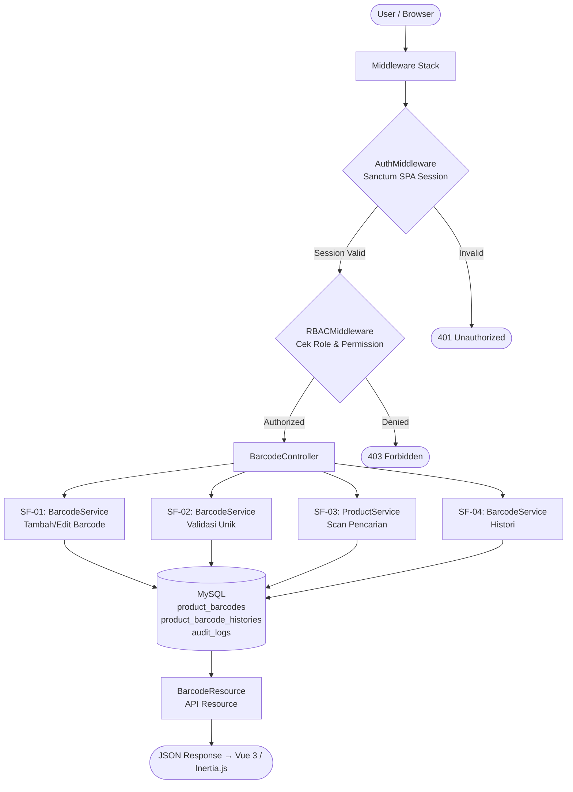
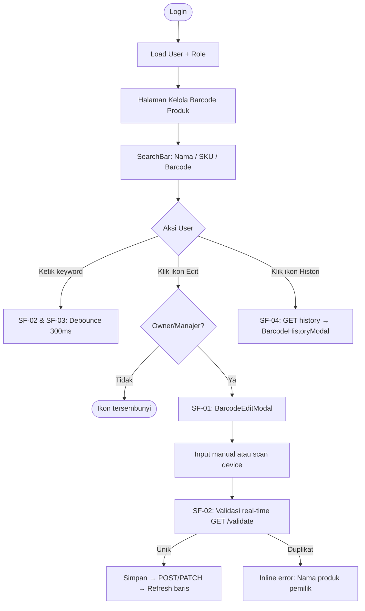
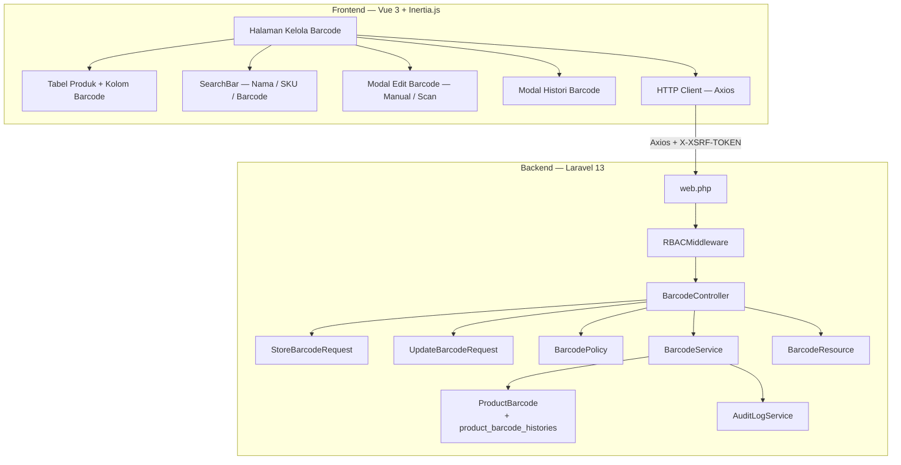
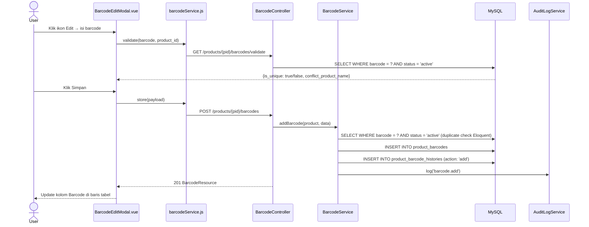
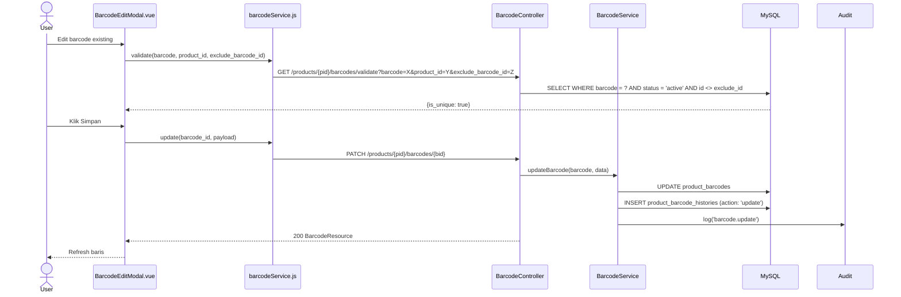
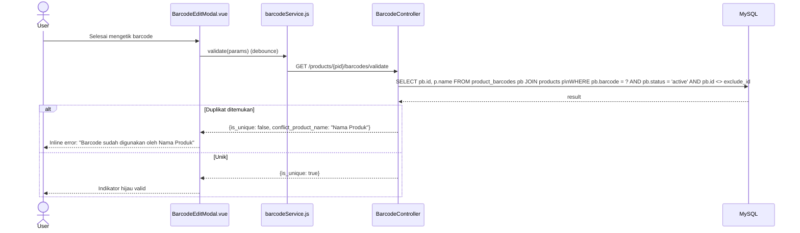
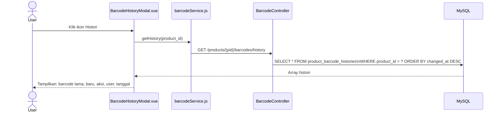
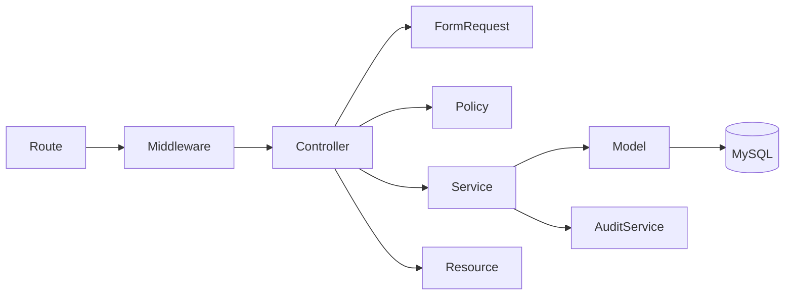

# Fitur - kelola barcode produk

<aside>
🏗️

**Software Architecture Document (SAD)** — Dibuat berdasarkan analisis fitur FT-PROD-09 Kelola Barcode Produk pada sistem Vetail POS **Single-Tenant** (1 toko, 1 owner, tanpa cabang). Dokumen ini menjadi acuan implementasi tim frontend dan backend.

</aside>

---

## 📋 Informasi Umum

| Field | Detail |
| --- | --- |
| **Kode Fitur** | FT-PROD-09 |
| **Nama Fitur** | Kelola Barcode Produk |
| **Modul Induk** | MOD-PROD — Produk |
| **Arsitektur** | Single-Tenant (store-scoped, tanpa cabang) |
| **Stack Teknologi** | Laravel 13, Vue 3, Inertia.js, Tailwind CSS, MySQL |
| **Autentikasi** | Laravel Sanctum SPA Session (bukan Bearer JWT) |
| **Versi Dokumen** | v3.0 |
| **Status** | 🟡 In Review |

<aside>
⚠️

**Unique Constraint Barcode:** Satu barcode aktif hanya boleh dimiliki SATU produk aktif. Validasi duplikasi wajib dilakukan sebelum simpan (di API dan DB level). Histori perubahan barcode dicatat di `product_barcode_histories`.

</aside>

---

## 1. 🎯 Tujuan Modul

Fitur **Kelola Barcode Produk** digunakan untuk menambah, mengubah, dan memastikan barcode produk unik serta valid untuk scan transaksi dan cetak label.

**Tujuan utama:**

- Menjaga barcode produk tetap unik — satu barcode = satu produk aktif.
- Mempercepat pencarian produk melalui scan di POS.
- Mendukung integrasi dengan Cetak Label (FT-PROD-08) dan transaksi kasir.
- Mencatat histori setiap perubahan barcode.

**Hak akses berdasarkan role:**

<aside>
ℹ️

**Sistem RBAC Vetail didefinisikan per-modul.** Fitur Kelola Barcode berada di bawah **Modul Produk** — yang dapat diakses oleh semua role. Namun, aksi spesifik di dalam fitur Barcode dibatasi lebih lanjut per role melalui `BarcodePolicy`.

</aside>

**Akses Modul Produk (level modul):**

| Role | Akses Modul Produk |
| --- | --- |
| Owner | ✅ |
| Manajer | ✅ |
| Staf Gudang | ✅ |
| Kasir | ✅ |

**Aksi spesifik Fitur Barcode (level fitur — via BarcodePolicy):**

| Role | Lihat | Tambah Barcode | Edit Barcode | Scan/Cari |
| --- | --- | --- | --- | --- |
| Owner | ✅ | ✅ | ✅ | ✅ |
| Manajer | ✅ | ✅ | ✅ | ✅ |
| Staf Gudang | ✅ | ❌ | ❌ | ✅ |
| Kasir | ✅ | ❌ | ❌ | ✅ |

---

## 2. 🔄 Data Flow

<aside>
🔑

**Autentikasi:** Seluruh request menggunakan **Sanctum SPA Session** + Cookie. Tidak ada Bearer JWT.

</aside>



| Sub-Fitur | Method | Query |
| --- | --- | --- |
| SF-01 Tambah/Edit | `store()` / `update()` | `INSERT`/`UPDATE product_barcodes`  • `INSERT product_barcode_histories` |
| SF-02 Validasi Unik | `validate()` | `SELECT WHERE barcode = ? AND status = 'active'` |
| SF-03 Scan/Cari | via `ProductController` | `SELECT JOIN product_barcodes WHERE barcode = ?` |
| SF-04 Histori | `history()` | `SELECT product_barcode_histories WHERE product_id = ?` |

---

## 3. 🖥️ UI Flow



> Produk tanpa barcode: teks **“Belum ada”** (abu-abu miring), tidak bisa digunakan untuk scan transaksi.
> 

---

## 4. 🧩 Component Diagram



---

## 5. 🔀 Sequence Diagram

### SF-01 — Add Barcode



### SF-01 — Update Barcode



### SF-02 — Validate Barcode



### SF-04 — Histori Barcode



---

## 6. 🏛️ Layer Responsibility

| Layer | File | Tanggung Jawab |
| --- | --- | --- |
| **Route** | `routes/web.php` | Group `/products/{product_id}/barcodes`, middleware stack |
| **Middleware** | `RBACMiddleware.php` | Cek permission per role |
| **Controller** | `BarcodeController.php` | `index`, `store`, `update`, `validate`, `history` |
| **Form Request** | `StoreBarcodeRequest.php` | Validasi create barcode |
| **Form Request** | `UpdateBarcodeRequest.php` | Validasi update barcode |
| **Policy** | `BarcodePolicy.php` | Gate authorization per aksi |
| **Service** | `BarcodeService.php` | Business logic + Eloquent langsung: duplikat check, insert barcode + history dalam DB transaction, audit |
| **Model** | `ProductBarcode.php` | Eloquent + relasi product + histories |
| **Model** | `ProductBarcodeHistory.php` | Eloquent audit trail barcode |
| **API Resource** | `BarcodeResource.php` | Serialisasi single barcode |
| **Audit Service** | `AuditLogService.php` | Catat mutasi ke `audit_logs` |
| **Halaman Barcode** | Inertia Page Component (nama & struktur file bebas) | Halaman utama kelola barcode; state keyword, tabel produk + kolom barcode |
| **Komponen UI** | Tabel + searchbar, modal edit barcode (manual/scan + validasi real-time), modal histori barcode (nama & struktur bebas) | Elemen UI interaktif; tidak langsung memanggil API |
| **HTTP Client** | Wrapper Axios (nama & lokasi file bebas) | Semua HTTP call ke backend; XSRF token otomatis, debounce validasi |

---

## 7. 🔗 Dependency Antar Layer



<aside>
⚠️

**Dua Layer Unique Constraint:** Validasi duplikat barcode ada di API validation (Service) DAN di database (UNIQUE INDEX). Jika dua user menyimpan barcode sama bersamaan, DB constraint menjadi pengaman terakhir.

</aside>

---

## 8. 🔗 Relasi Modul

| Modul Terkait | Jenis Relasi | Keterangan |
| --- | --- | --- |
| **Daftar Produk (FT-PROD-01)** | Sumber Produk | Tabel produk di Kelola Barcode dari master `products` |
| **Cetak Label (FT-PROD-08)** | Dependensi | Barcode valid dari `product_barcodes` wajib ada agar label bisa dicetak |
| **Transaksi / POS** | Konsumen | Kasir scan barcode → `SELECT products JOIN product_barcodes WHERE barcode = ?` |
| **Audit Log** | Write | Setiap tambah/edit barcode dicatat |

---

## 9. 🔌 API Endpoint

<aside>
🔑

**Auth:** Semua endpoint menggunakan **Sanctum SPA Session**. Route prefix: `/products/{product_id}/barcodes`.

</aside>

| Method | Endpoint | Controller Method | Sub-Fitur | Keterangan |
| --- | --- | --- | --- | --- |
| `GET` | `/products` | `index()` di ProductController | SF-01 | List produk + barcode aktif per produk |
| `POST` | `/products/{pid}/barcodes` | `store()` | SF-01 | Tambah barcode baru ke produk |
| `PATCH` | `/products/{pid}/barcodes/{bid}` | `update()` | SF-01 | Edit barcode existing |
| `GET` | `/products/{pid}/barcodes/validate` | `validate()` | SF-02 | Cek apakah barcode unik (real-time) |
| `GET` | `/products/{pid}/barcodes/history` | `history()` | SF-04 | Riwayat perubahan barcode per produk |

### Query Parameters — GET /validate

| Parameter | Tipe | Wajib | Keterangan |
| --- | --- | --- | --- |
| --- | --- | :---: | --- |
| `barcode` | string | ✅ | Nilai barcode yang ingin dicek |
| `product_id` | integer | ✅ | ID produk target |
| `exclude_barcode_id` | integer | ❌ | ID barcode yang sedang diedit (exclude dari cek duplikat) |

### Error Response Standar

| Kode Error | HTTP | Penyebab | Perilaku UI |
| --- | --- | --- | --- |
| --- | :---: | --- | --- |
| `ERR-AUTH-01` | 401 | Session expired | Redirect ke login |
| `ERR-FORBIDDEN-01` | 403 | Role tidak punya izin | "Akses ditolak" |
| `ERR-PRODUCT-NOT-FOUND` | 404 | Produk tidak ditemukan | Error data |
| `ERR-BARCODE-REQUIRED` | 422 | Barcode kosong | Inline error field |
| `ERR-BARCODE-DUPLICATE-01` | 409 | Barcode sudah dipakai produk lain | Inline error + nama produk pemilik |
| `ERR-SERVER-01` | 500 | Kesalahan internal | Pesan generik |

---

### 9.1 📦 Standar API Request

- **Auth:** Laravel Sanctum SPA Session; `X-XSRF-TOKEN` via Axios
- **Path Parameters:** `product_id`; `barcode_id` (update)

**Create Body:** `{ "barcode": "8991234567890", "source": "manual" }`

**Update Body:** `{ "barcode": "8991234567890" }`

**Validate Response:** `{ "is_unique": true/false, "conflict_product_name": "Nama Produk" }`

---

### 9.2 📤 Standar API Response

**HTTP 201 Created — Add Barcode**

```json
{
  "success": true,
  "message": "Barcode berhasil ditambahkan.",
  "data": {
    "barcode_id": 15,
    "product_id": 42,
    "barcode": "8991234567890",
    "status": "active",
    "source": "manual"
  }
}
```

**Error 409 (Duplikat):** `{ "success": false, "code": "ERR-BARCODE-DUPLICATE-01", "message": "Barcode sudah digunakan oleh produk \"Mie Goreng 85gr\". Gunakan barcode lain." }`

---

### 9.3 📑 API Response Contract

| HTTP | Success | Data | Code |
| --- | --- | --- | --- |
| :---: | :---: | :---: | --- |
| 200 | `true` | Object/Array | — |
| 201 | `true` | Object | — |
| 401 | `false` | — | `ERR-AUTH-01` |
| 403 | `false` | — | `ERR-FORBIDDEN-01` |
| 404 | `false` | — | `ERR-PRODUCT-NOT-FOUND` |
| 409 | `false` | — | `ERR-BARCODE-DUPLICATE-01` |
| 422 | `false` | — | `ERR-BARCODE-REQUIRED` |
| 500 | `false` | — | `ERR-SERVER-01` |

---

### 9.4 🔄 Mapping Laravel Implementation

| Konsep | Implementasi |
| --- | --- |
| Form Request | `StoreBarcodeRequest`, `UpdateBarcodeRequest` |
| API Resource | `BarcodeResource` |
| Service | `BarcodeService` — duplikat check, INSERT barcode + history dalam transaction |
| Model | `ProductBarcode`  • `ProductBarcodeHistory` |
| Transaction | `DB::transaction()` pada store/update + history insert |

---

### 9.5 📌 Standar HTTP Status Code

| Status | Digunakan Untuk |
| --- | --- |
| :---: | --- |
| **200** | Validate, list, update berhasil |
| **201** | Barcode baru berhasil ditambahkan |
| **403** | Role tidak memiliki izin |
| **404** | Produk tidak ditemukan |
| **409** | Barcode duplikat |
| **422** | Barcode kosong |
| **500** | Kesalahan internal |

---

## 10. 🗄️ Database Design

### Tabel `product_barcodes`

| Kolom | Tipe | Null | Default | Keterangan |
| --- | --- | --- | --- | --- |
| `id` | BIGINT UNSIGNED | NO | AUTO_INCREMENT | Primary key |
| `product_id` | BIGINT UNSIGNED | NO | — | FK → `products(id)` ON DELETE CASCADE |
| `barcode` | VARCHAR(100) | NO | — | Nilai barcode |
| `status` | ENUM | NO | `'active'` | `active` / `inactive` |
| `source` | ENUM | NO | `'manual'` | `manual` / `scanner` / `import` |
| `created_by` | BIGINT UNSIGNED | NO | — | FK → `users(id)` |
| `updated_by` | BIGINT UNSIGNED | YES | NULL | FK → `users(id)` |
| `created_at` | TIMESTAMP | NO | CURRENT_TIMESTAMP | — |
| `updated_at` | TIMESTAMP | NO | CURRENT_TIMESTAMP | ON UPDATE CURRENT_TIMESTAMP |

**UNIQUE:** `uq_barcode_active (barcode, status)` — 1 barcode aktif hanya boleh ada 1 di sistem
**Index:** `idx_product (product_id)`, `idx_barcode (barcode)`
**FK:** `product_id → products(id) ON DELETE CASCADE` · `created_by → users(id)` · `updated_by → users(id)`

### Tabel `product_barcode_histories`

| Kolom | Tipe | Null | Default | Keterangan |
| --- | --- | --- | --- | --- |
| `id` | BIGINT UNSIGNED | NO | AUTO_INCREMENT | Primary key |
| `product_id` | BIGINT UNSIGNED | NO | — | FK → `products(id)` |
| `barcode_id` | BIGINT UNSIGNED | NO | — | FK → `product_barcodes(id)` |
| `old_barcode` | VARCHAR(100) | YES | NULL | Nilai barcode sebelum diubah (`null` jika aksi `add`) |
| `new_barcode` | VARCHAR(100) | NO | — | Nilai barcode baru |
| `action` | ENUM | NO | — | `add` / `update` / `deactivate` |
| `changed_by` | BIGINT UNSIGNED | NO | — | FK → `users(id)` |
| `changed_at` | TIMESTAMP | NO | CURRENT_TIMESTAMP | — |

**Index:** `idx_product (product_id)`
**FK:** `product_id → products(id)` · `barcode_id → product_barcodes(id)` · `changed_by → users(id)`

**Catatan desain:**

- `UNIQUE (barcode, status)` memastikan satu barcode aktif hanya ada satu di sistem.
- Barcode nonaktif (histori) boleh sama antarproduk.
- `source`: `manual`, `scanner`, `import`.

### Tabel `audit_logs` (nilai `action` untuk barcode)

| Action | Keterangan |
| --- | --- |
| `barcode.add` | Barcode baru ditambahkan |
| `barcode.update` | Barcode diubah |
| `barcode.deactivate` | Barcode dinonaktifkan |

### Query Kunci

**List produk dengan barcode aktif:**

```sql
SELECT p.id, p.name, p.sku, c.name AS category_name, u.name AS unit_name,
  p.sell_price,
  pb.barcode AS active_barcode,
  pb.id      AS barcode_id,
  CASE WHEN pb.barcode IS NULL THEN 'Belum ada' ELSE pb.barcode END AS barcode_display
FROM products p
JOIN categories c ON c.id = p.category_id AND c.deleted_at IS NULL
JOIN product_units u ON u.id = p.unit_id
LEFT JOIN product_barcodes pb ON pb.product_id = p.id AND pb.status = 'active'
WHERE p.deleted_at IS NULL
  AND (:keyword IS NULL OR p.name LIKE :kw OR p.sku LIKE :kw OR pb.barcode LIKE :kw)
ORDER BY p.name ASC;
```

**Cek duplikat barcode:**

```sql
SELECT pb.id, p.name AS product_name
FROM product_barcodes pb
JOIN products p ON p.id = pb.product_id
WHERE pb.barcode = :barcode
  AND pb.status  = 'active'
  AND (:exclude_barcode_id IS NULL OR pb.id <> :exclude_barcode_id);
```

---

## 11. 📁 Folder Structure

```jsx
app/
├── Http/
│   ├── Controllers/Product/BarcodeController.php
│   ├── Requests/Product/
│   │   ├── StoreBarcodeRequest.php
│   │   └── UpdateBarcodeRequest.php
│   └── Resources/Product/BarcodeResource.php
├── Models/
│   ├── ProductBarcode.php
│   └── ProductBarcodeHistory.php
├── Policies/BarcodePolicy.php
├── Services/Product/BarcodeService.php

routes/web.php

// resources/js/ — Struktur dan nama file bebas, sesuai konvensi tim.
// Wajib menyediakan: Halaman Kelola Barcode (Inertia Page), Tabel Produk + Kolom Barcode,
// SearchBar, Modal Edit Barcode (manual/scan + validasi real-time),
// Modal Histori Barcode, HTTP Client (Axios wrapper).
```

---

## 12. 📋 Struktur Implementasi

| Layer | File | Keterangan |
| --- | --- | --- |
| Route | `routes/web.php` | Group `/products/{pid}/barcodes`; middleware stack |
| Controller | `BarcodeController.php` | store, update, validate, history |
| Form Request | `StoreBarcodeRequest.php` | Validasi barcode wajib, trim, sanitasi |
| Service | `BarcodeService.php` | Business logic + Eloquent langsung: duplikat check, INSERT barcode + history dalam DB transaction |
| Model | `ProductBarcode.php` | Eloquent + relasi product + histories |
| Model | `ProductBarcodeHistory.php` | Eloquent audit trail |
| Resource | `BarcodeResource.php` | Serialisasi barcode data |
| Halaman Barcode | Inertia Page Component (nama & struktur file bebas) | Halaman utama; state keyword, tabel produk + barcode |
| Komponen UI | Tabel + searchbar, modal edit barcode, modal histori barcode (nama & struktur bebas) | Elemen UI interaktif; tidak langsung memanggil API |
| HTTP Client | Wrapper Axios (nama & lokasi file bebas) | Semua HTTP call ke backend; XSRF token otomatis |

---

## 13. 🔒 Standar Keamanan

<aside>
⚠️

Seluruh item bersifat **WAJIB** sebelum fitur dinyatakan siap produksi.

</aside>

| Kategori | Standar | Implementasi |
| --- | --- | --- |
| **SQL Injection** | Dilarang konkatenasi string | Parameterized query wajib |
| **IDOR Prevention** | Validasi kepemilikan produk | Setiap query by `product_id` pastikan produk tidak deleted (`AND deleted_at IS NULL`) |
| **Concurrent Barcode** | Cegah race condition duplikat | `UNIQUE INDEX`  • DB `SELECT FOR UPDATE` jika perlu |
| **Scanner Input** | Validasi panjang dan karakter | Trim + strip whitespace + max length |
| **Session Security** | Sanctum SPA Session | Cookie `HttpOnly`, `SameSite=Lax`, `Secure` production |
| **Role Guard** | Sembunyikan edit dari Staf/Kasir | Vue `v-if`  • Policy backend |

---

## 📌 Catatan Arsitektur

<aside>
🔏

**Dua Layer Unique Constraint:** Validasi duplikat ada di: (1) API validation sebelum INSERT, dan (2) UNIQUE INDEX `(barcode, status)` di database. Jika dua user menyimpan barcode sama bersamaan, DB constraint yang jadi pengaman terakhir.

</aside>

<aside>
📝

**Histori Wajib:** Setiap perubahan barcode (add/update/deactivate) WAJIB dimasukkan ke `product_barcode_histories`. Ini mendukung audit trail dan debugging.

</aside>

<aside>
⚠️

**Barcode "Belum ada" Dilarang di Transaksi:** Produk tanpa barcode tidak boleh discan di POS. Backend wajib return error jika barcode tidak ada di `product_barcodes` dengan `status = 'active'`.

</aside>

<aside>
🔑

**Autentikasi Stack:** Menggunakan **Sanctum SPA Session** (bukan Bearer JWT). Axios mengirim cookie sesi + `X-XSRF-TOKEN` secara otomatis.

</aside>

---

## 📎 Lampiran: Implementation Checklist

### Task Frontend

- [ ]  Klik ikon pensil → modal edit barcode; input text manual + tombol scan (device support)
- [ ]  Validasi real-time saat user selesai mengetik: `GET /validate`
- [ ]  Saat edit, sertakan `exclude_barcode_id` agar barcode milik sendiri tidak dianggap duplikat
- [ ]  Jika duplikat: tampilkan nama produk yang sudah memakai barcode
- [ ]  Disable tombol Simpan saat validasi sedang berlangsung atau ada error
- [ ]  Setelah simpan: update kolom Barcode di baris tabel (reaktif, tanpa full reload)
- [ ]  Modal histori barcode: tampilkan old_barcode, new_barcode, action, user, tanggal
- [ ]  Debounce 300ms pada SearchBar; cari nama, SKU, barcode
- [ ]  Teks: "Total data yang ditemukan: N"
- [ ]  CSRF: `X-XSRF-TOKEN` auto; Role Guard: sembunyikan ikon edit dari Staf/Kasir

### Task Backend

- [ ]  `auth:sanctum`, `RBACMiddleware` di semua route
- [ ]  Validasi kepemilikan: `barcode_id` harus milik `product_id` yang di path
- [ ]  `SELECT FOR UPDATE` jika ada concurrent edit scenario
- [ ]  INSERT `product_barcodes` + INSERT `product_barcode_histories` dalam **DB transaction**
- [ ]  Sanitasi input barcode (trim, strip whitespace)
- [ ]  UNIQUE constraint DB sebagai last-line-of-defense

---