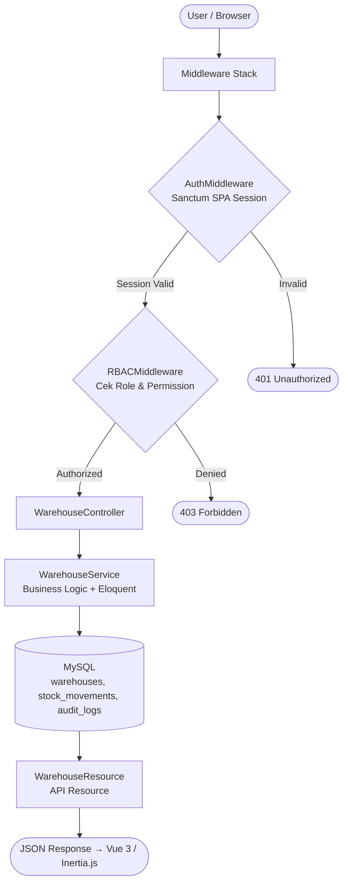
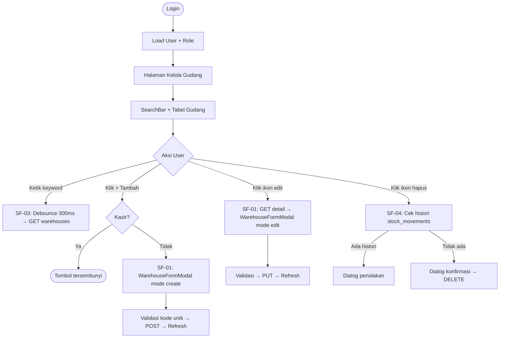
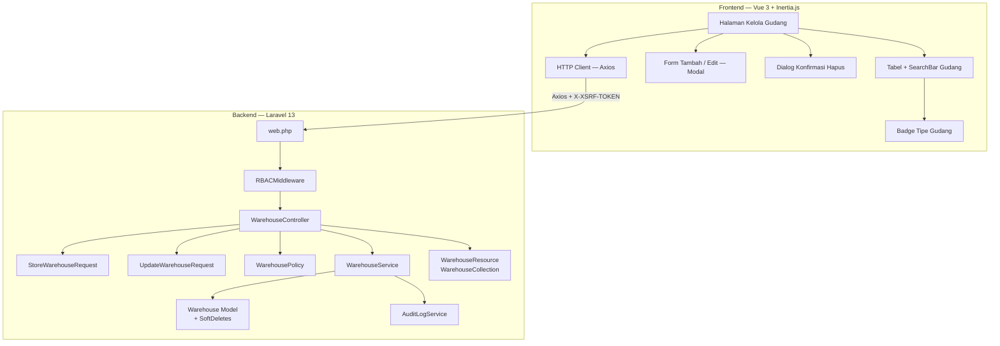
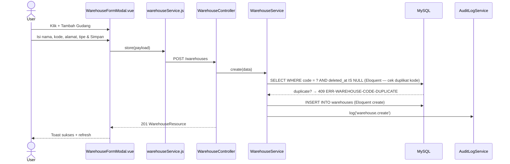
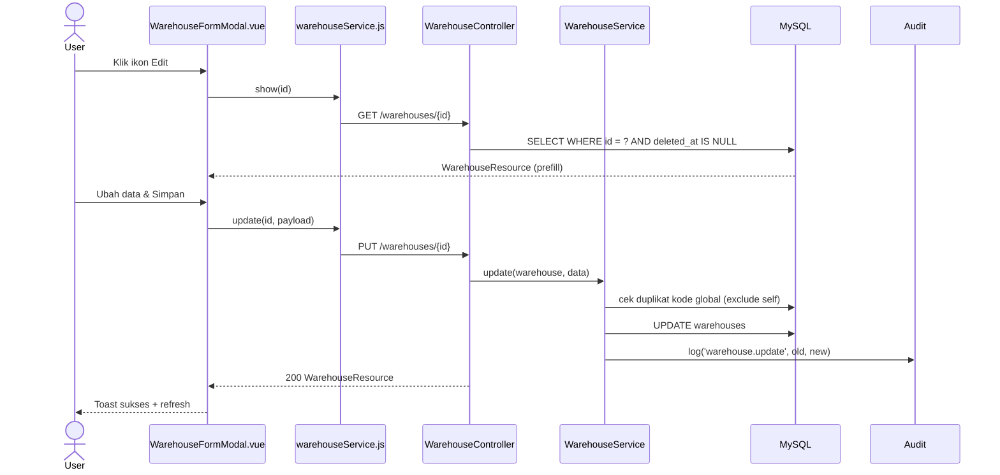
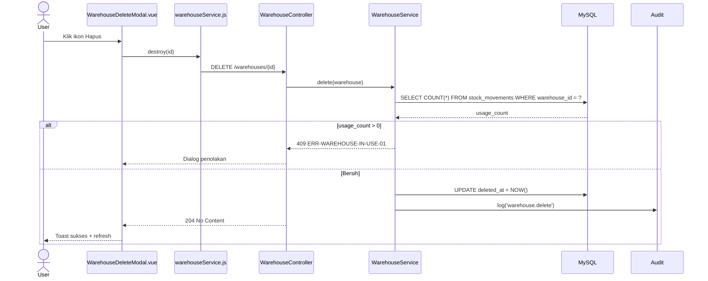
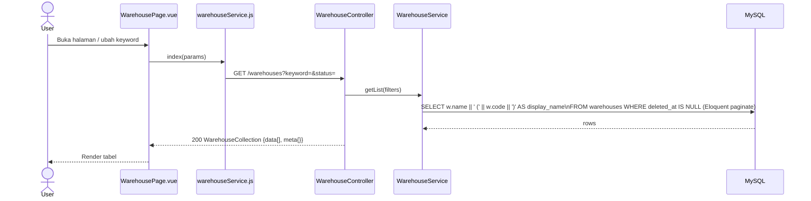
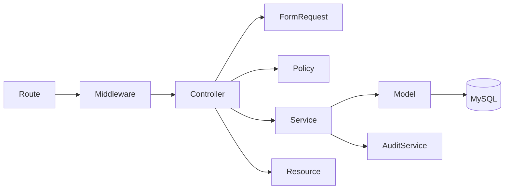

# Fitur - kelola gudang

<aside>
🏗️

**Software Architecture Document (SAD)** — Dibuat berdasarkan analisis fitur FT-PROD-03 Kelola Gudang pada sistem Vetail POS **Single-Tenant** (1 toko, 1 owner, tanpa cabang). Dokumen ini menjadi acuan implementasi tim frontend dan backend.

</aside>

---

## 📋 Informasi Umum

| Field | Detail |
| --- | --- |
| **Kode Fitur** | FT-PROD-03 |
| **Nama Fitur** | Kelola Gudang |
| **Modul Induk** | MOD-PROD — Produk |
| **Arsitektur** | Single-Tenant (store-scoped, tanpa cabang) |
| **Stack Teknologi** | Laravel 13, Vue 3, Inertia.js, Tailwind CSS, MySQL |
| **Autentikasi** | Laravel Sanctum SPA Session (bukan Bearer JWT) |
| **Versi Dokumen** | v4.0 |
| **Status** | 🟡 In Review |

<aside>
⚠️

**Gudang sebagai Referensi Stok:** Gudang (`warehouses`) adalah master data lokasi stok per cabang. Menjadi FK untuk modul Stok, Import Data Produk, dan filter Daftar Produk. Kode gudang wajib unik per cabang. Format tampilan: **“Nama (KODE)”**.

</aside>

---

## 1. 🎯 Tujuan Modul

Fitur **Kelola Gudang** digunakan untuk mengatur master data lokasi penyimpanan stok per cabang dalam sistem Vetail.

**Tujuan utama:**

- Menyediakan referensi lokasi stok yang akurat untuk modul Stok, Produk, dan Import.
- Memudahkan manajemen multi-gudang per cabang.
- Mencegah penghapusan gudang yang sudah memiliki histori transaksi stok.
- Mencatat perubahan data gudang di audit log.

**Hak akses berdasarkan role:**

<aside>
ℹ️

**Sistem RBAC Vetail didefinisikan per-modul.** Fitur Kelola Gudang berada di bawah **Modul Produk** — yang dapat diakses oleh semua role. Namun, aksi spesifik di dalam fitur Gudang dibatasi lebih lanjut per role melalui `WarehousePolicy`.

</aside>

**Akses Modul Produk (level modul):**

| Role | Akses Modul Produk |
| --- | --- |
| Owner | ✅ |
| Manajer | ✅ |
| Staf Gudang | ✅ |
| Kasir | ✅ |

**Aksi spesifik Fitur Gudang (level fitur — via WarehousePolicy):**

| Role | Lihat | Tambah | Edit | Hapus |
| --- | --- | --- | --- | --- |
| Owner | ✅ | ✅ | ✅ | ✅ (jika tanpa histori) |
| Manajer | ✅ | ✅ | ✅ | ✅ (jika tanpa histori) |
| Staf Gudang | ✅ | ✅ | ❌ | ❌ |
| Kasir | ❌ | ❌ | ❌ | ❌ |

---

## 2. 🔄 Data Flow

<aside>
🔑

**Autentikasi:** Seluruh request menggunakan **Sanctum SPA Session** + Cookie. Tidak ada Bearer JWT.

</aside>



| Sub-Fitur | Method | Query |
| --- | --- | --- |
| SF-01 Tambah/Edit | `store()` / `update()` | `INSERT`/`UPDATE warehouses` |
| SF-03 List & Cari | `index()` | `SELECT * FROM warehouses` |
| SF-04 Validasi Hapus | `destroy()` | `COUNT stock_movements` → soft delete |

---

## 3. 🖥️ UI Flow



> Alamat kosong ditampilkan sebagai **"-"**. Nama ditampilkan sebagai **"Nama (KODE)"**. Kolom **Status** di tabel menampilkan label tipe gudang (`type_label`); mapping dilakukan di `WarehouseResource` (contoh: `store_stock` → `Stok di Toko`).
> 

---

## 4. 🧩 Component Diagram



---

## 5. 🔀 Sequence Diagram

### SF-01 — Create Warehouse



### SF-01 — Update Warehouse



### SF-04 — Delete Warehouse



### SF-03 — List & Search Warehouse



---

## 6. 🏛️ Layer Responsibility

| Layer | File | Tanggung Jawab |
| --- | --- | --- |
| **Route** | `routes/web.php` | Group `/warehouses`, middleware stack |
| **Middleware** | `RBACMiddleware.php` | Cek permission per role |
| **Controller** | `WarehouseController.php` | `index`, `show`, `store`, `update`, `destroy` |
| **Form Request** | `StoreWarehouseRequest.php` | Validasi create (nama wajib; kode opsional, unik jika diisi); `warehouse_type` di-set otomatis di Service |
| **Form Request** | `UpdateWarehouseRequest.php` | Validasi update |
| **Policy** | `WarehousePolicy.php` | Gate authorization per aksi |
| **Service** | `WarehouseService.php` | Business logic + Eloquent langsung: kode duplikat check, mapping type_label (hardcoded), filter, pagination, delete guard, audit |
| **Model** | `Warehouse.php` | Eloquent + SoftDeletes + relasi warehouse_type |
| **API Resource** | `WarehouseResource.php` | Serialisasi single warehouse |
| **API Resource** | `WarehouseCollection.php` | `data[]`  • `meta{}` |
| **Audit Service** | `AuditLogService.php` | Catat mutasi ke `audit_logs` |
| **Halaman Gudang** | Inertia Page Component (nama & struktur file bebas) | Halaman utama manajemen gudang; state keyword, pagination |
| **Komponen UI** | Tabel + searchbar, modal form tambah/edit, dialog konfirmasi hapus, badge tipe gudang (nama & struktur bebas) | Elemen UI interaktif; tidak langsung memanggil API |
| **HTTP Client** | Wrapper Axios (nama & lokasi file bebas) | Semua HTTP call ke backend; XSRF token otomatis |

---

## 7. 🔗 Dependency Antar Layer



<aside>
⚠️

**Aturan Dependency:** Controller mendelegasikan ke Service. Service menjalankan query Eloquent langsung ke Model. Service tidak boleh memanggil Controller.

</aside>

---

## 8. 🔗 Relasi Modul

| Modul Terkait | Jenis Relasi | Keterangan |
| --- | --- | --- |
| **Daftar Produk (FT-PROD-01)** | Filter | Dropdown filter Gudang di halaman Daftar Produk mengambil dari `warehouses` |
| **Import Data Produk (FT-PROD-02)** | Referensi | Kolom gudang di Excel import divalidasi ke `warehouses` |
| **Stok Barang (Modul Stok)** | Parent Data | `stock_movements.warehouse_id` → `warehouses.id` |
| **Transaksi / Penjualan** | Konsumen Data | Transaksi stok mengacu ke gudang; histori ini menghalangi hapus |
| **Audit Log** | Write | Setiap mutasi gudang dicatat |

---

## 9. 🔌 API Endpoint

<aside>
🔑

**Auth:** Semua endpoint menggunakan **Sanctum SPA Session** + Cookie + `X-XSRF-TOKEN`. Route prefix: `/warehouses`.

</aside>

| Method | Endpoint | Controller Method | Sub-Fitur | Keterangan |
| --- | --- | --- | --- | --- |
| `GET` | `/warehouses` | `index()` | SF-03 | List gudang + filter keyword + sort + pagination |
| `GET` | `/warehouses/{id}` | `show()` | SF-01 | Detail gudang untuk form edit |
| `POST` | `/warehouses` | `store()` | SF-01 | Buat gudang baru |
| `PUT` | `/warehouses/{id}` | `update()` | SF-01 | Update data gudang |
| `DELETE` | `/warehouses/{id}` | `destroy()` | SF-04 | Hapus gudang (cek histori stock_movements) |

### Error Response Standar

| Kode Error | HTTP | Penyebab | Perilaku UI |
| --- | --- | --- | --- |
| --- | :---: | --- | --- |
| `ERR-AUTH-01` | 401 | Session tidak ada / expired | Redirect ke login |
| `ERR-FORBIDDEN-01` | 403 | Role tidak punya permission | "Akses ditolak" |
| `ERR-VALIDATION-01` | 422 | Nama/kode kosong atau format tidak valid | Inline error per field |
| `ERR-WAREHOUSE-CODE-DUPLICATE` | 409 | Kode gudang sudah digunakan di toko ini | Inline error field kode |
| `ERR-WAREHOUSE-NOT-FOUND` | 404 | Gudang tidak ditemukan | Error data tidak ada |
| `ERR-WAREHOUSE-IN-USE-01` | 409 | Gudang punya histori transaksi stok | Dialog penolakan + saran nonaktifkan |
| `ERR-SERVER-01` | 500 | Kesalahan internal | Pesan generik |

---

### 9.1 📦 Standar API Request

- **Auth:** Laravel Sanctum SPA Session; Cookie `HttpOnly`; `X-XSRF-TOKEN` via Axios
- **Path Parameter:** `id` (show/update/delete)

| Parameter | Tipe | Default | Keterangan |
| --- | --- | --- | --- |
| `keyword` | string | null | Cari nama, kode, alamat gudang |
| `sort_by` | string | `name` | in:name,address,warehouse_type |
| `sort_direction` | string | `asc` | in:asc,desc |
| `page` | integer | `1` | Nomor halaman |
| `limit` | integer | `20` | Item per halaman (max 100) |

**Create/Update Body:**

```json
{ "name": "Stok Di Toko", "code": "TOKO-01", "address": "Jl. Contoh No. 1", "phone": "081234567890", "description": "Gudang utama toko" }
```

---

### 9.2 📤 Standar API Response

**HTTP 200 OK — Single Warehouse**

```json
{
  "success": true,
  "message": "Data gudang berhasil dimuat.",
  "data": {
    "id": 7,
    "display_name": "Stok Di Toko (TOKO-01)",
    "name": "Stok Di Toko",
    "code": "TOKO-01",
    "address": "Jl. Contoh No. 1",
    "phone": "081234567890",
    "description": "Gudang utama toko",
    "warehouse_type": "store_stock",
    "type_label": "Stok di Toko"
  }
}
```

**Error 409 (In Use):** `{ "success": false, "code": "ERR-WAREHOUSE-IN-USE-01", "message": "Gudang tidak dapat dihapus karena memiliki histori transaksi stok." }`

---

### 9.3 📑 API Response Contract

| HTTP | Success | Data | Code |
| --- | --- | --- | --- |
| :---: | :---: | :---: | --- |
| 200 | `true` | Object/Array | — |
| 201 | `true` | Object | — |
| 204 | — | — | — |
| 401 | `false` | — | `ERR-AUTH-01` |
| 403 | `false` | — | `ERR-FORBIDDEN-01` |
| 404 | `false` | — | `ERR-WAREHOUSE-NOT-FOUND` |
| 409 | `false` | — | `ERR-WAREHOUSE-CODE-DUPLICATE` / `ERR-WAREHOUSE-IN-USE-01` |
| 422 | `false` | — | `ERR-VALIDATION-01` |
| 500 | `false` | — | `ERR-SERVER-01` |

---

### 9.4 🔄 Mapping Laravel Implementation

| Konsep | Implementasi |
| --- | --- |
| Form Request | `StoreWarehouseRequest`, `UpdateWarehouseRequest` |
| API Resource | `WarehouseResource`  • `WarehouseCollection` |
| Service | `WarehouseService` — kode duplikat check, delete guard (stock_movements) |
| Model | `Warehouse`  • `SoftDeletes` |

---

### 9.5 📌 Standar HTTP Status Code

| Status | Method | Digunakan Untuk |
| --- | --- | --- |
| :---: | --- | --- |
| **200** | GET, PUT | Request berhasil |
| **201** | POST | Gudang baru dibuat |
| **204** | DELETE | Gudang berhasil dihapus |
| **403** | Semua | Role tidak memiliki izin |
| **404** | GET, PUT, PATCH, DELETE | Gudang tidak ditemukan |
| **409** | POST, PUT, DELETE | Kode duplikat atau histori transaksi |
| **422** | POST, PUT | Validasi input gagal |
| **500** | Semua | Kesalahan internal |

---

## 10. 🗄️ Database Design

### 10.1 🗃️ Tabel `warehouses`

| Kolom | Tipe Data | Null | Default | Keterangan |
| --- | --- | --- | --- | --- |
| `id` | `BIGINT UNSIGNED` | NO | AUTO_INCREMENT | Primary Key |
| `name` | `VARCHAR(255)` | NO | — | Nama gudang; wajib |
| `code` | `VARCHAR(50)` | YES | NULL | Kode gudang; opsional, unik jika diisi |
| `address` | `TEXT` | YES | NULL | Alamat gudang; opsional |
| `phone` | `VARCHAR(50)` | YES | NULL | Nomor telepon; opsional |
| `description` | `TEXT` | YES | NULL | Deskripsi gudang; opsional |
| `warehouse_type` | `VARCHAR(50)` | NO | `'store_stock'` | Tipe gudang; di-set otomatis oleh backend (default `'store_stock'`); label di-mapping di `WarehouseResource` (tidak ada lookup table) |
| `created_by` | `BIGINT UNSIGNED` | NO | — | FK → `users.id`; user yang membuat |
| `updated_by` | `BIGINT UNSIGNED` | YES | NULL | FK → `users.id`; user yang terakhir mengubah |
| `created_at` | `TIMESTAMP` | YES | CURRENT_TIMESTAMP | Waktu dibuat (otomatis) |
| `updated_at` | `TIMESTAMP` | YES | CURRENT_TIMESTAMP ON UPDATE | Waktu diubah (otomatis) |
| `deleted_at` | `TIMESTAMP` | YES | NULL | Soft delete; NULL = aktif / belum dihapus |

**DDL Lengkap:**

```sql
CREATE TABLE warehouses (
    id              BIGINT UNSIGNED AUTO_INCREMENT PRIMARY KEY,
    name            VARCHAR(255)    NOT NULL,
    code            VARCHAR(50)     NULL,
    address         TEXT            NULL,
    phone           VARCHAR(50)     NULL,
    description     TEXT            NULL,
    warehouse_type  VARCHAR(50)     NOT NULL DEFAULT 'store_stock',
    created_by      BIGINT UNSIGNED NOT NULL,
    updated_by      BIGINT UNSIGNED NULL,
    created_at      TIMESTAMP DEFAULT CURRENT_TIMESTAMP,
    updated_at      TIMESTAMP DEFAULT CURRENT_TIMESTAMP ON UPDATE CURRENT_TIMESTAMP,
    deleted_at      TIMESTAMP NULL,

    UNIQUE KEY uq_warehouse_code (code),
    INDEX idx_deleted_at (deleted_at),

    FOREIGN KEY (created_by) REFERENCES users(id),
    FOREIGN KEY (updated_by) REFERENCES users(id)
);
```

### Tabel `audit_logs` (nilai `action` untuk gudang)

| Action | Keterangan |
| --- | --- |
| `warehouse.create` | Gudang baru dibuat |
| `warehouse.update` | Data gudang diubah |
| `warehouse.delete` | Gudang dihapus (soft delete) |
| `warehouse.delete_rejected` | Hapus ditolak karena ada histori stok |

### Query Kunci

**List gudang dengan format nama + badge:**

```sql
SELECT
  w.id,
  w.name || ' (' || w.code || ')'      AS display_name,
  COALESCE(w.address, '-')              AS address,
  w.warehouse_type AS type_label
FROM warehouses w
WHERE w.deleted_at IS NULL
  AND (:keyword IS NULL OR LOWER(w.name) LIKE :kw OR LOWER(COALESCE(w.code,'')) LIKE :kw OR LOWER(COALESCE(w.address,'')) LIKE :kw OR LOWER(COALESCE(w.phone,'')) LIKE :kw)
ORDER BY w.name ASC;
```

**Cek histori sebelum hapus:**

```sql
SELECT COUNT(*) AS usage_count
FROM stock_movements
WHERE warehouse_id = :warehouse_id;
```

---

## 11. 📁 Folder Structure

```jsx
app/
├── Http/
│   ├── Controllers/Product/WarehouseController.php
│   ├── Requests/Product/
│   │   ├── StoreWarehouseRequest.php
│   │   └── UpdateWarehouseRequest.php
│   └── Resources/Product/
│       ├── WarehouseResource.php
│       └── WarehouseCollection.php
├── Models/Warehouse.php
├── Policies/WarehousePolicy.php
└── Services/Product/WarehouseService.php

routes/web.php

// resources/js/ — Struktur dan nama file bebas, sesuai konvensi tim.
// Wajib menyediakan: Halaman Kelola Gudang (Inertia Page), Tabel + SearchBar,
// Modal Form Gudang (create/edit), Dialog Konfirmasi Hapus,
// Badge Tipe Gudang, HTTP Client (Axios wrapper).
```

---

## 12. 📋 Struktur Implementasi

| Layer | File | Keterangan |
| --- | --- | --- |
| Route | `routes/web.php` | Group `/warehouses`; middleware stack |
| Controller | `WarehouseController.php` | 5 method: index, show, store, update, destroy |
| Form Request | `StoreWarehouseRequest.php` | Validasi: nama wajib; kode opsional, unik jika diisi |
| Service | `WarehouseService.php` | Kode duplikat check global, delete guard (stock_movements), audit |
| Model | `Warehouse.php` | Eloquent + SoftDeletes |
| Resource | `WarehouseResource.php` / `WarehouseCollection.php` | Serialisasi; display_name = "Nama (KODE)" |
| Halaman Gudang | Inertia Page Component (nama & struktur file bebas) | Halaman utama; state keyword, pagination |
| Komponen UI | Tabel + searchbar, modal form tambah/edit, dialog konfirmasi hapus, badge tipe gudang (nama & struktur bebas) | Elemen UI interaktif; tidak langsung memanggil API |
| HTTP Client | Wrapper Axios (nama & lokasi file bebas) | Semua HTTP call ke backend; XSRF token otomatis |

---

## 13. 🔒 Standar Keamanan

<aside>
⚠️

Seluruh item bersifat **WAJIB** sebelum fitur dinyatakan siap produksi.

</aside>

| Kategori | Standar | Implementasi |
| --- | --- | --- |
| **SQL Injection** | Dilarang konkatenasi string | Parameterized query wajib |
| **Input Validation** | Zero-Trust | Laravel Form Request |
| **IDOR Prevention** | Validasi keberadaan resource | Query by ID wajib sertakan `AND deleted_at IS NULL` |
| **Session Security** | Sanctum SPA Session | Cookie `HttpOnly`, `SameSite=Lax`, `Secure` production |
| **Error Handling** | Stack trace tidak bocor | Pesan generik ke client |

---

## 📌 Catatan Arsitektur

<aside>
🏢

**Gudang = Single-Tenant:** `warehouses` tidak memiliki `branch_id`. Tidak ada `CheckBranchAccess` middleware. Kode gudang unik secara global dalam satu toko.

</aside>

<aside>
📝

**Format Nama:** Tampilkan gudang sebagai **“Nama (KODE)”** di seluruh UI. Alamat kosong selalu ditampilkan sebagai **“-”**.

</aside>

<aside>
⚠️

**Proteksi Histori Stok:** Sebelum hapus gudang, sistem WAJIB cek `stock_movements`. Jika ada histori, hapus ditolak. Gudang dengan histori stok tidak dapat dihapus.

</aside>

<aside>
🔑

**Autentikasi Stack:** Menggunakan **Sanctum SPA Session** (bukan Bearer JWT). Axios mengirim cookie sesi + `X-XSRF-TOKEN` secara otomatis.

</aside>

---

## 📎 Lampiran: Implementation Checklist

### Task Frontend

- [ ]  Modal form dua mode: **tambah** (kosong) dan **edit** (prefill dari `GET /warehouses/{id}`); field: nama (required), kode (optional), alamat, telepon, deskripsi
- [ ]  Validasi kode unik saat input (inline error, hanya jika kode diisi)
- [ ]  Nama ditampilkan sebagai "Nama (KODE)" di seluruh UI
- [ ]  Alamat kosong simpan sebagai `null`, tampilkan sebagai "-"
- [ ]  Dialog konfirmasi hapus dua state: *dapat dihapus* (lanjut delete) dan *ditolak* (ada histori stock_movements)
- [ ]  Debounce 300ms; cari di nama, kode, alamat
- [ ]  Teks: "Total gudang yang ditemukan: N"
- [ ]  Skeleton loading + empty state
- [ ]  CSRF: Axios `withCredentials: true`; `X-XSRF-TOKEN` auto
- [ ]  Role Guard: sembunyikan tombol **Edit** dan **Hapus** untuk Staf Gudang; sembunyikan tombol **Tambah**, **Edit**, dan **Hapus** untuk Kasir

### Task Backend

- [ ]  `auth:sanctum`, `RBACMiddleware` di semua route
- [ ]  Validasi kode unik secara global jika diisi (UNIQUE KEY nullable di DB + Service check)
- [ ]  `warehouse_type` di-set otomatis oleh Service (`'store_stock'`); tidak diterima dari request frontend
- [ ]  Alamat, telepon, deskripsi nullable; simpan `null` jika kosong
- [ ]  `SELECT COUNT(*) FROM stock_movements WHERE warehouse_id = ?` sebelum hapus
- [ ]  Return 409 `ERR-WAREHOUSE-IN-USE-01` jika ada histori; catat `warehouse.delete_rejected`
- [ ]  Soft delete + audit log dalam **database transaction**
- [ ]  IDOR: setiap query by `{id}` sertakan `AND deleted_at IS NULL`
- [ ]  Mapping `warehouse_type` → label di `WarehouseResource` (contoh: `store_stock` → `Stok di Toko`, `warehouse` → `Gudang`)

---