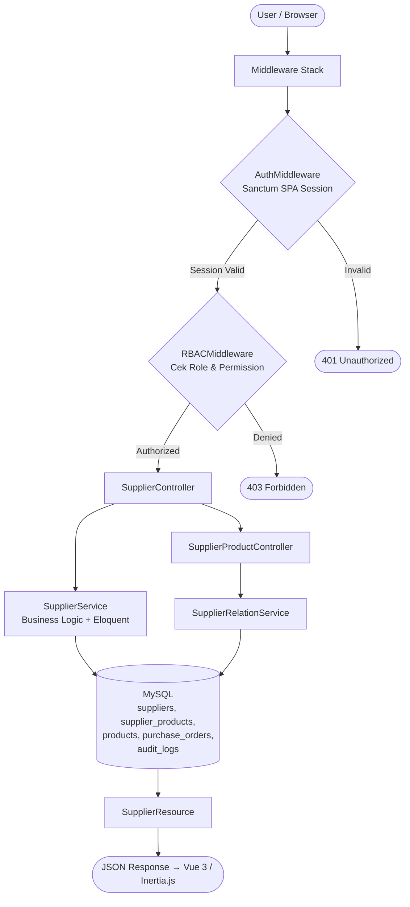
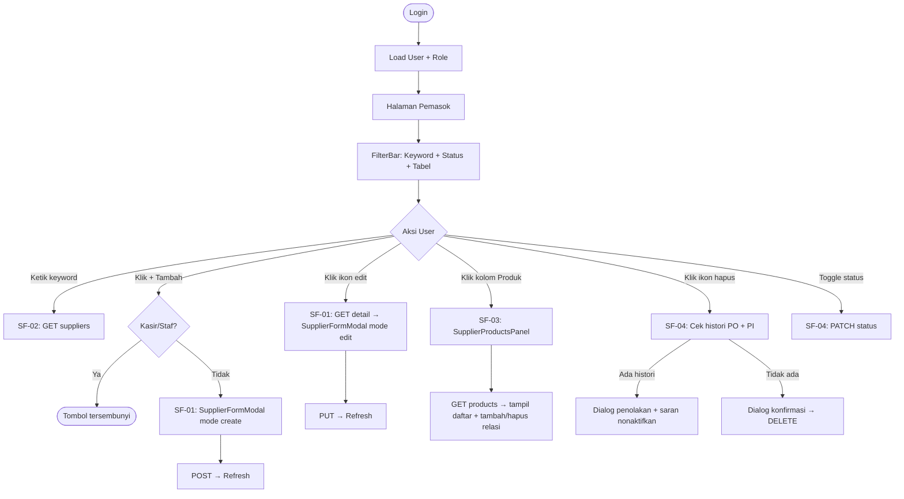
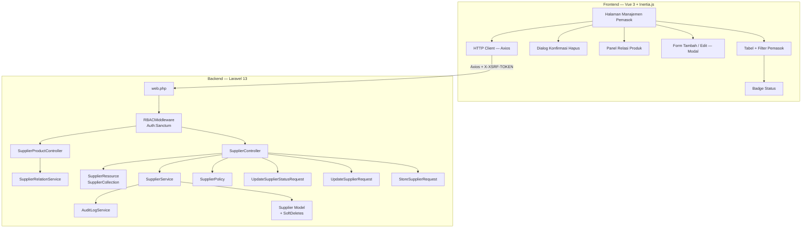
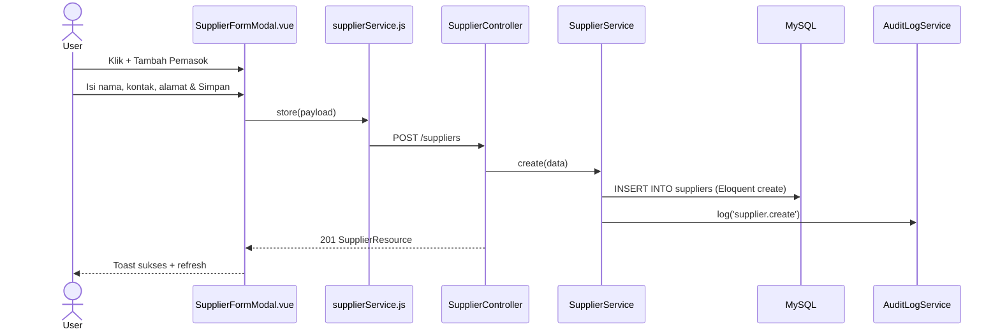
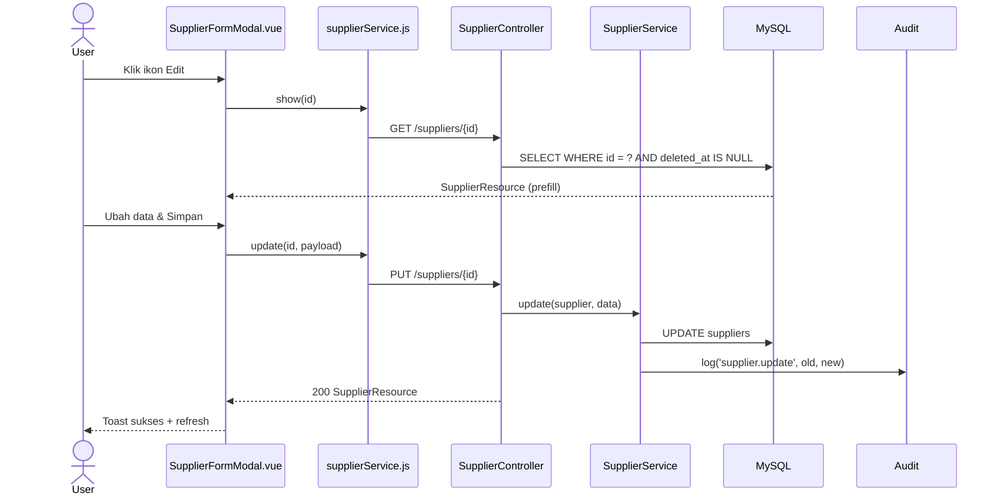
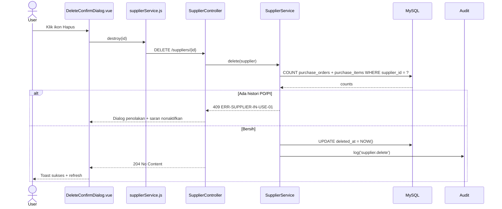
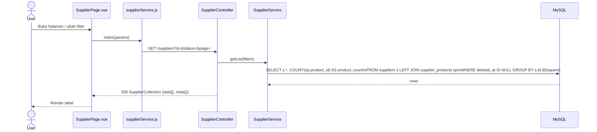
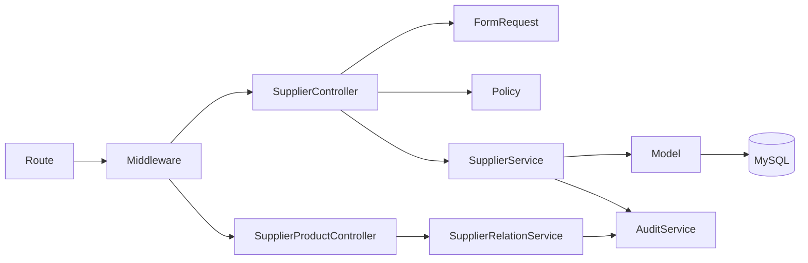

# Fitur - pemasok

<aside>
🏗️

**Software Architecture Document (SAD)** — Dibuat berdasarkan analisis fitur FT-PROD-07 Pemasok pada sistem Vetail POS **Single-Tenant**. Dokumen ini menjadi acuan implementasi tim frontend dan backend.

</aside>

---

## 📋 Informasi Umum

| Field | Detail |
| --- | --- |
| **Kode Fitur** | FT-PROD-07 |
| **Nama Fitur** | Pemasok |
| **Modul Induk** | MOD-PROD — Produk |
| **Arsitektur** | Global (workspace-scoped, tidak per-cabang) |
| **Stack Teknologi** | Laravel 13, Vue 3, Inertia.js, Tailwind CSS, MySQL |
| **Autentikasi** | Laravel Sanctum SPA Session (bukan Bearer JWT) |
| **Versi Dokumen** | v2.0 |
| **Status** | 🟡 In Review |

<aside>
⚠️

**Global Master Data + Many-to-Many:** Pemasok adalah master data global tanpa `branch_id`. Berbeda dari Kategori/Merek yang per-cabang. Pemasok memiliki relasi many-to-many ke `products` via junction table `supplier_products`. Status menggunakan `aktif`/`nonaktif` (Bahasa Indonesia).

</aside>

---

## 1. 🎯 Tujuan Modul

Fitur **Pemasok** berfungsi sebagai **master data supplier produk global** dalam sistem Vetail. Pemasok dikelola bersama di seluruh workspace untuk mendukung proses pengadaan, pembelian, dan pelacakan sumber barang.

**Tujuan utama:**

- Menyediakan data pemasok yang rapi dan terpusat untuk proses pengadaan.
- Memudahkan pelacakan supplier utama untuk tiap produk.
- Menjadi referensi wajib pada Modul Pembelian, Pengadaan, dan Laporan.

**Hak akses berdasarkan role (RBAC):**

<aside>
ℹ️

**Sistem RBAC Vetail didefinisikan per-modul.** Fitur Pemasok berada di bawah **Modul Produk** — yang dapat diakses oleh semua role. Namun, aksi spesifik di dalam fitur Pemasok dibatasi lebih lanjut per role melalui `SupplierPolicy`.

</aside>

**Akses Modul Produk (level modul):**

| Role | Akses Modul Produk |
| --- | --- |
| Owner | ✅ |
| Manajer | ✅ |
| Staf Gudang | ✅ |
| Kasir | ✅ |

**Aksi spesifik Fitur Pemasok (level fitur — via SupplierPolicy):**

| Role | Lihat | Tambah | Edit | Ubah Status | Hapus |
| --- | --- | --- | --- | --- | --- |
| Owner | ✅ | ✅ | ✅ | ✅ | ✅ |
| Manajer | ✅ | ✅ | ✅ | ✅ | ✅ |
| Staf Gudang | ✅ | ❌ | ❌ | ❌ | ❌ |
| Kasir | ❌ | ❌ | ❌ | ❌ | ❌ |

> Pemasok bersifat global — semua user yang berwenang melihat daftar pemasok yang sama.
> 

---

## 2. 🔄 Data Flow

<aside>
🔑

**Autentikasi:** Seluruh request menggunakan **Sanctum SPA Session** + Cookie. Tidak ada Bearer JWT. Tidak ada `CheckBranchAccess` — pemasok bersifat global.

</aside>



| Sub-Fitur | Method | Query |
| --- | --- | --- |
| SF-01 Tambah/Edit | `store()` / `update()` | `INSERT`/`UPDATE suppliers` |
| SF-02 Pencarian | `index()` | `SELECT ... LEFT JOIN supplier_products ... COUNT` |
| SF-03 Relasi Produk | `linkProduct()` / `unlinkProduct()` | `INSERT`/`DELETE supplier_products` |
| SF-04 Status & Hapus | `updateStatus()` / `destroy()` | cek histori PO → soft delete |

---

## 3. 🖥️ UI Flow



> Tidak ada `BranchSwitcher` — pemasok bersifat global.
> 

---

## 4. 🧩 Component Diagram



---

## 5. 🔀 Sequence Diagram

### SF-01 — Create Supplier



### SF-01 — Update Supplier



### SF-04 — Delete / Deactivate Supplier



### SF-02 — List & Search Supplier



---

## 6. 🏛️ Layer Responsibility

| Layer | File | Tanggung Jawab |
| --- | --- | --- |
| **Route** | `routes/web.php` | Group `/suppliers`  • `/suppliers/{id}/products`, middleware auth + rbac |
| **Middleware** | `RBACMiddleware.php` | Cek permission per role |
| **Controller** | `SupplierController.php` | `index`, `show`, `store`, `update`, `updateStatus`, `destroy` |
| **Controller** | `SupplierProductController.php` | `index`, `store`, `destroy` — kelola relasi `supplier_products` |
| **Form Request** | `StoreSupplierRequest.php` | Validasi create |
| **Form Request** | `UpdateSupplierRequest.php` | Validasi update |
| **Form Request** | `UpdateSupplierStatusRequest.php` | Validasi status (aktif/nonaktif) |
| **Policy** | `SupplierPolicy.php` | Gate authorization per aksi |
| **Service** | `SupplierService.php` | Business logic + Eloquent langsung: create, update, status, delete guard (cek histori PO), filter, pagination |
| **Service** | `SupplierRelationService.php` | Kelola relasi `supplier_products` (link/unlink) |
| **Model** | `Supplier.php` | Eloquent + SoftDeletes + relasi products (many-to-many) |
| **API Resource** | `SupplierResource.php` | Serialisasi single supplier |
| **API Resource** | `SupplierCollection.php` | `data[]`  • `meta{}` |
| **Audit Service** | `AuditLogService.php` | Catat mutasi ke `audit_logs` |
| **Halaman Pemasok** | Inertia Page Component (nama & struktur file bebas) | Halaman utama manajemen pemasok; mengatur state, memanggil HTTP client, merender seluruh UI pemasok |
| **Komponen UI** | Tabel + filter, modal form tambah/edit, panel relasi produk, dialog konfirmasi hapus, badge status (struktur & nama file bebas) | Elemen UI interaktif; menampilkan data, menerima input user, mengirim event ke parent; tidak langsung memanggil API |
| **HTTP Client** | Wrapper Axios (nama & lokasi file bebas) | Menangani semua HTTP call ke backend; XSRF token otomatis, loading state, error normalization |

---

## 7. 🔗 Dependency Antar Layer



<aside>
⚠️

**Aturan Dependency:** Controller mendelegasikan ke Service. Service menjalankan query Eloquent langsung ke Model. Service tidak boleh memanggil Controller. Relasi produk dikelola melalui `SupplierRelationService` yang terpisah dari `SupplierService` utama.

</aside>

---

## 8. 🔗 Relasi Modul

| Modul Terkait | Jenis Relasi | Keterangan |
| --- | --- | --- |
| **Produk (Daftar Produk)** | Many-to-Many via `supplier_products` | Satu produk bisa punya banyak pemasok |
| **Pembelian / Pengadaan** | FK Konsumen | `purchase_orders.supplier_id` → `suppliers.id` |
| **Import Data Produk** | Konsumen Data | Kolom pemasok pada template Excel divalidasi ke `suppliers` |
| **Laporan** | Konsumen Data | Laporan pembelian dikelompokkan per pemasok |
| **Audit Log** | Write | Setiap mutasi dicatat ke `audit_logs` |

---

## 9. 🔌 API Endpoint

<aside>
🔑

**Auth:** Semua endpoint menggunakan **Sanctum SPA Session**. Tidak ada `branch_id` path param — pemasok bersifat global.

</aside>

| Method | Endpoint | Controller Method | Sub-Fitur | Keterangan |
| --- | --- | --- | --- | --- |
| `GET` | `/suppliers` | `index()` | SF-02 | List pemasok + filter + pagination + product_count |
| `GET` | `/suppliers/{id}` | `show()` | SF-01 | Detail pemasok untuk form edit |
| `POST` | `/suppliers` | `store()` | SF-01 | Buat pemasok baru |
| `PUT` | `/suppliers/{id}` | `update()` | SF-01 | Update nama/kontak/alamat |
| `PATCH` | `/suppliers/{id}/status` | `updateStatus()` | SF-04 | Update status aktif/nonaktif |
| `DELETE` | `/suppliers/{id}` | `destroy()` | SF-04 | Hapus pemasok (soft delete, cek histori) |
| `GET` | `/suppliers/{id}/products` | `index()` | SF-03 | Daftar produk terkait pemasok |
| `POST` | `/suppliers/{id}/products` | `store()` | SF-03 | Tambah relasi produk ke pemasok |
| `DELETE` | `/suppliers/{id}/products/{product_id}` | `destroy()` | SF-03 | Hapus relasi produk dari pemasok |

### Error Response Standar

| Kode Error | HTTP | Penyebab | Perilaku UI |
| --- | --- | --- | --- |
| --- | :---: | --- | --- |
| `ERR-AUTH-01` | 401 | Session tidak ada / expired | Redirect ke login |
| `ERR-FORBIDDEN-01` | 403 | Role tidak punya permission | "Akses ditolak" |
| `ERR-VALIDATION-01` | 422 | Input tidak valid | Inline error |
| `ERR-DUPLICATE-01` | 409 | Nama pemasok sudah digunakan | Inline error duplikasi |
| `ERR-SUPPLIER-NOT-FOUND` | 404 | Pemasok tidak ditemukan | Error data tidak ada |
| `ERR-SUPPLIER-IN-USE-01` | 409 | Pemasok punya histori transaksi PO | Dialog penolakan + saran nonaktif |
| `ERR-SUPPLIER-INACTIVE-01` | 400 | Pemasok nonaktif dipilih untuk PO baru | Peringatan pemasok nonaktif |
| `ERR-RELATION-NOT-FOUND` | 404 | Relasi produk-pemasok tidak ditemukan | Error relasi |
| `ERR-SERVER-01` | 500 | Kesalahan internal | Pesan generik |

> Tidak ada `ERR-BRANCH-*` karena pemasok tidak di-scope per cabang.
> 

---

### 9.1 📦 Standar API Request

Seluruh endpoint FT-PROD-07 menggunakan:

- **Laravel Sanctum SPA Session Authentication**
- **Session Cookie** dikirim otomatis oleh browser
- **X-XSRF-TOKEN** dikirim otomatis oleh Axios
- **Tidak ada** `branch_id` path parameter — pemasok bersifat global

#### Request Header

| Header | Wajib | Nilai | Keterangan |
| --- | --- | --- | --- |
| --- | :---: | --- | --- |
| `Accept` | ✅ | `application/json` | Wajib |
| `Content-Type` | ✅ (POST/PUT/PATCH) | `application/json` | Wajib pada request dengan body |
| `X-XSRF-TOKEN` | ✅ (POST/PUT/PATCH/DELETE) | Nilai dari cookie | Auto oleh Axios |

#### Query Parameter (GET /suppliers)

| Parameter | Tipe | Default | Keterangan |
| --- | --- | --- | --- |
| `page` | integer | `1` | Nomor halaman |
| `limit` | integer | `15` | Item per halaman (max 100) |
| `q` | string | null | Cari nama, email, telepon, alamat |
| `status` | string | `semua` | in:semua,aktif,nonaktif |
| `sort_by` | string | `name` | in:name,email,phone,product_count,status |
| `sort_direction` | string | `asc` | in:asc,desc |

#### Request Body

**Create/Update:** `{ "code": "SUP-001", "name": "PT Supplier ABC", "email": "supplier@example.com", "phone": "081234567890", "address": "Jl. Contoh No. 1", "notes": "Catatan pemasok", "status": "aktif" }`

**Patch Status:** `{ "status": "nonaktif" }`

**Link Product:** `{ "product_id": 42 }`

---

### 9.2 📤 Standar API Response

**HTTP 200 OK — Single Supplier**

```json
{
  "success": true,
  "message": "Data pemasok berhasil dimuat.",
  "data": {
    "id": 10,
    "code": "SUP-001",
    "name": "PT Supplier ABC",
    "email": "supplier@example.com",
    "phone": "081234567890",
    "address": "Jl. Contoh No. 1",
    "notes": null,
    "product_count": 8,
    "status": "aktif",
    "status_label": "Aktif"
  }
}
```

**Error 409 (In Use):** `{ "success": false, "code": "ERR-SUPPLIER-IN-USE-01", "message": "Pemasok tidak dapat dihapus karena memiliki histori transaksi. Nonaktifkan pemasok sebagai gantinya." }`

---

### 9.3 📑 API Response Contract

| HTTP | Success | Data | Errors | Code |
| --- | --- | --- | --- | --- |
| :---: | :---: | :---: | :---: | --- |
| 200 | `true` | Object/Array | — | — |
| 201 | `true` | Object | — | — |
| 204 | — | — | — | — |
| 401 | `false` | — | — | `ERR-AUTH-01` |
| 403 | `false` | — | — | `ERR-FORBIDDEN-01` |
| 404 | `false` | — | — | `ERR-SUPPLIER-NOT-FOUND` |
| 409 | `false` | — | — | `ERR-DUPLICATE-01` / `ERR-SUPPLIER-IN-USE-01` |
| 422 | `false` | — | Object per field | `ERR-VALIDATION-01` |
| 500 | `false` | — | — | `ERR-SERVER-01` |

---

### 9.4 🔄 Mapping Laravel Implementation

| Konsep | Implementasi Laravel 13 |
| --- | --- |
| **Form Request** | `StoreSupplierRequest`, `UpdateSupplierRequest`, `UpdateSupplierStatusRequest` |
| **API Resource** | `SupplierResource`  • `SupplierCollection` |
| **Exception Handler** | `Handler.php` — `ModelNotFoundException` → 404 |
| **Service** | `SupplierService` — create, update, status, delete guard (cek PO) |
| **Service** | `SupplierRelationService` — link/unlink `supplier_products` |
| **Model** | `Supplier`  • `SoftDeletes`  • `belongsToMany(Product)` via `supplier_products` |
| **Pagination** | `SupplierService` query Eloquent + LEFT JOIN → `LengthAwarePaginator` → `SupplierCollection` |

---

### 9.5 📌 Standar HTTP Status Code

| Status | Method | Digunakan Untuk |
| --- | --- | --- |
| :---: | --- | --- |
| **200** | GET, PUT, PATCH | Request berhasil |
| **201** | POST | Pemasok baru dibuat |
| **204** | DELETE | Pemasok / relasi berhasil dihapus |
| **401** | Semua | Session tidak valid |
| **403** | Semua | Role tidak punya izin |
| **404** | GET, PUT, PATCH, DELETE | Pemasok/relasi tidak ditemukan |
| **409** | POST, PUT, DELETE | Konflik bisnis (duplikat, histori PO) |
| **422** | POST, PUT, PATCH | Validasi input gagal |
| **500** | Semua | Kesalahan internal |

---

## 10. 🗄️ Database Design

### 10.1 🗃️ Tabel `suppliers`

| Kolom | Tipe Data | Null | Default | Keterangan |
| --- | --- | --- | --- | --- |
| `id` | `BIGINT UNSIGNED` | NO | AUTO_INCREMENT | Primary Key |
| `code` | `VARCHAR(50)` | YES | NULL | Kode pemasok; opsional |
| `name` | `VARCHAR(255)` | NO | — | Nama pemasok |
| `email` | `VARCHAR(255)` | YES | NULL | Email pemasok; opsional |
| `phone` | `VARCHAR(50)` | YES | NULL | Nomor telepon; opsional |
| `address` | `TEXT` | YES | NULL | Alamat pemasok; opsional |
| `notes` | `TEXT` | YES | NULL | Catatan internal; opsional |
| `status` | `ENUM('aktif','nonaktif')` | NO | `'aktif'` | Status pemasok |
| `created_by` | `BIGINT UNSIGNED` | NO | — | FK → `users.id`; user yang membuat |
| `updated_by` | `BIGINT UNSIGNED` | YES | NULL | FK → `users.id`; user yang terakhir mengubah |
| `created_at` | `TIMESTAMP` | YES | CURRENT_TIMESTAMP | Waktu dibuat (otomatis) |
| `updated_at` | `TIMESTAMP` | YES | CURRENT_TIMESTAMP ON UPDATE | Waktu diubah (otomatis) |
| `deleted_at` | `TIMESTAMP` | YES | NULL | Soft delete; NULL = aktif / belum dihapus |

**DDL Lengkap:**

```sql
CREATE TABLE suppliers (
    id          BIGINT UNSIGNED AUTO_INCREMENT PRIMARY KEY,
    code        VARCHAR(50)     NULL,
    name        VARCHAR(255)    NOT NULL,
    email       VARCHAR(255)    NULL,
    phone       VARCHAR(50)     NULL,
    address     TEXT            NULL,
    notes       TEXT            NULL,
    status      ENUM('aktif', 'nonaktif') NOT NULL DEFAULT 'aktif',
    created_by  BIGINT UNSIGNED NOT NULL,
    updated_by  BIGINT UNSIGNED NULL,
    created_at  TIMESTAMP DEFAULT CURRENT_TIMESTAMP,
    updated_at  TIMESTAMP DEFAULT CURRENT_TIMESTAMP ON UPDATE CURRENT_TIMESTAMP,
    deleted_at  TIMESTAMP NULL,

    UNIQUE KEY uq_supplier_code (code),
    INDEX idx_name       (name),
    INDEX idx_status     (status),
    INDEX idx_deleted_at (deleted_at),

    FOREIGN KEY (created_by) REFERENCES users(id),
    FOREIGN KEY (updated_by) REFERENCES users(id)
);
```

<aside>
⚠️

**Perhatian Enum Status:** Tabel `suppliers` menggunakan `'aktif'`/`'nonaktif'` (Indonesia), berbeda dari `brands`, `product_categories`, `product_units` yang menggunakan `'active'`/`'inactive'` (English). Pastikan konsistensi di seluruh layer.

</aside>

### Tabel `supplier_products` (junction many-to-many)

```sql
CREATE TABLE supplier_products (
    id          BIGINT UNSIGNED AUTO_INCREMENT PRIMARY KEY,
    supplier_id BIGINT UNSIGNED NOT NULL,
    product_id  BIGINT UNSIGNED NOT NULL,
    created_at  TIMESTAMP DEFAULT CURRENT_TIMESTAMP,

    UNIQUE KEY uq_supplier_product (supplier_id, product_id),
    INDEX idx_supplier (supplier_id),
    INDEX idx_product  (product_id),

    FOREIGN KEY (supplier_id) REFERENCES suppliers(id) ON DELETE CASCADE,
    FOREIGN KEY (product_id)  REFERENCES products(id)  ON DELETE CASCADE
);
```

### Tabel `audit_logs` (nilai `action` untuk pemasok)

| Action | Keterangan |
| --- | --- |
| `supplier.create` | Pemasok baru dibuat |
| `supplier.update` | Nama/kode/email/telepon/alamat/catatan diubah |
| `supplier.update_status` | Status diubah |
| `supplier.delete` | Pemasok dihapus (soft delete) |
| `supplier.delete_rejected` | Upaya hapus ditolak |
| `supplier.product_linked` | Produk dikaitkan ke pemasok |
| `supplier.product_unlinked` | Relasi produk-pemasok dihapus |

### Query Kunci

**List pemasok dengan product_count:**

```sql
SELECT s.id, s.name,
  COALESCE(s.email, '-')   AS email,
  COALESCE(s.phone, '-')   AS phone,
  COALESCE(s.address, '-') AS address,
  COUNT(sp.product_id)     AS product_count,
  s.status
FROM suppliers s
LEFT JOIN supplier_products sp ON sp.supplier_id = s.id
WHERE s.deleted_at IS NULL
  AND (:status = 'semua' OR s.status = :status)
  AND (:q IS NULL OR s.name LIKE :kw OR s.email LIKE :kw OR s.phone LIKE :kw OR s.address LIKE :kw)
GROUP BY s.id
ORDER BY s.name ASC;
```

**Cek histori sebelum hapus:**

```sql
SELECT
  COUNT(DISTINCT po.id) AS purchase_order_count,
  COUNT(DISTINCT pi.id) AS purchase_item_count
FROM suppliers s
LEFT JOIN purchase_orders po ON po.supplier_id = s.id
LEFT JOIN purchase_items  pi ON pi.supplier_id = s.id
WHERE s.id = :supplier_id;
```

---

## 11. 📁 Folder Structure

```jsx
app/
├── Http/
│   ├── Controllers/Product/
│   │   ├── SupplierController.php
│   │   └── SupplierProductController.php
│   ├── Requests/Product/
│   │   ├── StoreSupplierRequest.php
│   │   ├── UpdateSupplierRequest.php
│   │   └── UpdateSupplierStatusRequest.php
│   └── Resources/Product/
│       ├── SupplierResource.php
│       └── SupplierCollection.php
├── Models/Supplier.php
├── Policies/SupplierPolicy.php
├── Services/Product/
│   ├── SupplierService.php
│   └── SupplierRelationService.php

routes/web.php

// resources/js/ — Struktur dan nama file bebas, sesuai konvensi tim.
// Wajib menyediakan: Halaman Pemasok (Inertia Page), Tabel + Filter,
// Form Modal (tambah/edit), Panel Relasi Produk, Dialog Konfirmasi Hapus,
// Badge Status, HTTP Client (Axios wrapper).
```

---

## 12. 📋 Struktur Implementasi

| Layer | File | Keterangan |
| --- | --- | --- |
| Route | `routes/web.php` | Group `/suppliers`  • `/suppliers/{id}/products`; middleware auth + rbac |
| Controller | `SupplierController.php` | 6 method: index, show, store, update, updateStatus, destroy |
| Controller | `SupplierProductController.php` | index, store, destroy relasi supplier_products |
| Form Request | `StoreSupplierRequest.php` | Validasi create |
| Form Request | `UpdateSupplierRequest.php` | Validasi update |
| Form Request | `UpdateSupplierStatusRequest.php` | Validasi status (aktif/nonaktif) |
| Policy | `SupplierPolicy.php` | Gate per aksi |
| Service | `SupplierService.php` | Create, update, status, delete guard (cek PO) |
| Service | `SupplierRelationService.php` | Link/unlink supplier_products + audit |
| Model | `Supplier.php` | Eloquent + SoftDeletes + belongsToMany(Product) |
| Resource | `SupplierResource.php` / `SupplierCollection.php` | Serialisasi response |
| Halaman Pemasok | Inertia Page Component (nama & struktur file bebas) | Halaman utama; state filter, pagination |
| Komponen UI | Tabel + filter, modal form, panel relasi produk, dialog hapus, badge status (nama & struktur bebas) | Elemen UI interaktif; tidak langsung memanggil API |
| HTTP Client | Wrapper Axios (nama & lokasi file bebas) | Semua HTTP call ke backend; XSRF token otomatis |

---

## 13. 🔒 Standar Keamanan

<aside>
⚠️

Seluruh item bersifat **WAJIB** sebelum fitur dinyatakan siap produksi.

</aside>

| Kategori | Standar | Implementasi |
| --- | --- | --- |
| **SQL Injection** | Dilarang konkatenasi string | Parameterized query wajib |
| **Input Validation** | Zero-Trust | Laravel Form Request |
| **IDOR Prevention** | Validasi eksistensi resource | Query by ID wajib cek `deleted_at IS NULL` |
| **Session Security** | Sanctum SPA Session | Cookie `HttpOnly`, `SameSite=Lax`, `Secure` production |
| **Error Handling** | Stack trace tidak bocor | Pesan generik ke client; detail ke log |
| **Concurrent Delete Guard** | Cegah race condition | DB transaction pada delete + audit log |

---

## 📌 Catatan Arsitektur

<aside>
🔗

**Many-to-Many via `supplier_products`:** Pemasok memiliki relasi many-to-many ke `products`. Sub-fitur SF-03 unik dibanding fitur master data lainnya (Kategori, Merek, Satuan).

</aside>

<aside>
⚠️

**Status Enum Indonesia:** Tabel `suppliers` menggunakan `ENUM('aktif', 'nonaktif')` — berbeda dari tabel lain yang pakai `'active'`/`'inactive'`. Pastikan konsistensi di seluruh layer backend dan frontend.

</aside>

<aside>
🔑

**Autentikasi Stack:** Menggunakan **Sanctum SPA Session** (bukan Bearer JWT). Tidak ada `CheckBranchAccess` — pemasok bersifat global.

</aside>

---

## 📎 Lampiran: Implementation Checklist

### Task Frontend

- [ ]  Form modal dua mode: **tambah** (kosong) dan **edit** (prefill dari `GET /suppliers/{id}`); field: kode (opsional), nama (required), email, telepon, alamat, catatan, status
- [ ]  Pre-fill dari `GET /suppliers/{id}` saat edit
- [ ]  Kontak/alamat kosong ditampilkan sebagai "-" di tabel
- [ ]  Debounce 300ms; keyword cari nama, email, telepon, alamat
- [ ]  Kolom **Produk** menampilkan `product_count` (clickable → SupplierProductsPanel)
- [ ]  Panel relasi produk: `GET /suppliers/{id}/products`; tambah/hapus relasi produk ke pemasok
- [ ]  Dialog konfirmasi hapus dua state: *dapat dihapus* (lanjut delete) dan *ditolak* (ada histori PO); shortcut "Nonaktifkan saja"
- [ ]  Pemasok nonaktif tidak ditawarkan pada form PO baru
- [ ]  CSRF: Axios `withCredentials: true`; `X-XSRF-TOKEN` auto

### Task Backend

- [ ]  `auth:sanctum`, `RBACMiddleware` di semua route (tanpa `CheckBranchAccess`)
- [ ]  Cek histori `purchase_orders` + `purchase_items` sebelum hapus
- [ ]  Return 409 `ERR-SUPPLIER-IN-USE-01` jika ada histori
- [ ]  Soft delete + audit log dalam **database transaction**
- [ ]  `SupplierRelationService`: validasi produk aktif sebelum link; cek duplikasi UNIQUE KEY
- [ ]  Audit log `supplier.product_linked` dan `supplier.product_unlinked`
- [ ]  Parameterized query; tidak ada konkatenasi string

---

```

```