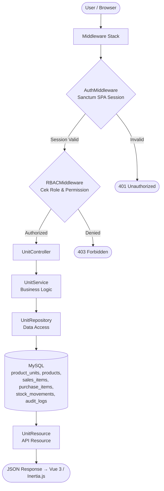
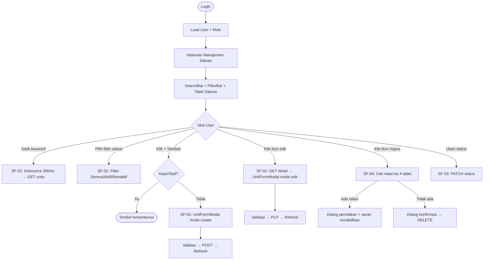
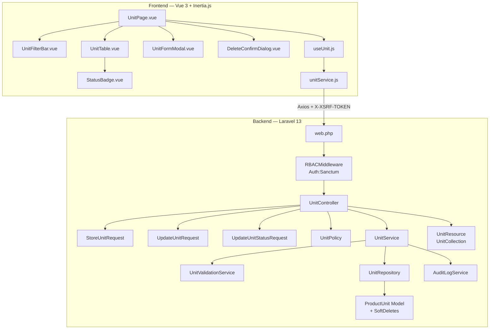
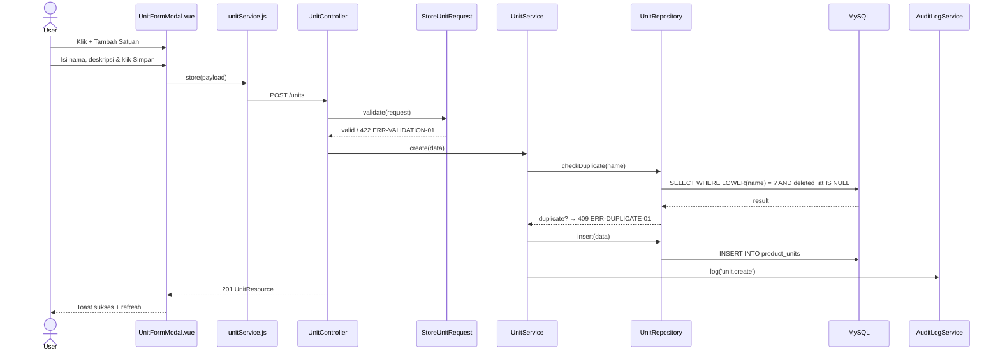
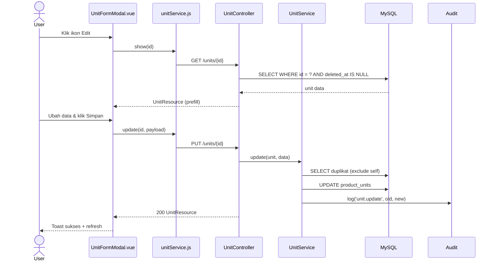
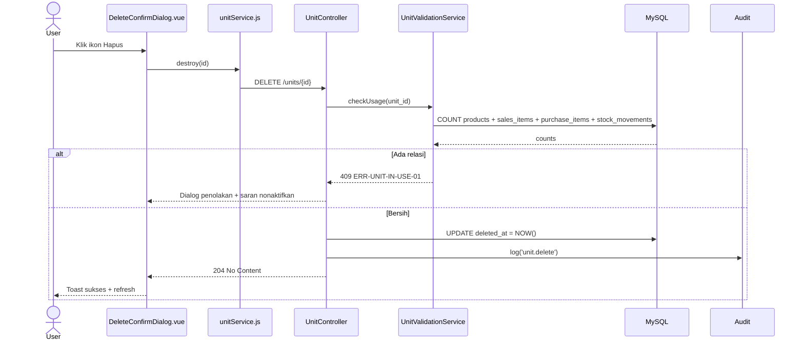
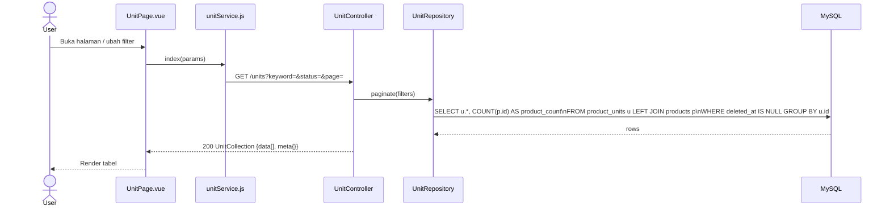
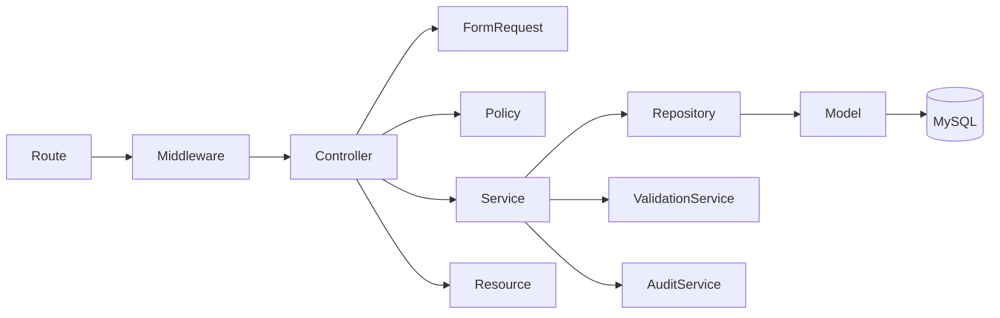

# Fitur- Satuan

<aside>
🏗️

**Software Architecture Document (SAD)** — Dibuat berdasarkan analisis fitur FT-PROD-06 Satuan pada sistem Vetail POS Multi-Cabang. Dokumen ini menjadi acuan implementasi tim frontend dan backend.

</aside>

---

## 📋 Informasi Umum

| Field | Detail |
| --- | --- |
| **Kode Fitur** | FT-PROD-06 |
| **Nama Fitur** | Satuan |
| **Modul Induk** | MOD-PROD — Produk |
| **Arsitektur** | Global (workspace-scoped, tidak per-cabang) |
| **Stack Teknologi** | Laravel 13, Vue 3, Inertia.js, Tailwind CSS, MySQL |
| **Autentikasi** | Laravel Sanctum SPA Session (bukan Bearer JWT) |
| **Versi Dokumen** | v2.0 |
| **Status** | 🟡 In Review |

<aside>
⚠️

**Global Master Data:** Satuan adalah master data global yang berlaku untuk seluruh cabang dalam satu workspace. Tidak ada `branch_id` di tabel `product_units` dan tidak ada `CheckBranchAccess` di middleware. Satuan seperti “Pcs”, “Kg”, “Dus” bersifat universal.

</aside>

---

## 1. 🎯 Tujuan Modul

Fitur **Satuan** berfungsi sebagai **master data satuan produk global** dalam sistem Vetail. Satuan dipakai oleh seluruh cabang untuk memastikan konsistensi penghitungan qty, stok, dan transaksi.

**Tujuan utama:**

- Menstandarkan satuan produk agar transaksi dan stok konsisten lintas cabang.
- Memudahkan pengelolaan produk dengan satuan berbeda (pcs, kg, lusin, dus, karton, dll.).
- Menjadi referensi wajib pada Modul Produk, Stok, POS, dan Pembelian.

**Hak akses berdasarkan role (RBAC):**

| Role | Lihat | Tambah | Edit | Ubah Status | Hapus |
| --- | --- | --- | --- | --- | --- |
| --- | :---: | :---: | :---: | :---: | :---: |
| Owner | ✅ | ✅ | ✅ | ✅ | ✅ |
| Manajer | ✅ | ✅ | ✅ | ✅ | ✅ |
| Staf Gudang | ✅ | ❌ | ❌ | ❌ | ❌ |
| Kasir | ✅ | ❌ | ❌ | ❌ | ❌ |

> Satuan bersifat global — semua user yang berwenang melihat daftar satuan yang sama tanpa memilih cabang.
> 

---

## 2. 🔄 Data Flow

<aside>
🔑

**Autentikasi:** Seluruh request menggunakan **Sanctum SPA Session** + Cookie. Tidak ada Bearer JWT. Tidak ada `CheckBranchAccess` — satuan bersifat global.

</aside>



| Sub-Fitur | Method | Query |
| --- | --- | --- |
| SF-01 Tambah/Edit | `store()` / `update()` | `INSERT`/`UPDATE product_units` |
| SF-02 Pencarian | `index()` | `SELECT ... LEFT JOIN products ... COUNT` |
| SF-03 Status | `updateStatus()` | `UPDATE product_units.status` |
| SF-04 Validasi Hapus | `destroy()` | cek relasi ke 4 tabel → soft delete |

---

## 3. 🖥️ UI Flow



> Tidak ada `BranchSwitcher` — satuan bersifat global untuk seluruh workspace.
> 

---

## 4. 🧩 Component Diagram



---

## 5. 🔀 Sequence Diagram

### SF-01 — Create Unit



### SF-01 — Update Unit



### SF-04 — Delete Unit



### SF-02 — List & Search Unit



---

## 6. 🏛️ Layer Responsibility

| Layer | File | Tanggung Jawab |
| --- | --- | --- |
| **Route** | `routes/web.php` | Group `/units`, middleware auth + rbac (tanpa branch check) |
| **Middleware** | `RBACMiddleware.php` | Cek permission per role |
| **Controller** | `UnitController.php` | `index`, `show`, `store`, `update`, `updateStatus`, `destroy` |
| **Form Request** | `StoreUnitRequest.php` | Validasi create (nama unik global) |
| **Form Request** | `UpdateUnitRequest.php` | Validasi update |
| **Form Request** | `UpdateUnitStatusRequest.php` | Validasi: status in [active, inactive] |
| **Policy** | `UnitPolicy.php` | Gate authorization per aksi |
| **Service** | `UnitService.php` | Duplikat check, delete guard (4 tabel), audit |
| **Validation Svc** | `UnitValidationService.php` | Pre-check relasi ke products, sales, purchase, stock |
| **Repository** | `UnitRepository.php` | Query + LEFT JOIN products (product_count) |
| **Model** | `ProductUnit.php` | Eloquent + SoftDeletes + relasi products |
| **API Resource** | `UnitResource.php` | Serialisasi single unit |
| **API Resource** | `UnitCollection.php` | `data[]`  • `meta{}` |
| **Audit Service** | `AuditLogService.php` | Catat mutasi |
| **Vue Page** | `UnitPage.vue` | State: filters, pagination |
| **Vue Component** | `UnitFormModal.vue` | Dual-mode create/edit |
| **Composable** | `useUnit.js` | fetchUnits, openModal, deleteUnit |
| **Service FE** | `unitService.js` | Axios wrapper |

---

## 7. 🔗 Dependency Antar Layer



<aside>
⚠️

**Aturan Dependency:** Controller tidak boleh langsung query ke Model. Semua akses data melalui Repository. Service tidak boleh memanggil Controller.

</aside>

---

## 8. 🔗 Relasi Modul

| Modul Terkait | Jenis Relasi | Keterangan |
| --- | --- | --- |
| **Produk** | FK Wajib (NOT NULL) | `products.unit_id` → `product_units.id`; produk aktif wajib punya satuan valid |
| **Stok Barang** | Konsumen Data | Satuan digunakan sebagai referensi qty stok per gudang |
| **Jualan / POS** | Konsumen Data | Satuan dipakai untuk menampilkan qty pada struk |
| **Pembelian** | Konsumen Data | Satuan dipakai pada `purchase_items` |
| **Import Data Produk** | Konsumen Data | Kolom satuan pada template Excel divalidasi ke `product_units` |
| **Audit Log** | Write | Setiap mutasi satuan dicatat |

---

## 9. 🔌 API Endpoint

<aside>
🔑

**Auth:** Semua endpoint menggunakan **Sanctum SPA Session**. Tidak ada `branch_id` path param — satuan bersifat global.

</aside>

| Method | Endpoint | Controller Method | Sub-Fitur | Keterangan |
| --- | --- | --- | --- | --- |
| `GET` | `/units` | `index()` | SF-02 | List satuan + filter + sort + pagination + product_count |
| `GET` | `/units/{id}` | `show()` | SF-01 | Detail satuan untuk form edit |
| `POST` | `/units` | `store()` | SF-01 | Buat satuan baru |
| `PUT` | `/units/{id}` | `update()` | SF-01 | Update nama/deskripsi |
| `PATCH` | `/units/{id}/status` | `updateStatus()` | SF-03 | Update status active/inactive |
| `DELETE` | `/units/{id}` | `destroy()` | SF-04 | Hapus satuan (soft delete, cek 4 tabel relasi) |

### Error Response Standar

| Kode Error | HTTP | Penyebab | Perilaku UI |
| --- | --- | --- | --- |
| --- | :---: | --- | --- |
| `ERR-AUTH-01` | 401 | Session tidak ada / expired | Redirect ke login |
| `ERR-FORBIDDEN-01` | 403 | Role tidak punya permission | "Akses ditolak" |
| `ERR-VALIDATION-01` | 422 | Nama satuan kosong / format tidak valid | Inline error |
| `ERR-DUPLICATE-01` | 409 | Nama satuan sudah digunakan (global) | Inline error duplikasi |
| `ERR-UNIT-NOT-FOUND` | 404 | Satuan tidak ditemukan | Error data tidak ada |
| `ERR-UNIT-IN-USE-01` | 409 | Satuan masih dipakai produk/transaksi | Dialog penolakan + saran nonaktif |
| `ERR-UNIT-INACTIVE-01` | 400 | Satuan nonaktif dipilih untuk produk baru | Peringatan satuan nonaktif |
| `ERR-SERVER-01` | 500 | Kesalahan internal | Pesan generik |

> Tidak ada `ERR-BRANCH-*` karena satuan tidak di-scope per cabang.
> 

---

### 9.1 📦 Standar API Request

Seluruh endpoint FT-PROD-06 menggunakan:

- **Laravel Sanctum SPA Session Authentication**
- **Session Cookie** dikirim otomatis oleh browser
- **X-XSRF-TOKEN** dikirim otomatis oleh Axios
- **Tidak ada** `branch_id` path parameter — satuan bersifat global

#### Request Header

| Header | Wajib | Nilai | Keterangan |
| --- | --- | --- | --- |
| --- | :---: | --- | --- |
| `Accept` | ✅ | `application/json` | Wajib |
| `Content-Type` | ✅ (POST/PUT/PATCH) | `application/json` | Wajib pada request dengan body |
| `X-XSRF-TOKEN` | ✅ (POST/PUT/PATCH/DELETE) | Nilai dari cookie | Auto oleh Axios |

#### Query Parameter

| Parameter | Tipe | Default | Validasi | Keterangan |
| --- | --- | --- | --- | --- |
| `page` | integer | `1` | min:1 | Nomor halaman |
| `limit` | integer | `15` | min:1, max:100 | Item per halaman |
| `keyword` | string | null | max:255 | Cari nama, deskripsi |
| `status` | string | `all` | in:all,active,inactive | Filter status |
| `sort_by` | string | `name` | in:name,product_count,status | Kolom sort |
| `sort_direction` | string | `asc` | in:asc,desc | Arah sort |

#### Request Body

**Create (POST):** `{ "name": "Kilogram", "description": "Satuan berat", "status": "active" }`

**Update (PUT):** `{ "name": "Kilogram", "description": "Satuan berat", "status": "active" }`

**Patch Status (PATCH):** `{ "status": "inactive" }`

---

### 9.2 📤 Standar API Response

**HTTP 200 OK — Single Unit**

```json
{
  "success": true,
  "message": "Data satuan berhasil dimuat.",
  "data": {
    "id": 3,
    "name": "Kilogram",
    "description": "Satuan berat",
    "product_count": 25,
    "status": "active",
    "status_label": "Aktif"
  }
}
```

**Collection (HTTP 200):** `{ "success": true, "data": [...], "meta": { "total": 20, "per_page": 15, "..." } }`

**Error 409 (In Use):** `{ "success": false, "code": "ERR-UNIT-IN-USE-01", "message": "Satuan masih digunakan oleh 25 produk dan histori transaksi. Nonaktifkan satuan sebagai gantinya." }`

---

### 9.3 📑 API Response Contract

| HTTP | Success | Data | Errors | Code |
| --- | --- | --- | --- | --- |
| :---: | :---: | :---: | :---: | --- |
| 200 | `true` | Object/Array | — | — |
| 201 | `true` | Object | — | — |
| 204 | — | — | — | — |
| 401 | `false` | — | — | `ERR-AUTH-01` |
| 403 | `false` | — | — | `ERR-FORBIDDEN-01` |
| 404 | `false` | — | — | `ERR-UNIT-NOT-FOUND` |
| 409 | `false` | — | — | `ERR-DUPLICATE-01` / `ERR-UNIT-IN-USE-01` |
| 422 | `false` | — | Object per field | `ERR-VALIDATION-01` |
| 500 | `false` | — | — | `ERR-SERVER-01` |

---

### 9.4 🔄 Mapping Laravel Implementation

| Konsep | Implementasi Laravel 13 |
| --- | --- |
| **Form Request** | `StoreUnitRequest`, `UpdateUnitRequest`, `UpdateUnitStatusRequest` |
| **API Resource** | `UnitResource` — serialisasi single unit |
| **Resource Collection** | `UnitCollection` — `data[]`  • `meta{}` |
| **Exception Handler** | `Handler.php` — `ModelNotFoundException` → 404 |
| **Service** | `UnitService` — duplikat check global, delete guard (4 tabel) |
| **Repository** | `UnitRepository` — LEFT JOIN products + sales_items + dll |
| **Model** | `ProductUnit`  • `SoftDeletes`  • `scopeActive()` |
| **Pagination** | `UnitRepository::paginate()` → `UnitCollection` |
| **Validation** | Rule duplikat nama global (case-insensitive, exclude self) |

---

### 9.5 📌 Standar HTTP Status Code

| Status | Method | Digunakan Untuk |
| --- | --- | --- |
| :---: | --- | --- |
| **200** | GET, PUT, PATCH | Request berhasil |
| **201** | POST | Satuan baru dibuat |
| **204** | DELETE | Satuan berhasil dihapus |
| **401** | Semua | Session tidak valid |
| **403** | Semua | Role tidak punya izin |
| **404** | GET, PUT, PATCH, DELETE | Satuan tidak ditemukan |
| **409** | POST, PUT, DELETE | Duplikat nama atau satuan masih dipakai |
| **422** | POST, PUT, PATCH | Validasi input gagal |
| **500** | Semua | Kesalahan internal |

---

## 10. 🗄️ Database Design

### 10.1 🗃️ Tabel `product_units`

| Kolom | Tipe Data | Null | Default | Keterangan |
| --- | --- | --- | --- | --- |
| `id` | `BIGINT UNSIGNED` | NO | AUTO_INCREMENT | Primary Key |
| `name` | `VARCHAR(100)` | NO | — | Nama satuan; UNIQUE global |
| `description` | `TEXT` | YES | NULL | Deskripsi satuan; opsional |
| `status` | `ENUM('active','inactive')` | NO | `'active'` | Status satuan |
| `created_by` | `BIGINT UNSIGNED` | NO | — | FK → `users.id`; user yang membuat |
| `updated_by` | `BIGINT UNSIGNED` | YES | NULL | FK → `users.id`; user yang terakhir mengubah |
| `created_at` | `TIMESTAMP` | YES | CURRENT_TIMESTAMP | Waktu dibuat (otomatis) |
| `updated_at` | `TIMESTAMP` | YES | CURRENT_TIMESTAMP ON UPDATE | Waktu diubah (otomatis) |
| `deleted_at` | `TIMESTAMP` | YES | NULL | Soft delete; NULL = aktif / belum dihapus |

**DDL Lengkap:**

```sql
CREATE TABLE product_units (
    id          BIGINT UNSIGNED AUTO_INCREMENT PRIMARY KEY,
    name        VARCHAR(100)    NOT NULL,
    description TEXT            NULL,
    status      ENUM('active', 'inactive') NOT NULL DEFAULT 'active',
    created_by  BIGINT UNSIGNED NOT NULL,
    updated_by  BIGINT UNSIGNED NULL,
    created_at  TIMESTAMP DEFAULT CURRENT_TIMESTAMP,
    updated_at  TIMESTAMP DEFAULT CURRENT_TIMESTAMP ON UPDATE CURRENT_TIMESTAMP,
    deleted_at  TIMESTAMP NULL,

    UNIQUE KEY uq_unit_name (name),
    INDEX idx_status     (status),
    INDEX idx_deleted_at (deleted_at),

    FOREIGN KEY (created_by) REFERENCES users(id),
    FOREIGN KEY (updated_by) REFERENCES users(id)
);
```

**Catatan desain:**

- Tidak ada `branch_id` — satuan bersifat **global**.
- `name` unik secara global (bukan per cabang).
- `deleted_at` → soft delete.

### Relasi pada tabel `products`

```sql
unit_id   BIGINT UNSIGNED NOT NULL,  -- WAJIB: produk harus punya satuan valid
FOREIGN KEY (unit_id) REFERENCES product_units(id)
```

> `products.unit_id` adalah **NOT NULL** — berbeda dari `brand_id` yang nullable.
> 

### Tabel `audit_logs` (nilai `action` untuk satuan)

| Action | Keterangan |
| --- | --- |
| `unit.create` | Satuan baru dibuat |
| `unit.update` | Nama/deskripsi diubah |
| `unit.update_status` | Status diubah |
| `unit.delete` | Satuan dihapus (soft delete) |
| `unit.delete_rejected` | Upaya hapus ditolak karena masih dipakai |

### Query Kunci

**List satuan dengan filter + product_count:**

```sql
SELECT u.id, u.name,
  COALESCE(u.description, '-') AS description,
  COUNT(p.id) AS product_count,
  u.status
FROM product_units u
LEFT JOIN products p ON p.unit_id = u.id AND p.deleted_at IS NULL
WHERE u.deleted_at IS NULL
  AND (:status = 'all' OR u.status = :status)
  AND (:keyword IS NULL OR LOWER(u.name) LIKE LOWER(:kw))
GROUP BY u.id
ORDER BY u.name ASC;
```

**Cek penggunaan sebelum hapus (4 tabel):**

```sql
SELECT
  COUNT(DISTINCT p.id)  AS product_count,
  COUNT(DISTINCT si.id) AS sales_item_count,
  COUNT(DISTINCT pi.id) AS purchase_item_count,
  COUNT(DISTINCT sm.id) AS stock_movement_count
FROM product_units u
LEFT JOIN products       p  ON p.unit_id  = u.id
LEFT JOIN sales_items    si ON si.unit_id = u.id
LEFT JOIN purchase_items pi ON pi.unit_id = u.id
LEFT JOIN stock_movements sm ON sm.unit_id = u.id
WHERE u.id = :unit_id;
```

---

## 11. 📁 Folder Structure

```
app/
├── Http/
│   ├── Controllers/Product/UnitController.php
│   ├── Requests/Product/
│   │   ├── StoreUnitRequest.php
│   │   ├── UpdateUnitRequest.php
│   │   └── UpdateUnitStatusRequest.php
│   └── Resources/Product/
│       ├── UnitResource.php
│       └── UnitCollection.php
├── Models/ProductUnit.php
├── Policies/UnitPolicy.php
├── Services/Product/
│   ├── UnitService.php
│   └── UnitValidationService.php
└── Repositories/Product/UnitRepository.php

routes/web.php

resources/js/
├── Pages/Product/Unit/UnitPage.vue
├── Components/Product/Unit/
│   ├── UnitFilterBar.vue
│   ├── UnitTable.vue
│   ├── UnitFormModal.vue
│   └── DeleteConfirmDialog.vue
├── Composables/useUnit.js
└── Services/unitService.js
```

---

## 12. 📋 Struktur Implementasi

| Layer | File | Keterangan |
| --- | --- | --- |
| Route | `routes/web.php` | Group `/units`  • middleware `auth:sanctum`, `rbac` (tanpa branch check) |
| Controller | `UnitController.php` | 6 method: index, show, store, update, updateStatus, destroy |
| Form Request | `StoreUnitRequest.php` | Validasi create + duplikat global |
| Service | `UnitService.php` | Duplikat check global, delete guard (4 tabel), audit |
| Validation Svc | `UnitValidationService.php` | Cek relasi ke products, sales_items, purchase_items, stock_movements |
| Repository | `UnitRepository.php` | LEFT JOIN products + filter + pagination |
| Model | `ProductUnit.php` | Eloquent + SoftDeletes |
| Resource | `UnitResource.php` / `UnitCollection.php` | Serialisasi response |
| Vue Page | `UnitPage.vue` | State: filters, pagination |
| Composable | `useUnit.js` | fetchUnits, openModal, deleteUnit |

---

## 13. 🔒 Standar Keamanan

<aside>
⚠️

Seluruh item bersifat **WAJIB** sebelum fitur dinyatakan siap produksi.

</aside>

| Kategori | Standar | Implementasi |
| --- | --- | --- |
| **SQL Injection** | Dilarang konkatenasi string | Parameterized query wajib |
| **Input Validation** | Zero-Trust | Laravel Form Request |
| **IDOR Prevention** | Validasi eksistensi resource | Query by ID wajib cek `deleted_at IS NULL` |
| **Session Security** | Sanctum SPA Session | Cookie `HttpOnly`, `SameSite=Lax`, `Secure` production |
| **Error Handling** | Stack trace tidak bocor | Pesan generik ke client |
| **Rate Limiting** | Cegah brute force | Token Bucket via Redis |

---

## 📌 Catatan Arsitektur

<aside>
🌐

**Satuan adalah Global Master Data:** Berbeda dari Kategori dan Merek, Satuan berlaku untuk seluruh workspace. Tidak ada `branch_id` di tabel `product_units`. Perubahan satuan berdampak ke seluruh cabang.

</aside>

<aside>
⚠️

**unit_id WAJIB (NOT NULL):** `products.unit_id` adalah **NOT NULL** — produk aktif wajib memiliki satuan valid.

</aside>

<aside>
📊

**Cek Relasi Lebih Luas:** Sebelum hapus satuan, sistem harus cek relasi ke 4 tabel: `products`, `sales_items`, `purchase_items`, dan `stock_movements`.

</aside>

<aside>
🔑

**Autentikasi Stack:** Menggunakan **Sanctum SPA Session** (bukan Bearer JWT). Tidak ada `CheckBranchAccess` — satuan bersifat global.

</aside>

---

## 📎 Lampiran: Implementation Checklist

### Task Frontend

- [ ]  `UnitFormModal.vue` mode `create` dan `edit`; field: nama (required), deskripsi (optional), status
- [ ]  Pre-fill dari `GET /units/{id}` saat edit
- [ ]  Debounce 300ms; sinkronisasi filter keyword + status; teks total data
- [ ]  Kolom **Jumlah Produk** dari `product_count` response API
- [ ]  `DeleteConfirmDialog.vue` dua state; sediakan shortcut "Nonaktifkan saja"
- [ ]  Satuan nonaktif tidak ditawarkan saat pilih satuan pada form produk
- [ ]  CSRF: Axios `withCredentials: true`; `X-XSRF-TOKEN` auto

### Task Backend

- [ ]  `auth:sanctum`, `RBACMiddleware` di semua route (tanpa `CheckBranchAccess`)
- [ ]  Duplikasi nama secara global (case-insensitive)
- [ ]  Cek relasi ke 4 tabel sebelum hapus; return 409 `ERR-UNIT-IN-USE-01` jika ada
- [ ]  Soft delete + audit log dalam **database transaction**
- [ ]  Parameterized query; IDOR: cek `deleted_at IS NULL` pada setiap query by ID

---

## 📜 Riwayat Perubahan

| Versi | Tanggal | Perubahan | Oleh |
| --- | --- | --- | --- |
| v1.0 | 28 Juli 2026 | Dokumen arsitektur awal FT-PROD-06 Satuan; global-scoped | Markasdev Junior |
| v2.0 | 28 Juli 2026 | Revisi SAD: Mermaid diagrams, Component Diagram, Sequence Diagram (4 alur), Layer Responsibility, Dependency, Folder Structure, Struktur Implementasi; JWT → Sanctum; revisi endpoint /api/v1/ → /units; revisi error codes (ERR-UNIT-404→ERR-UNIT-NOT-FOUND, ERR-UNIT-IN-USE→ERR-UNIT-IN-USE-01, dll.); tambah API Contract 9.1–9.5; Task Checklist → Lampiran | Markasdev Junior |