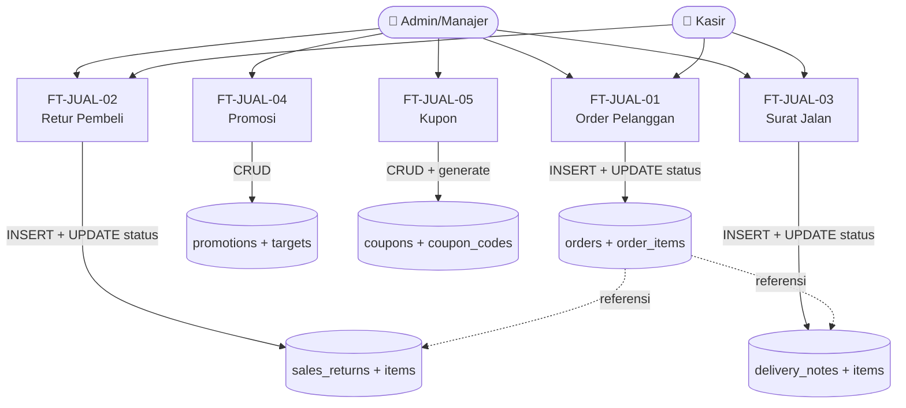
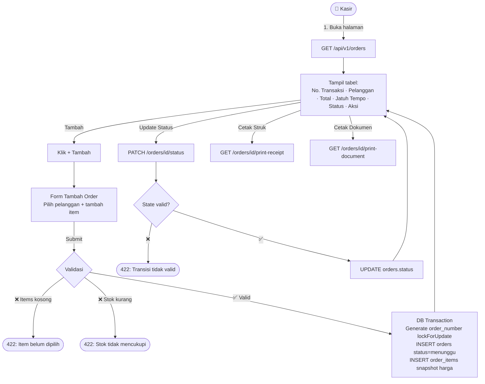
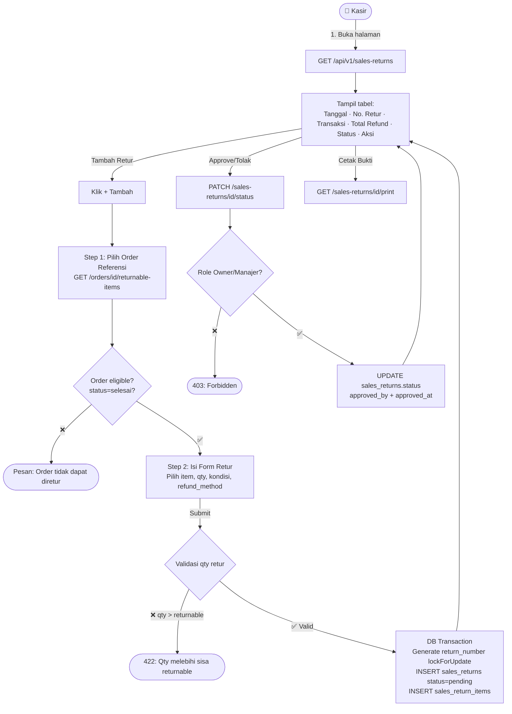
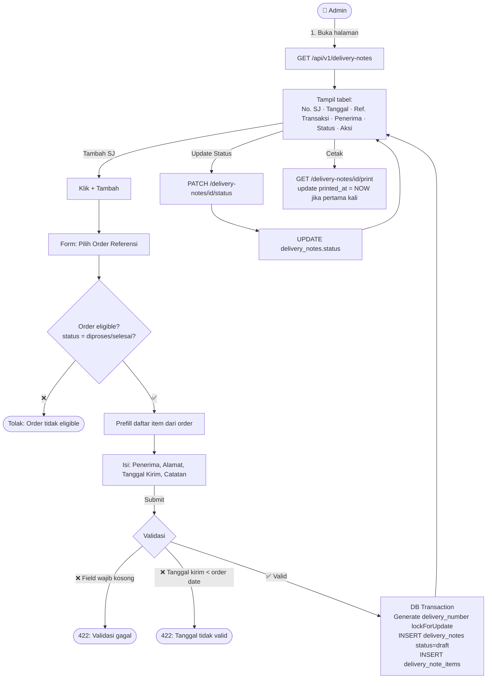
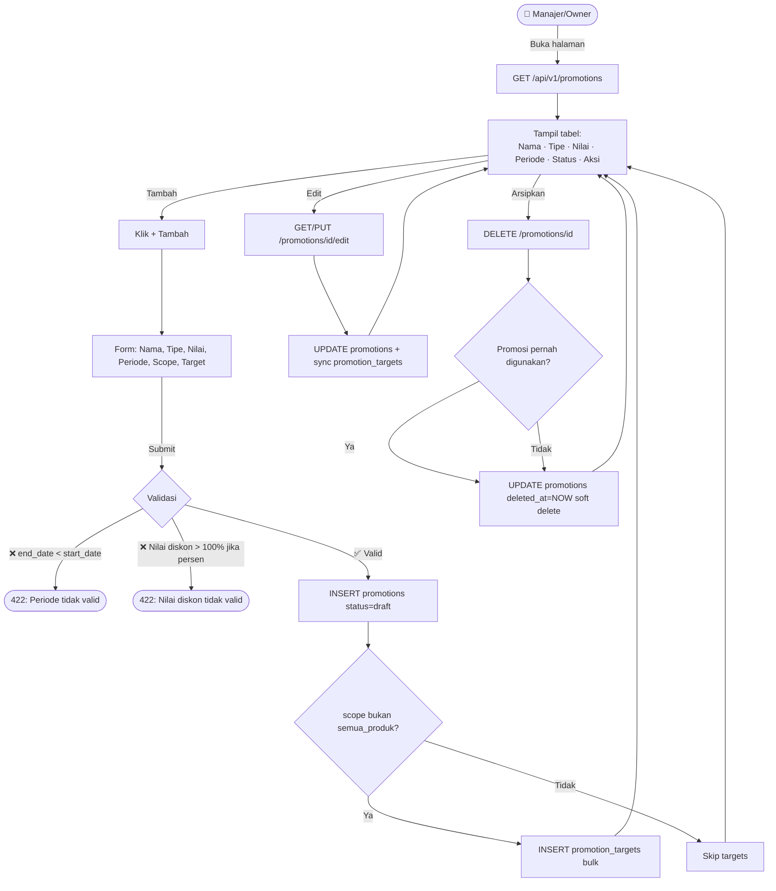
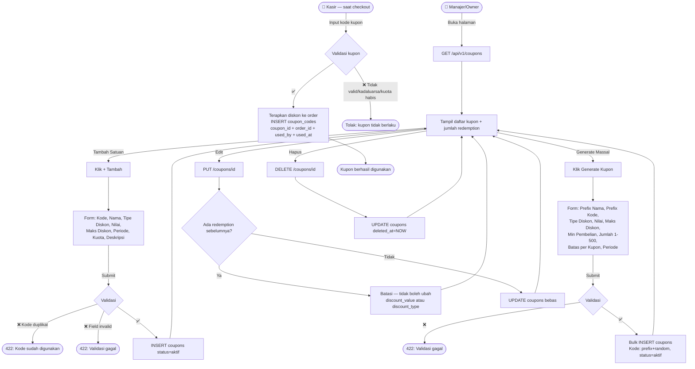

# Data Flow — Modul Jualan

<aside>
🔀

**Data Flow per Fitur — Modul Jualan**

Stack: Laravel 13 · MySQL · Single-Tenant

Setiap heading = satu fitur. Alur mencakup: Aktor → Request → Validasi → DB Operations → Response.

</aside>

---

## 🗺️ Gambaran Umum Alur Modul Jualan



> **Prinsip Utama:** FT-JUAL-01/02/03 menggunakan pola header + items dengan state machine (status). FT-JUAL-04/05 adalah master data CRUD. Semua nomor dokumen (ORD/RET/SJ) di-auto-generate dengan `lockForUpdate` untuk mencegah race condition.
> 

---

## FT-JUAL-01 — Order Pelanggan

<aside>
🛒

Kasir/Admin membuat order pelanggan dengan memilih pelanggan (opsional) dan menambahkan item produk. Pola **header + items** dengan state machine status: menunggu → diproses → selesai. Auto-generate nomor order. Mendukung cetak struk dan dokumen.

</aside>

### Aktor & Trigger

- **Aktor:** Kasir, Admin Backoffice, Manajer, Owner
- **Trigger:** Ada pesanan dari pelanggan → klik Tambah Order di halaman Order Pelanggan

### Alur Lengkap



### Detail Operasi Database

| Langkah | Aksi | Tabel | Operasi | Keterangan |
| --- | --- | --- | --- | --- |
| 1 | Tampil Daftar | `orders` | SELECT + JOIN | LEFT JOIN `customers` untuk nama · paginate · filter status & payment_status |
| 2a | Buat Order | `orders` | INSERT | `order_number`=ORD-YYYYMMDD-XXXX (lockForUpdate) · `status`=menunggu · `payment_status` dari input |
| 2b | Tambah Items | `order_items` | INSERT bulk | Snapshot `product_name`, `unit_price` · hitung `subtotal` per item |
| 2c | Hitung Total | `orders` | UPDATE | SET `total` = Σ subtotal item − discount_total + tax_total |
| 3 | Update Status | `orders` | UPDATE | Validasi state machine sebelum update · `updated_by`=auth user |
| 4 | Soft Delete | `orders` | UPDATE | `deleted_at`=NOW() · hanya dari status menunggu atau diproses |

### Validasi

- `items` wajib minimal 1 item (BR-01)
- `items.*.quantity` min: 0.001 · cek stok jika modul stok aktif
- `items.*.discount_value` tidak boleh membuat harga item negatif (BR-03)
- `due_date` opsional; jika diisi harus ≥ tanggal hari ini
- `customer_id` opsional; jika diisi harus ada di `customers` dan `deleted_at IS NULL`

### State Transition

```
[menunggu] ──(Proses)──► [diproses] ──(Selesai)──► [selesai] ✅ FINAL
[menunggu] ──(Batal)──► [dibatalkan]
[diproses] ──(Batal)──► [dibatalkan]
[selesai]  ──► immutable (tidak bisa berubah)
[dibatalkan] ──► immutable
```

---

## FT-JUAL-02 — Retur Pembeli

<aside>
↩️

Kasir/Admin mencatat pengembalian barang dari pelanggan atas transaksi order yang sudah selesai. Pola **2-step form** (pilih order → isi item retur) + **approval workflow** (pending → disetujui/ditolak oleh Owner/Manajer). Auto-generate nomor retur.

</aside>

### Aktor & Trigger

- **Aktor Buat Retur:** Kasir, Admin Backoffice, Manajer, Owner
- **Aktor Approve/Tolak:** Manajer, Owner (saja)
- **Trigger:** Pelanggan mengembalikan barang atas order yang sudah selesai

### Alur Lengkap



### Detail Operasi Database

| Langkah | Aksi | Tabel | Operasi | Keterangan |
| --- | --- | --- | --- | --- |
| 1 | Cek Returnable Items | `order_items`  • `sales_return_items` | SELECT | Hitung sisa qty returnable per item: qty_order − Σ qty_retur_sebelumnya (status ≠ ditolak/dibatalkan) |
| 2a | Buat Retur | `sales_returns` | INSERT | `return_number`=RET-YYYYMMDD-XXXX (lockForUpdate) · `status`=pending |
| 2b | Tambah Items Retur | `sales_return_items` | INSERT bulk | Snapshot `product_name`, `unit_price` dari order_item · `qty_returned` (qty dikembalikan) · `condition` per item (baik/rusak/cacat) |
| 3 | Approve/Tolak | `sales_returns` | UPDATE | `status`=disetujui/ditolak · `approved_by`=user_id · `approved_at`=NOW() |

### Validasi

- Retur hanya bisa dari order berstatus `selesai` (BR-01)
- `qty_returned` per item ≤ (qty_order − Σ qty_returned_sebelumnya) (BR-02)
- `total_refund` tidak boleh negatif (BR-03)
- Approval hanya bisa dilakukan oleh Owner atau Manajer

### State Transition

```
[pending] ──(Approve — Owner/Manajer)──► [disetujui] ✅ FINAL
[pending] ──(Tolak — Owner/Manajer)──► [ditolak] ✅ FINAL
[pending] ──(Batal)──► [dibatalkan] ✅ FINAL
Semua status FINAL bersifat immutable.
```

---

## FT-JUAL-03 — Surat Jalan

<aside>
🚚

Admin/Kasir membuat dokumen pengiriman (surat jalan) berdasarkan order yang sudah diproses/selesai. Pola **prefill dari order** + state machine pengiriman: draft → dikirim → terkirim. Mendukung cetak/unduh dokumen.

</aside>

### Aktor & Trigger

- **Aktor:** Kasir, Admin Backoffice, Manajer, Owner
- **Trigger:** Order siap dikirim → buat surat jalan dari order referensi

### Alur Lengkap



### Detail Operasi Database

| Langkah | Aksi | Tabel | Operasi | Keterangan |
| --- | --- | --- | --- | --- |
| 1 | Tampil Daftar | `delivery_notes` | SELECT + JOIN | LEFT JOIN `orders` untuk no. transaksi · filter status & pencarian |
| 2a | Buat Surat Jalan | `delivery_notes` | INSERT | `delivery_number`=SJ-YYYYMMDD-XXXX (lockForUpdate) · `status`=draft · `source_type`=transaksi_penjualan/order_pelanggan · `order_id` atau `customer_order_id` sesuai source |
| 2b | Tambah Items | `delivery_note_items` | INSERT bulk | Prefill dari `order_items` · snapshot `product_name`  • `quantity` |
| 3 | Update Status | `delivery_notes` | UPDATE | Validasi state machine · `updated_by`=auth user |
| 4 | Cetak | `delivery_notes` | UPDATE | `printed_at`=NOW() hanya jika `printed_at IS NULL` (pertama kali cetak) |

### Validasi

- `source_type` wajib diisi: `transaksi_penjualan` atau `order_pelanggan`
- Jika source=transaksi_penjualan: `order_id` required, harus berstatus `diproses`/`selesai` (BR-01)
- Jika source=order_pelanggan: `customer_order_id` required
- Satu surat jalan → satu referensi sumber (BR-02)
- `delivery_date` nullable; jika diisi harus ≥ tanggal sumber dibuat (BR-06)
- `recipient_name` dan `recipient_address` wajib diisi
- Item wajib berasal dari order referensi (BR-05)
- Surat jalan berstatus `dikirim`/`terkirim` tidak bisa diedit (BR-04)

### State Transition

```
[draft] ──(Kirim)──► [dikirim] ──(Konfirmasi Terima)──► [terkirim] ✅ FINAL
[draft] ──(Batal)──► [dibatalkan]
[dikirim] ──(Batal)──► [dibatalkan]
[terkirim] ──► immutable
```

---

## FT-JUAL-04 — Promosi

<aside>
🏷️

Owner/Manajer mendefinisikan aturan promosi yang diterapkan otomatis pada transaksi penjualan. Pola **CRUD langsung** pada `promotions` + `promotion_targets`. Promosi aktif ditentukan oleh periode berlaku dan status.

</aside>

### Aktor & Trigger

- **Aktor:** Owner, Manajer (Kasir tidak bisa akses)
- **Trigger:** Ada strategi penjualan baru → buat promosi di menu Jualan → Promosi

### Alur Lengkap



### Detail Operasi Database

| Langkah | Aksi | Tabel | Operasi | Keterangan |
| --- | --- | --- | --- | --- |
| 1 | Tampil Daftar | `promotions` | SELECT | WHERE `deleted_at IS NULL` · filter status · cek apakah sudah aktif/berakhir berdasarkan tanggal |
| 2a | Tambah Promosi | `promotions` | INSERT | `status`=draft · periode, scope, is_stackable, priority |
| 2b | Tambah Target (jika ada) | `promotion_targets` | INSERT bulk | Polymorphic: target_type (produk/kategori/brand/grup_pelanggan) + target_id |
| 3 | Edit Promosi | `promotions`  • `promotion_targets` | UPDATE + sync | DELETE lama targets → INSERT baru (sync targets) |
| 4 | Arsipkan | `promotions` | UPDATE | `deleted_at`=NOW() · soft delete · tidak ada hard delete |

### Validasi

- `end_date` ≥ `start_date` (BR-01)
- `type`: required, in:diskon_persen,potongan_tetap
- `discount_value` ≥ 0; jika tipe=diskon_persen maka ≤ 100
- `max_discount`: nullable — cap maksimal potongan (berlaku jika type=diskon_persen)
- Jika `scope` bukan `semua_produk`, maka `targets` wajib minimal 1
- Promosi yang sudah diterapkan pada transaksi tidak bisa diubah nilainya secara retroaktif (BR-02 — TBD)

### State Transition

```
[draft] ──(Aktifkan / start_date tercapai)──► [aktif]
[aktif] ──(end_date terlampaui)──► [berakhir] (otomatis)
[aktif/draft/berakhir] ──(Arsipkan)──► [diarsipkan]

Penetapan status aktif bisa manual (Owner aktifkan) atau otomatis berdasarkan tanggal.
```

---

## FT-JUAL-05 — Kupon

<aside>
🎫

Owner/Manajer membuat kupon satu per satu (isi `code` langsung) atau massal via **Generate Kupon** (bulk INSERT dengan prefix kode, maks 500 per sekali generate). Setiap pemakaian kupon dicatat sebagai redemption log di `coupon_codes`. Pola **CRUD + Generate Massal + redemption log**.

</aside>

### Aktor & Trigger

- **Aktor:** Owner, Manajer
- **Trigger kupon satuan:** buat kupon → isi kode langsung → bagikan ke pelanggan
- **Trigger kampanye massal:** klik Generate Kupon → isi prefix + jumlah → sistem generate bulk → bagikan kode

### Alur Lengkap



### Detail Operasi Database

| Langkah | Aksi | Tabel | Operasi | Keterangan |
| --- | --- | --- | --- | --- |
| 1 | Tampil Daftar | `coupons` | SELECT | WHERE `deleted_at IS NULL` · COUNT coupon_codes per coupon untuk info jumlah redemption |
| 2 | Buat Kupon (satuan) | `coupons` | INSERT | `code`=kode unik input user · `status`=aktif · definisi diskon, periode, kuota |
| 2b | Generate Kupon (massal) | `coupons` | INSERT bulk | Loop `quantity` kali: generate kode unik `{code_prefix}{random_chars}` · bulk INSERT coupons (masing-masing status=aktif, setting diskon sama) · maks 500 per request |
| 3 | Redemption Kupon (saat checkout) | `coupon_codes` | INSERT | Dilakukan oleh order flow (FT-JUAL-01): INSERT coupon_codes (`coupon_id`, `order_id`, `used_by`, `used_at`) — setiap pemakaian = satu baris, immutable |

### Validasi

**Kupon satuan (POST /coupons):**

- `code`: required, unique — tidak boleh sama dengan kode kupon lain
- `discount_type`: required, in:persentase,nominal
- `discount_value` ≥ 0; jika tipe=persentase maka ≤ 100
- `end_date` ≥ `start_date`

**Generate massal (POST /coupons/generate):**

- `name_prefix` & `code_prefix`: required
- `quantity`: required, integer, min:1, max:500
- Setting diskon sama dengan kupon satuan

**Semua kupon:**

- Kupon yang sudah pernah digunakan (ada baris di `coupon_codes`) tidak boleh diubah `discount_value` atau `discount_type`-nya
- Jika `total_quota` diisi dan COUNT(coupon_codes) ≥ kuota, kupon otomatis tidak bisa dipakai

### State Transition

```
[Kupon (coupons)]
  aktif → nonaktif (toggle manual oleh Owner/Manajer)
  aktif → berakhir (otomatis saat end_date terlampaui)

[Redemption (coupon_codes)]
  Setiap pemakaian kupon = satu baris INSERT (immutable).
  Tidak ada UPDATE atau DELETE pada coupon_codes.
```

---

## 📊 Perbandingan Alur Antar Fitur

| Aspek | FT-01 Order | FT-02 Retur | FT-03 Surat Jalan | FT-04 Promosi | FT-05 Kupon |
| --- | --- | --- | --- | --- | --- |
| **Pola** | Header + Items | Header + Items | Header + Items (prefill) | CRUD Langsung | CRUD + Generate |
| **Auto-Number** | ORD-YYYYMMDD | RET-YYYYMMDD | SJ-YYYYMMDD | ❌ | Kode input user / `{prefix}+random` (generate massal) |
| **Approval** | ❌ | ✅ Owner/Manajer | ❌ | ❌ | ❌ |
| **State Machine** | 4 status | 4 status | 4 status | 4 status | Aktif/Nonaktif/Berakhir |
| **DB Transaction** | ✅ header + items | ✅ header + items | ✅ header + items | ✅ sync targets | ✅ bulk insert codes |
| **Soft Delete** | ✅ | ❌ (final status) | ❌ (final status) | ✅ (arsip) | ✅ |
| **Akses Kasir** | ✅ Full | ✅ Buat saja | ✅ Buat saja | ❌ | ❌ |
| **Snapshot Harga** | ✅ unit_price | ✅ dari order_item | ✅ product_name | ❌ | ❌ |
| **Referensi FK** | customers, products | orders, order_items | orders, order_items | products, categories | customers, orders |
| **Print/Cetak** | ✅ Struk + Dokumen | ✅ Bukti Retur | ✅ Surat Jalan | ❌ | ❌ |

---

## ⚙️ Mekanisme Shared — DB Transaction & Auto-Number

<aside>
⚠️

Semua operasi INSERT header + items (Order, Retur, Surat Jalan) **wajib** dijalankan dalam satu DB Transaction. Gunakan `lockForUpdate` untuk auto-generate nomor dokumen agar tidak terjadi race condition.

</aside>

```php
// Pola umum untuk semua header + items (Order / Retur / Surat Jalan)
DB::transaction(function () use ($data, $userId, $storeId) {

    // 1. Generate nomor dokumen dengan lock
    $lastDoc = Order::where('store_id', $storeId)
        ->lockForUpdate()
        ->orderByDesc('id')
        ->value('order_number');

    $nextSeq     = $lastDoc ? (intval(substr($lastDoc, -4)) + 1) : 1;
    $docNumber   = 'ORD-' . now()->format('Ymd') . '-' . str_pad($nextSeq, 4, '0', STR_PAD_LEFT);

    // 2. INSERT header
    $order = Order::create([
        'order_number' => $docNumber,
        'store_id'     => $storeId,
        'customer_id'  => $data['customer_id'] ?? null,
        'status'       => 'menunggu',
        'payment_status' => $data['payment_status'],
        'created_by'   => $userId,
    ]);

    // 3. INSERT items (snapshot harga)
    $subtotal = 0;
    foreach ($data['items'] as $item) {
        $product  = Product::findOrFail($item['product_id']);
        $itemSubtotal = ($product->price * $item['quantity']) - ($item['discount_value'] ?? 0);
        $order->items()->create([
            'product_id'    => $product->id,
            'product_name'  => $product->name,   // snapshot
            'unit_price'    => $product->price,   // snapshot
            'quantity'      => $item['quantity'],
            'discount_value'=> $item['discount_value'] ?? 0,
            'subtotal'      => $itemSubtotal,
        ]);
        $subtotal += $itemSubtotal;
    }

    // 4. Update total header
    $order->update(['subtotal' => $subtotal, 'total' => $subtotal]);

    return $order;
});
```