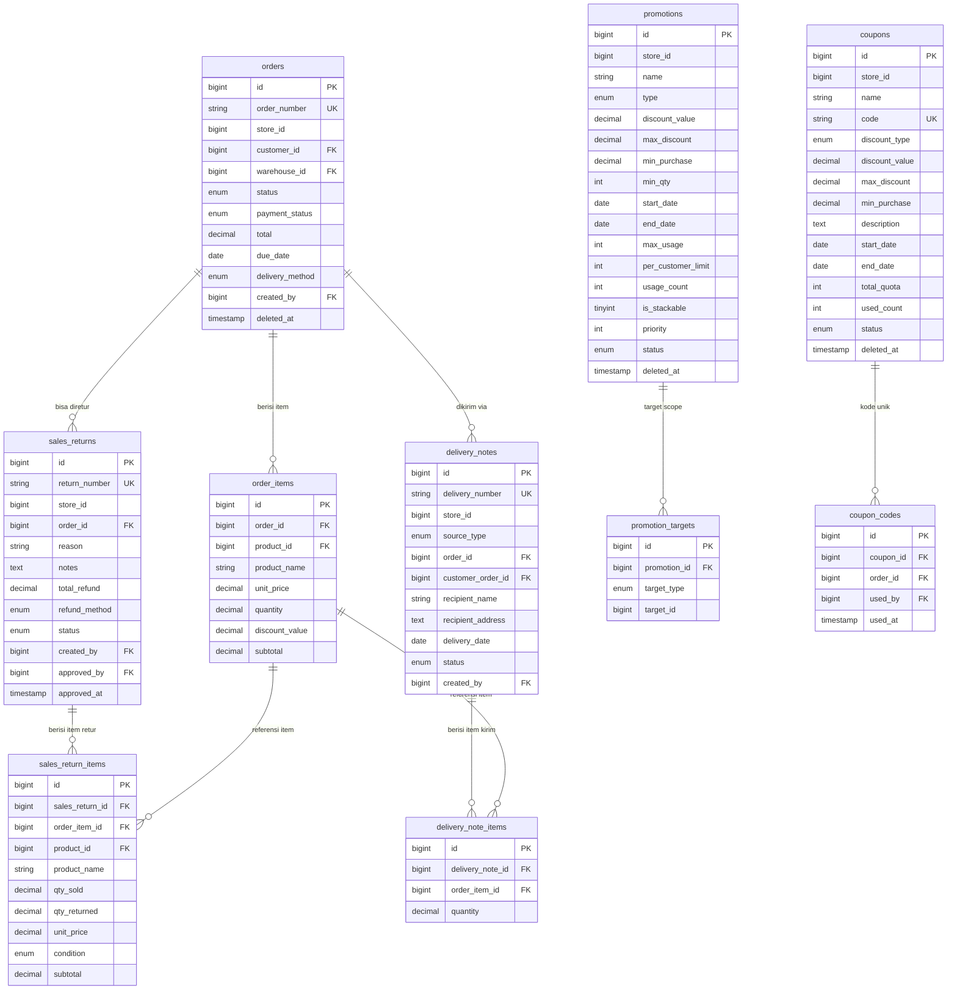

# Desain Database — Modul Jualan

<aside>
🗄️

**Desain Database — Modul Jualan (MOD-JUAL)**

Stack: MySQL 8 · Laravel 13 · Single-Tenant (store_id di setiap tabel)

Modul ini memiliki 10 tabel utama yang mencakup 5 fitur: Order, Retur, Surat Jalan, Promosi, Kupon.

</aside>

---

## Urutan Pembuatan Migration (FK Dependency)

<aside>
⚠️

**Wajib dibuat berurutan!** Tabel induk harus ada sebelum tabel yang mereferensikannya.

1. `orders` → 2. `order_items` → 3. `sales_returns` → 4. `sales_return_items` → 5. `delivery_notes` → 6. `delivery_note_items` → 7. `promotions` → 8. `promotion_targets` → 9. `coupons` → 10. `coupon_codes`

Dependensi eksternal: `customers` (MOD-PEL) · `products` (MOD-PRODUK) · `users` (MOD-AUTH)

</aside>

---

## ERD Modul Jualan



---

## 1. Tabel `orders`

**Deskripsi:** Master data order/transaksi penjualan pelanggan.

| Field | Tipe | Nullable | Default | Keterangan |
| --- | --- | --- | --- | --- |
| id | BIGINT UNSIGNED | NOT NULL | AUTO_INCREMENT | Primary Key |
| order_number | VARCHAR(30) | NOT NULL |  | UNIQUE · Format: ORD-YYYYMMDD-XXXX · auto-generate |
| store_id | BIGINT UNSIGNED | NOT NULL |  | FK → [stores.id](http://stores.id) · multi-tenant identifier |
| customer_id | BIGINT UNSIGNED | ✅ | NULL | FK → [customers.id](http://customers.id) SET NULL · NULL = transaksi tanpa pelanggan |
| warehouse_id | BIGINT UNSIGNED | NOT NULL |  | FK → warehouses.id RESTRICT · gudang asal barang — wajib dipilih saat buat order |
| status | ENUM | NOT NULL | menunggu | menunggu / diproses / selesai / dibatalkan |
| payment_status | ENUM | NOT NULL | belum_bayar | belum_bayar / lunas / parsial |
| subtotal | DECIMAL(15,2) | NOT NULL | 0.00 | Total sebelum diskon + pajak |
| discount_total | DECIMAL(15,2) | NOT NULL | 0.00 | Total diskon dari promosi/kupon |
| tax_total | DECIMAL(15,2) | NOT NULL | 0.00 | Total pajak (jika diaktifkan) |
| total | DECIMAL(15,2) | NOT NULL | 0.00 | Grand total = subtotal − discount_total + tax_total |
| due_date | DATE | ✅ | NULL | Jatuh tempo pembayaran · NULL = tidak ada jatuh tempo |
| delivery_method | ENUM | NOT NULL |  | Metode pengambilan pesanan: `ambil_ditempat` / `pengiriman` — wajib diisi |
| notes | TEXT | ✅ | NULL | Catatan order |
| created_by | BIGINT UNSIGNED | ✅ | NULL | FK → [users.id](http://users.id) SET NULL |
| updated_by | BIGINT UNSIGNED | ✅ | NULL | FK → [users.id](http://users.id) SET NULL |
| deleted_at | TIMESTAMP | ✅ | NULL | Soft delete · NULL = aktif |
| created_at | TIMESTAMP | ✅ | NULL |  |
| updated_at | TIMESTAMP | ✅ | NULL |  |

**Constraint & Index:**

- `UNIQUE(order_number)`
- FK `customer_id` → `customers.id` ON DELETE SET NULL
- FK `warehouse_id` → `warehouses.id` ON DELETE RESTRICT
- FK `created_by`, `updated_by` → `users.id` ON DELETE SET NULL
- Index: `store_id`, `customer_id`, `warehouse_id`, `status`, `payment_status`, `delivery_method`, `created_at`, `deleted_at`

---

## 2. Tabel `order_items`

**Deskripsi:** Item/produk dalam setiap order. Harga di-snapshot saat order dibuat.

| Field | Tipe | Nullable | Default | Keterangan |
| --- | --- | --- | --- | --- |
| id | BIGINT UNSIGNED | NOT NULL | AUTO_INCREMENT | Primary Key |
| order_id | BIGINT UNSIGNED | NOT NULL |  | FK → [orders.id](http://orders.id) ON DELETE CASCADE |
| product_id | BIGINT UNSIGNED | ✅ | NULL | FK → [products.id](http://products.id) SET NULL · NULL jika produk dihapus |
| product_name | VARCHAR(255) | NOT NULL |  | **Snapshot** nama produk saat order dibuat |
| product_code | VARCHAR(50) | ✅ | NULL | **Snapshot** kode produk saat order dibuat |
| unit_price | DECIMAL(15,2) | NOT NULL |  | **Snapshot** harga satuan saat order dibuat |
| quantity | DECIMAL(10,3) | NOT NULL |  | Jumlah item yang dipesan · min: 0.001 |
| discount_value | DECIMAL(10,2) | NOT NULL | 0.00 | Diskon per item (nominal) |
| subtotal | DECIMAL(15,2) | NOT NULL |  | = (unit_price × quantity) − discount_value |
| created_at | TIMESTAMP | ✅ | NULL |  |
| updated_at | TIMESTAMP | ✅ | NULL |  |

**Constraint & Index:**

- FK `order_id` → `orders.id` ON DELETE CASCADE
- FK `product_id` → `products.id` ON DELETE SET NULL
- Index: `order_id`, `product_id`

---

## 3. Tabel `sales_returns`

**Deskripsi:** Header dokumen retur penjualan dari pelanggan.

| Field | Tipe | Nullable | Default | Keterangan |
| --- | --- | --- | --- | --- |
| id | BIGINT UNSIGNED | NOT NULL | AUTO_INCREMENT | Primary Key |
| return_number | VARCHAR(30) | NOT NULL |  | UNIQUE · Format: RET-YYYYMMDD-XXXX · auto-generate |
| store_id | BIGINT UNSIGNED | NOT NULL |  | FK → [stores.id](http://stores.id) |
| order_id | BIGINT UNSIGNED | NOT NULL |  | FK → [orders.id](http://orders.id) · transaksi referensi retur |
| total_refund | DECIMAL(15,2) | NOT NULL | 0.00 | Total nilai refund |
| refund_method | ENUM | NOT NULL |  | **tunai / saldo_toko / tukar_barang** (sesuai UI Metode Refund) |
| status | ENUM | NOT NULL | pending | pending / disetujui / ditolak / dibatalkan |
| reason | TEXT | NOT NULL |  | Alasan retur · **wajib diisi** (field "Alasan retur *") |
| notes | TEXT | ✅ | NULL | Catatan tambahan |
| approved_by | BIGINT UNSIGNED | ✅ | NULL | FK → [users.id](http://users.id) SET NULL · user yang menyetujui/menolak |
| approved_at | TIMESTAMP | ✅ | NULL | Waktu persetujuan/penolakan |
| created_by | BIGINT UNSIGNED | ✅ | NULL | FK → [users.id](http://users.id) SET NULL |
| updated_by | BIGINT UNSIGNED | ✅ | NULL | FK → [users.id](http://users.id) SET NULL |
| created_at | TIMESTAMP | ✅ | NULL |  |
| updated_at | TIMESTAMP | ✅ | NULL |  |

**Constraint & Index:**

- `UNIQUE(return_number)`
- FK `order_id` → `orders.id` RESTRICT (tidak boleh hapus order yang punya retur)
- FK `approved_by`, `created_by`, `updated_by` → `users.id` ON DELETE SET NULL
- Index: `store_id`, `order_id`, `status`, `created_at`

---

## 4. Tabel `sales_return_items`

**Deskripsi:** Item produk yang dikembalikan dalam satu dokumen retur.

| Field | Tipe | Nullable | Default | Keterangan |
| --- | --- | --- | --- | --- |
| id | BIGINT UNSIGNED | NOT NULL | AUTO_INCREMENT | Primary Key |
| sales_return_id | BIGINT UNSIGNED | NOT NULL |  | FK → sales_[returns.id](http://returns.id) ON DELETE CASCADE |
| order_item_id | BIGINT UNSIGNED | ✅ | NULL | FK → order_[items.id](http://items.id) SET NULL · referensi item original |
| product_id | BIGINT UNSIGNED | ✅ | NULL | FK → [products.id](http://products.id) SET NULL |
| product_name | VARCHAR(255) | NOT NULL |  | **Snapshot** nama produk |
| qty_sold | DECIMAL(10,3) | NOT NULL |  | Qty terjual dari transaksi asal (label "Terjual: N") · read-only referensi |
| qty_returned | DECIMAL(10,3) | NOT NULL |  | Qty yang dikembalikan (input "Qty Retur") · ≤ sisa returnable dari order_item |
| unit_price | DECIMAL(15,2) | NOT NULL |  | **Snapshot** harga satuan dari order_item |
| condition | ENUM | NOT NULL | baik | **baik / rusak / kadaluarsa**  default: baik) |
| subtotal | DECIMAL(15,2) | NOT NULL |  | = unit_price × quantity |
| created_at | TIMESTAMP | ✅ | NULL |  |

---

## 5. Tabel `delivery_notes`

**Deskripsi:** Header surat jalan / dokumen pengiriman barang.

| Field | Tipe | Nullable | Default | Keterangan |
| --- | --- | --- | --- | --- |
| id | BIGINT UNSIGNED | NOT NULL | AUTO_INCREMENT | Primary Key |
| delivery_number | VARCHAR(30) | NOT NULL |  | UNIQUE · Format: SJ-YYYYMMDD-XXXX · auto-generate |
| store_id | BIGINT UNSIGNED | NOT NULL |  | FK → [stores.id](http://stores.id) |
| source_type | ENUM | NOT NULL |  | **transaksi_penjualan / order_pelanggan** · tab "Sumber Pengiriman" di form Buat Surat Jalan |
| order_id | BIGINT UNSIGNED | ✅ | NULL | FK → orders.id RESTRICT · diisi jika source_type = transaksi_penjualan (format TRX-) |
| customer_order_id | BIGINT UNSIGNED | ✅ | NULL | FK → customer_orders.id RESTRICT · diisi jika source_type = order_pelanggan (format PO-) |
| recipient_name | VARCHAR(255) | NOT NULL |  | Nama penerima barang (field "Nama Penerima" di form) |
| recipient_address | TEXT | NOT NULL |  | Alamat pengiriman (field "Alamat Pengiriman" di form) |
| delivery_date | DATE | ✅ | NULL | Tanggal pengiriman · auto-set ke hari ini saat dibuat · ≥ tanggal transaksi referensi |
| status | ENUM | NOT NULL | draft | draft / dikirim / terkirim / dibatalkan |
| notes | TEXT | ✅ | NULL | Catatan pengiriman (field "Catatan" di form) |
| printed_at | TIMESTAMP | ✅ | NULL | Waktu pertama kali dicetak |
| created_by | BIGINT UNSIGNED | ✅ | NULL | FK → [users.id](http://users.id) SET NULL |
| updated_by | BIGINT UNSIGNED | ✅ | NULL | FK → [users.id](http://users.id) SET NULL |
| created_at | TIMESTAMP | ✅ | NULL |  |
| updated_at | TIMESTAMP | ✅ | NULL |  |

**Constraint & Index:**

- `UNIQUE(delivery_number)`
- FK `order_id` → `orders.id` RESTRICT · hanya aktif jika source_type = transaksi_penjualan
- FK `customer_order_id` → `customer_orders.id` RESTRICT · hanya aktif jika source_type = order_pelanggan
- CHECK: tepat salah satu dari `order_id` / `customer_order_id` harus terisi sesuai `source_type`
- Index: `store_id`, `source_type`, `order_id`, `customer_order_id`, `status`, `created_at`

---

## 6. Tabel `delivery_note_items`

**Deskripsi:** Item produk yang dikirimkan dalam satu surat jalan. Referensi item bergantung pada source_type header-nya.

| Field | Tipe | Nullable | Default | Keterangan |
| --- | --- | --- | --- | --- |
| id | BIGINT UNSIGNED | NOT NULL | AUTO_INCREMENT | Primary Key |
| delivery_note_id | BIGINT UNSIGNED | NOT NULL |  | FK → delivery_[notes.id](http://notes.id) ON DELETE CASCADE |
| order_item_id | BIGINT UNSIGNED | ✅ | NULL | FK → order_items.id SET NULL · diisi jika source_type = transaksi_penjualan |
| product_id | BIGINT UNSIGNED | ✅ | NULL | FK → [products.id](http://products.id) SET NULL |
| product_name | VARCHAR(255) | NOT NULL |  | **Snapshot** nama produk |
| quantity | DECIMAL(10,3) | NOT NULL |  | Qty yang dikirim · ≤ sisa qty yang belum dikirim dari item referensi |
| created_at | TIMESTAMP | ✅ | NULL |  |

---

## 7. Tabel `promotions`

**Deskripsi:** Definisi aturan promosi yang diterapkan pada transaksi penjualan.

| Field | Tipe | Nullable | Default | Keterangan |
| --- | --- | --- | --- | --- |
| id | BIGINT UNSIGNED | NOT NULL | AUTO_INCREMENT | Primary Key |
| store_id | BIGINT UNSIGNED | NOT NULL |  | FK → [stores.id](http://stores.id) |
| name | VARCHAR(255) | NOT NULL |  | Nama promosi |
| description | TEXT | ✅ | NULL | Deskripsi promosi |
| type | ENUM | NOT NULL |  | **diskon_persen / potongan_tetap** ("Tipe reward": "Diskon %" / "Potongan tetap (Rp)") |
| discount_value | DECIMAL(10,2) | NOT NULL | 0.00 | Nilai diskon · persen (0–100) untuk diskon_persen · nominal (Rp) untuk potongan_tetap |
| max_discount | DECIMAL(15,2) | ✅ | NULL | Batas maksimal nilai diskon untuk tipe diskon_persen (field "Maks. diskon (opsional)") · NULL = tidak ada batas |
| min_purchase | DECIMAL(15,2) | ✅ | NULL | Syarat "Min. nominal belanja" · NULL = tidak ada syarat minimum belanja |
| min_qty | INT UNSIGNED | ✅ | NULL | Syarat "Min. jumlah item" · NULL = tidak ada syarat minimum qty item |
| start_date | DATE | NOT NULL |  | Jadwal "Mulai" · tanggal promosi mulai berlaku |
| end_date | DATE | NOT NULL |  | Jadwal "Selesai" · tanggal promosi berakhir · ≥ start_date |
| scope | ENUM | NOT NULL | semua_produk | semua_produk / per_produk / per_kategori / per_brand / per_grup_pelanggan |
| max_usage | INT UNSIGNED | ✅ | NULL | "Batas penggunaan total (kosong = unlimited)" · NULL = tidak terbatas |
| per_customer_limit | INT UNSIGNED | ✅ | NULL | "Batas per pelanggan (kosong = unlimited)" · NULL = tidak terbatas |
| usage_count | INT UNSIGNED | NOT NULL | 0 | Counter pemakaian aktual |
| is_stackable | TINYINT(1) | NOT NULL | 0 | Toggle "Bisa digabung dengan promosi lain" · 0 = tidak bisa · 1 = bisa |
| priority | INT | NOT NULL | 0 | "Urutan prioritas (0 = terendah)" · makin tinggi angka makin diprioritaskan saat tumpang tindih |
| status | ENUM | NOT NULL | aktif | aktif / nonaktif / berakhir / diarsipkan · toggle "Aktif" → aktif/nonaktif · berakhir di-set otomatis saat end_date terlewat |
| created_by | BIGINT UNSIGNED | ✅ | NULL | FK → [users.id](http://users.id) SET NULL |
| updated_by | BIGINT UNSIGNED | ✅ | NULL | FK → [users.id](http://users.id) SET NULL |
| deleted_at | TIMESTAMP | ✅ | NULL | Soft delete (arsip) |
| created_at | TIMESTAMP | ✅ | NULL |  |
| updated_at | TIMESTAMP | ✅ | NULL |  |

**Constraint & Index:**

- Index: `store_id`, `status`, `start_date`, `end_date`, `deleted_at`
- CHECK: `end_date >= start_date`
- Promosi dianggap aktif: `status = aktif` AND `start_date <= CURDATE() <= end_date`

---

## 8. Tabel `promotion_targets`

**Deskripsi:** Target scope promosi (produk / kategori / brand / grup pelanggan tertentu).

| Field | Tipe | Nullable | Default | Keterangan |
| --- | --- | --- | --- | --- |
| id | BIGINT UNSIGNED | NOT NULL | AUTO_INCREMENT | Primary Key |
| promotion_id | BIGINT UNSIGNED | NOT NULL |  | FK → [promotions.id](http://promotions.id) ON DELETE CASCADE |
| target_type | ENUM | NOT NULL |  | **produk / kategori / brand / grup_pelanggan** (Syarat: "Produk tertentu" / "Kategori tertentu" / "Grup pelanggan") |
| target_id | BIGINT UNSIGNED | NOT NULL |  | ID referensi sesuai `target_type` (polymorphic) |
| created_at | TIMESTAMP | ✅ | NULL |  |

**Catatan:** `UNIQUE(promotion_id, target_type, target_id)` untuk mencegah duplikasi target.

---

## 9. Tabel `coupons`

**Deskripsi:** Definisi / template kupon diskon yang bisa digenerate kode uniknya.

| Field | Tipe | Nullable | Default | Keterangan |
| --- | --- | --- | --- | --- |
| id | BIGINT UNSIGNED | NOT NULL | AUTO_INCREMENT | Primary Key |
| store_id | BIGINT UNSIGNED | NOT NULL |  | FK → [stores.id](http://stores.id) |
| name | VARCHAR(255) | ✅ | NULL | Nama kupon (opsional di form) · NULL jika tidak diisi |
| code | VARCHAR(50) | NOT NULL |  | UNIQUE · **kode kupon** (field "Kode kupon *") · diinput langsung oleh user |
| discount_type | ENUM | NOT NULL |  | **persentase / nominal** ("Jenis diskon": "Persentase (%)" / "Nominal (Rp)") |
| discount_value | DECIMAL(10,2) | NOT NULL |  | "Besar diskon" · persen (0–100) untuk persentase · nominal (Rp) untuk nominal |
| max_discount | DECIMAL(15,2) | ✅ | NULL | "Diskon maksimal (Rp, kosong = unlimited)" · batas atas diskon untuk tipe persentase · NULL = tidak ada batas |
| min_purchase | DECIMAL(15,2) | ✅ | NULL | "Minimum pembelian (Rp, kosong = tanpa syarat)" · NULL = tidak ada syarat minimum belanja |
| description | TEXT | ✅ | NULL | Deskripsi kupon (field "Deskripsi") |
| start_date | DATE | NOT NULL |  | Jadwal "Mulai" · tanggal kupon mulai berlaku |
| end_date | DATE | NOT NULL |  | Jadwal "Selesai" · tanggal kupon berakhir · ≥ start_date |
| total_quota | INT UNSIGNED | ✅ | NULL | "Batas penggunaan (kosong = unlimited)" · total berapa kali kupon bisa dipakai · NULL = tidak terbatas |
| used_count | INT UNSIGNED | NOT NULL | 0 | Counter kode yang sudah dipakai |
| per_customer_limit | INT UNSIGNED | NOT NULL | 1 | Berapa kali satu customer boleh memakai kupon dari set ini |
| status | ENUM | NOT NULL | aktif | aktif / nonaktif / berakhir |
| created_by | BIGINT UNSIGNED | ✅ | NULL | FK → [users.id](http://users.id) SET NULL |
| updated_by | BIGINT UNSIGNED | ✅ | NULL | FK → [users.id](http://users.id) SET NULL |
| deleted_at | TIMESTAMP | ✅ | NULL | Soft delete |
| created_at | TIMESTAMP | ✅ | NULL |  |
| updated_at | TIMESTAMP | ✅ | NULL |  |

---

## 10. Tabel `coupon_codes`

**Deskripsi:** Log pemakaian kupon. Setiap baris merekam satu transaksi yang menggunakan kupon. (Kode kupon kini disimpan langsung di tabel `coupons`.)

| Field | Tipe | Nullable | Default | Keterangan |
| --- | --- | --- | --- | --- |
| id | BIGINT UNSIGNED | NOT NULL | AUTO_INCREMENT | Primary Key |
| coupon_id | BIGINT UNSIGNED | NOT NULL |  | FK → [coupons.id](http://coupons.id) ON DELETE CASCADE |
| used_by | BIGINT UNSIGNED | ✅ | NULL | FK → customers.id SET NULL · customer yang menggunakan kupon ini |
| used_at | TIMESTAMP | ✅ | NULL | Waktu pemakaian |
| order_id | BIGINT UNSIGNED | ✅ | NULL | FK → [orders.id](http://orders.id) SET NULL · dipakai di order mana |
| created_at | TIMESTAMP | ✅ | NULL |  |

**Constraint & Index:**

- FK `coupon_id` → `coupons.id` ON DELETE CASCADE
- FK `order_id` → `orders.id` ON DELETE SET NULL
- FK `used_by` → `customers.id` ON DELETE SET NULL
- `UNIQUE(coupon_id, order_id)` — satu order hanya bisa menggunakan kupon yang sama satu kali
- Index: `coupon_id`, `order_id`

---

## Ringkasan Semua Tabel

| No | Tabel | Fitur | Operasi Utama | Pola |
| --- | --- | --- | --- | --- |
| 1 | `orders` | FT-JUAL-01 | INSERT + UPDATE status | SoftDeletes · auto-number |
| 2 | `order_items` | FT-JUAL-01 | INSERT bulk (cascade) | Snapshot harga |
| 3 | `sales_returns` | FT-JUAL-02 | INSERT + UPDATE status (approve/reject) | auto-number · audit trail |
| 4 | `sales_return_items` | FT-JUAL-02 | INSERT bulk (cascade) | Snapshot harga · qty check |
| 5 | `delivery_notes` | FT-JUAL-03 | INSERT + UPDATE status | auto-number · printed_at |
| 6 | `delivery_note_items` | FT-JUAL-03 | INSERT bulk (cascade) | Snapshot nama produk |
| 7 | `promotions` | FT-JUAL-04 | CRUD + SoftDeletes | Period-based · scope ENUM |
| 8 | `promotion_targets` | FT-JUAL-04 | INSERT/DELETE bulk | Polymorphic target |
| 9 | `coupons` | FT-JUAL-05 | CRUD + SoftDeletes | Template + quota |
| 10 | `coupon_codes` | FT-JUAL-05 | INSERT saat kupon dipakai di order | Log redemption · immutable setelah dibuat |

<aside>
🔗

**Dependensi Eksternal (tabel dari modul lain yang direferensikan):**

`customers` (MOD-PEL) · `products` (MOD-PRODUK) · `warehouses` (MOD-GUDANG) · `categories` · `brands` · `stores` · `users` (MOD-AUTH)

Koordinasikan dengan tim modul terkait untuk memastikan FK dan index yang dibutuhkan sudah tersedia.

</aside>

cek apakah database table \database\migrations\2026_08_13_000001_create_promotions_table.php
<?php

use Illuminate\Database\Migrations\Migration;
use Illuminate\Database\Schema\Blueprint;
use Illuminate\Support\Facades\Schema;

return new class extends Migration
{
public function up(): void
{
Schema::create('promotions', function (Blueprint $table) {
$table->id();
$table->foreignId('store_id')->constrained('stores')->cascadeOnDelete();
$table->string('name');
$table->text('description')->nullable();
$table->enum('type', ['diskon_persen', 'potongan_tetap']);
$table->decimal('discount_value', 10, 2)->default(0);
$table->decimal('max_discount', 15, 2)->nullable();
$table->decimal('min_purchase', 15, 2)->nullable();
$table->unsignedInteger('min_qty')->nullable();
$table->date('start_date');
$table->date('end_date');
$table->enum('scope', ['semua_produk', 'per_produk', 'per_kategori', 'per_brand', 'per_grup_pelanggan']);
$table->unsignedInteger('max_usage')->nullable();
$table->unsignedInteger('per_customer_limit')->nullable();
$table->unsignedInteger('usage_count')->default(0);
$table->boolean('is_stackable')->default(false);
$table->unsignedInteger('priority')->default(0);
$table->enum('status', ['draft', 'aktif', 'nonaktif', 'berakhir', 'diarsipkan'])->default('draft');
$table->foreignId('created_by')->nullable()->constrained('users')->nullOnDelete();
$table->foreignId('updated_by')->nullable()->constrained('users')->nullOnDelete();
$table->softDeletes();
$table->timestamps();

```
        $table->index('store_id');
        $table->index('status');
        $table->index('start_date');
        $table->index('end_date');
        $table->index('deleted_at');
    });
}

public function down(): void
{
    Schema::dropIfExists('promotions');
}
```

};
sudah sesuai deengan database design di modul dan yang telah kita sepakati