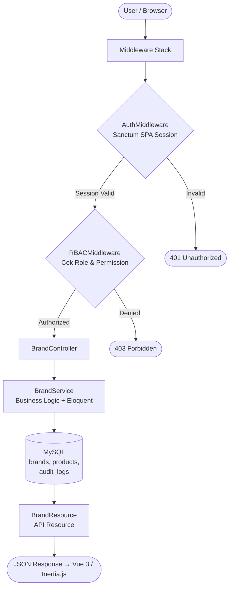
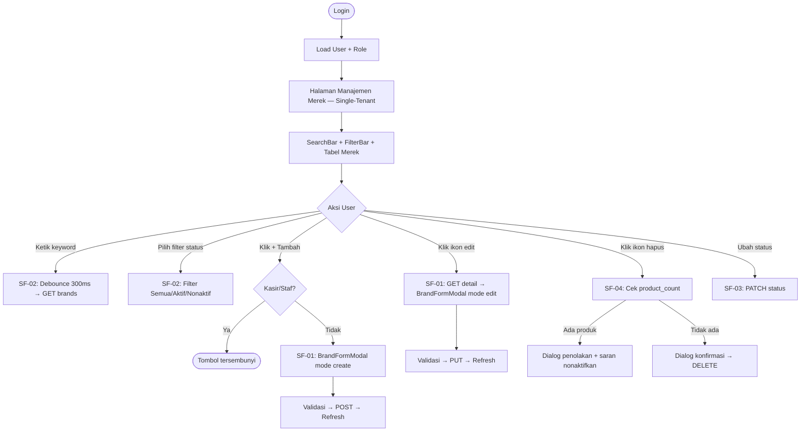
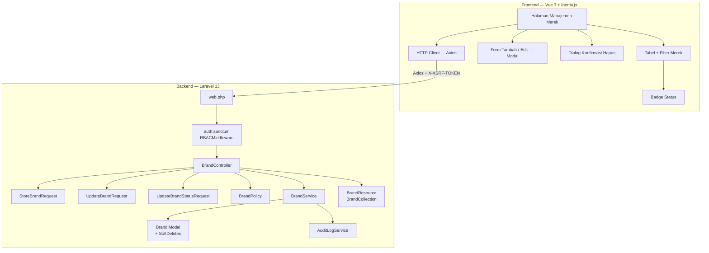
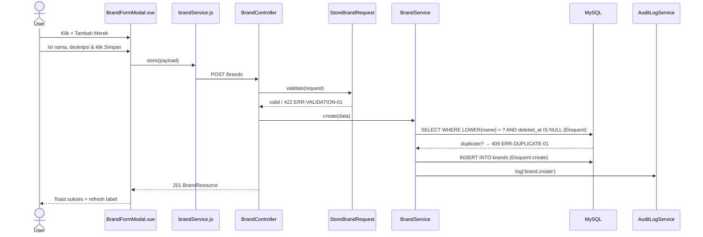
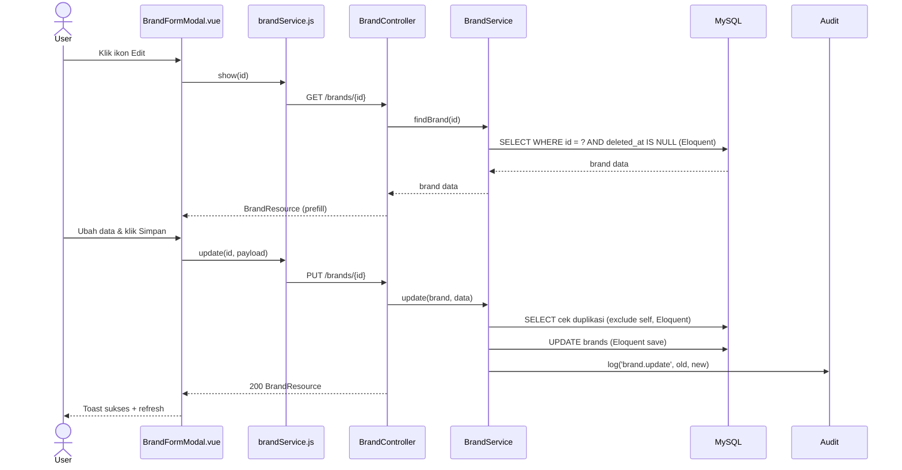
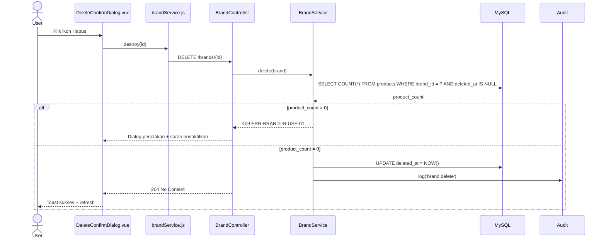
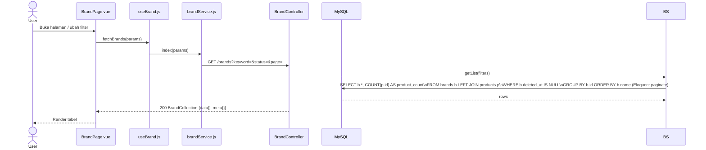
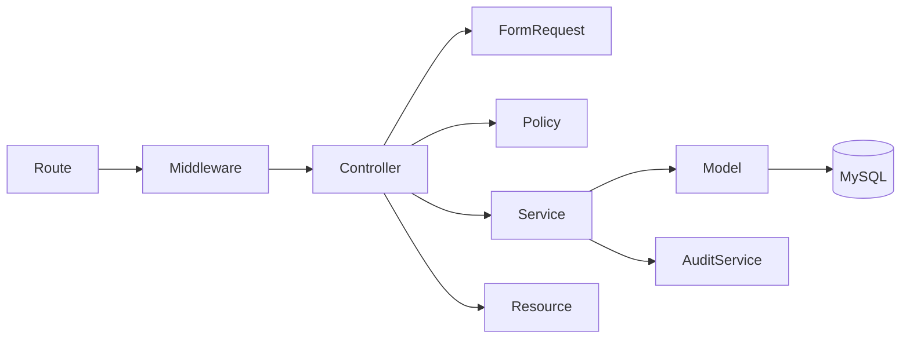

# fitur-Merek

<aside>
🏗️

**Software Architecture Document (SAD)** — Dibuat berdasarkan analisis fitur FT-PROD-05 Merek pada sistem Vetail POS **Single-Tenant** (1 toko, 1 owner, tanpa cabang). Dokumen ini menjadi acuan implementasi tim frontend dan backend.

</aside>

---

## 📋 Informasi Umum

| Field | Detail |
| --- | --- |
| **Kode Fitur** | FT-PROD-05 |
| **Nama Fitur** | Merek |
| **Modul Induk** | MOD-PROD — Produk |
| **Arsitektur** | Single-Tenant (store-scoped, tanpa cabang) |
| **Stack Teknologi** | Laravel 13, Vue 3, Inertia.js, Tailwind CSS, MySQL |
| **Autentikasi** | Laravel Sanctum SPA Session (bukan Bearer JWT) |
| **Versi Dokumen** | v4.0 |
| **Status** | 🟡 In Review |

---

## 1. 🎯 Tujuan Modul

Fitur **Merek** berfungsi sebagai **master data brand produk** dalam sistem Vetail POS Single-Tenant. Satu toko memiliki dan mengelola data mereknya secara terpusat.

**Tujuan utama:**

- Menstandarkan data brand produk dalam lingkup satu toko.
- Memudahkan pencarian dan filter produk berdasarkan merek.
- Mendukung analisis penjualan dan stok per merek.
- Mencegah data merek duplikat yang dapat merusak konsistensi master produk.
- Satu toko mengelola semua data merek secara terpusat tanpa pembatasan cabang.

**Hak akses berdasarkan role (RBAC):**

<aside>
ℹ️

**Sistem RBAC Vetail didefinisikan per-modul.** Fitur Merek berada di bawah **Modul Produk** — yang dapat diakses oleh semua role (Kasir, Staf Gudang, Manajer, Owner). Namun, aksi spesifik di dalam fitur Merek dibatasi lebih lanjut per role melalui `BrandPolicy`.

</aside>

**Akses Modul Produk (level modul):**

| Role | Akses Modul Produk |
| --- | --- |
| Owner | ✅ |
| Manajer | ✅ |
| Staf Gudang | ✅ |
| Kasir | ✅ |

**Aksi spesifik Fitur Merek (level fitur — via BrandPolicy):**

| Role | Lihat | Tambah | Edit | Ubah Status | Hapus |
| --- | --- | --- | --- | --- | --- |
| Owner | ✅ | ✅ | ✅ | ✅ | ✅ |
| Manajer | ✅ | ✅ | ✅ | ✅ | ✅ |
| Staf Gudang | ✅ | ❌ | ❌ | ❌ | ❌ |
| Kasir | ✅ | ❌ | ❌ | ❌ | ❌ |

> Semua role yang berwenang mengakses seluruh merek dalam satu toko. Tidak ada pembatasan per cabang.
> 

---

## 2. 🔄 Data Flow

<aside>
🔑

**Autentikasi:** Seluruh request menggunakan **Sanctum SPA Session** + Cookie. Tidak ada Authorization Bearer JWT.

</aside>



| Sub-Fitur | Method | Query |
| --- | --- | --- |
| SF-01 Tambah | `store()` | `INSERT brands` |
| SF-01 Edit | `show()` / `update()` | `SELECT` / `UPDATE brands` |
| SF-02 Pencarian | `index()` | `SELECT ... LEFT JOIN products ... COUNT` |
| SF-03 Status | `updateStatus()` | `UPDATE brands.status` |
| SF-04 Validasi Hapus | `destroy()` | cek `product_count` → soft delete |

---

## 3. 🖥️ UI Flow



---

## 4. 🧩 Component Diagram



---

## 5. 🔀 Sequence Diagram

### SF-01 — Create Brand



### SF-01 — Update Brand



### SF-04 — Delete Brand



### SF-02 — List & Search Brand



---

## 6. 🏛️ Layer Responsibility

| Layer | File | Tanggung Jawab |
| --- | --- | --- |
| **Route** | `routes/web.php` | Group `/brands`, middleware stack |
| **Middleware** | `RBACMiddleware.php` | Cek permission per role |
| **Controller** | `BrandController.php` | `index`, `show`, `store`, `update`, `updateStatus`, `destroy` |
| **Form Request** | `StoreBrandRequest.php` | Validasi & otorisasi create |
| **Form Request** | `UpdateBrandRequest.php` | Validasi & otorisasi update |
| **Form Request** | `UpdateBrandStatusRequest.php` | Validasi input status |
| **Policy** | `BrandPolicy.php` | Gate authorization per aksi & role |
| **Service** | `BrandService.php` | Business logic + Eloquent langsung: duplikat check, LEFT JOIN products (product_count), filter, pagination, delete guard, audit |
| **Model** | `Brand.php` | Eloquent + SoftDeletes + relasi product |
| **API Resource** | `BrandResource.php` | Serialisasi single brand |
| **API Resource** | `BrandCollection.php` | Serialisasi list + meta pagination |
| **Audit Service** | `AuditLogService.php` | Catat mutasi ke `audit_logs` |
| **Halaman Merek** | Inertia Page Component (nama & struktur file bebas, sesuai konvensi tim) | Halaman utama manajemen merek; mengatur state, memanggil HTTP client, merender seluruh UI merek |
| **Komponen UI** | Tabel + filter, modal form tambah/edit, dialog konfirmasi hapus, badge status (struktur & nama file bebas) | Elemen UI interaktif; menampilkan data, menerima input user, mengirim event ke parent; tidak langsung memanggil API |
| **HTTP Client** | Wrapper Axios (nama & lokasi file bebas, sesuai konvensi tim) | Menangani semua HTTP call ke backend; XSRF token otomatis, loading state, error normalization |

---

## 7. 🔗 Dependency Antar Layer



<aside>
⚠️

**Aturan Dependency:** Controller mendelegasikan ke Service. Service menjalankan query Eloquent langsung ke Model. Service tidak boleh memanggil Controller. Resource hanya untuk serialisasi output.

</aside>

---

## 8. 🔗 Relasi Modul

| Modul Terkait | Jenis Relasi | Keterangan |
| --- | --- | --- |
| **Produk (Daftar Produk)** | FK Opsional | `products.brand_id` → `brands.id`; nullable, produk boleh tanpa merek |
| **Stok Barang** | Konsumen Data | Filter laporan stok berbasis merek produk |
| **Jualan / POS** | Konsumen Data | Filter produk saat transaksi berdasarkan merek |
| **Laporan** | Konsumen Data | Laporan penjualan dan stok dikelompokkan per merek |
| **Audit Log** | Write | Setiap mutasi merek dicatat ke `audit_logs` |

---

## 9. 🔌 API Endpoint

<aside>
🔑

**Auth:** Semua endpoint menggunakan **Sanctum SPA Session** + Session Cookie + `X-XSRF-TOKEN`. Tidak menggunakan `Authorization: Bearer JWT`.

</aside>

| Method | Endpoint | Controller Method | Sub-Fitur | Keterangan |
| --- | --- | --- | --- | --- |
| `GET` | `/brands` | `index()` | SF-02 | List merek + filter + sort + pagination + product_count |
| `GET` | `/brands/{id}` | `show()` | SF-01 | Detail merek untuk form edit |
| `POST` | `/brands` | `store()` | SF-01 | Buat merek baru |
| `PUT` | `/brands/{id}` | `update()` | SF-01 | Update nama/deskripsi |
| `PATCH` | `/brands/{id}/status` | `updateStatus()` | SF-03 | Update status active/inactive |
| `DELETE` | `/brands/{id}` | `destroy()` | SF-04 | Hapus merek (soft delete, cek product_count) |

### Error Response Standar

| Kode Error | HTTP | Penyebab | Perilaku UI |
| --- | --- | --- | --- |
| --- | :---: | --- | --- |
| `ERR-AUTH-01` | 401 | Session tidak ada / expired | Redirect ke login |
| `ERR-FORBIDDEN-01` | 403 | Role tidak punya permission | Tampilkan "Akses ditolak" |
| `ERR-VALIDATION-01` | 422 | Nama merek kosong atau format tidak valid | Inline error field nama |
| `ERR-DUPLICATE-01` | 409 | Nama merek sudah ada di toko ini | Inline error duplikasi |
| `ERR-BRAND-NOT-FOUND` | 404 | Merek tidak ditemukan | Error data tidak ada |
| `ERR-BRAND-IN-USE-01` | 409 | Merek masih dipakai produk | Dialog penolakan + saran nonaktifkan |
| `ERR-BRAND-INACTIVE-01` | 400 | Merek nonaktif dipilih untuk produk baru | Peringatan merek nonaktif |
| `ERR-SERVER-01` | 500 | Kesalahan internal server | Pesan generik |

---

### 9.1 📦 Standar API Request

Seluruh endpoint FT-PROD-05 menggunakan:

- **Laravel Sanctum SPA Session Authentication**
- **Session Cookie** dikirim otomatis oleh browser
- **X-XSRF-TOKEN** dikirim otomatis oleh Axios
- **Tidak menggunakan** `Authorization: Bearer {JWT}`

#### Request Header

| Header | Wajib | Nilai | Keterangan |
| --- | --- | --- | --- |
| --- | :---: | --- | --- |
| `Accept` | ✅ | `application/json` | Wajib agar Laravel return JSON |
| `Content-Type` | ✅ (POST/PUT/PATCH) | `application/json` | Wajib pada request dengan body |
| `X-XSRF-TOKEN` | ✅ (POST/PUT/PATCH/DELETE) | Nilai dari cookie `XSRF-TOKEN` | Auto oleh Axios |

#### Path Parameter

| Nama | Tipe | Wajib | Keterangan |
| --- | --- | --- | --- |
| --- | --- | :---: | --- |
| `id` | integer | ✅ (show/update/delete) | ID merek |

#### Query Parameter

| Parameter | Tipe | Default | Validasi | Keterangan |
| --- | --- | --- | --- | --- |
| `page` | integer | `1` | min:1 | Nomor halaman |
| `limit` | integer | `15` | min:1, max:100 | Item per halaman |
| `keyword` | string | null | max:255 | Cari nama & deskripsi |
| `status` | string | `all` | in:all,active,inactive | Filter status |
| `sort_by` | string | `name` | in:name,description,product_count,status | Kolom sort |
| `sort_direction` | string | `asc` | in:asc,desc | Arah sort |

#### Request Body

**Create (POST)**

```json
{ "name": "Nike", "description": "Merek olahraga internasional", "status": "active" }
```

**Update (PUT)**

```json
{ "name": "Nike", "description": "Merek olahraga internasional", "status": "active" }
```

**Patch Status (PATCH)**

```json
{ "status": "inactive" }
```

---

### 9.2 📤 Standar API Response

**HTTP 200 OK — Single Brand**

```json
{
  "success": true,
  "message": "Data merek berhasil dimuat.",
  "data": {
    "id": 5,
    "name": "Nike",
    "description": "Merek olahraga internasional",
    "product_count": 12,
    "status": "active",
    "status_label": "Aktif",
    "created_at": "2026-07-28T10:00:00Z",
    "updated_at": "2026-07-28T10:00:00Z"
  }
}
```

**HTTP 201 Created**

```json
{ "success": true, "message": "Merek berhasil ditambahkan.", "data": { "..." } }
```

**HTTP 204 No Content** — *(DELETE berhasil; tidak ada body)*

**Collection (HTTP 200)**

```json
{
  "success": true, "message": "Daftar merek berhasil dimuat.",
  "data": [ { "id": 5, "name": "Nike", "product_count": 12, "status": "active", "..." } ],
  "meta": { "total": 40, "per_page": 15, "current_page": 1, "last_page": 3, "from": 1, "to": 15 }
}
```

**Error 409 (In Use)**

```json
{ "success": false, "code": "ERR-BRAND-IN-USE-01", "message": "Merek masih digunakan oleh 12 produk. Nonaktifkan merek sebagai gantinya." }
```

**Error 422**

```json
{ "success": false, "code": "ERR-VALIDATION-01", "message": "Data tidak valid.", "errors": { "name": ["Nama merek wajib diisi."] } }
```

---

### 9.3 📑 API Response Contract

| HTTP | Success | Message | Data | Meta | Errors | Code |
| --- | --- | --- | --- | --- | --- | --- |
| :---: | :---: | --- | :---: | :---: | :---: | --- |
| 200 | `true` | Deskriptif | Object/Array | Saat collection | — | — |
| 201 | `true` | "Merek berhasil ditambahkan." | Object | — | — | — |
| 204 | — | — | — | — | — | — |
| 400 | `false` | Error parameter | — | — | — | `ERR-QUERY-01` |
| 401 | `false` | Sesi tidak valid | — | — | — | `ERR-AUTH-01` |
| 403 | `false` | Akses ditolak | — | — | — | `ERR-FORBIDDEN-01` |
| 404 | `false` | Tidak ditemukan | — | — | — | `ERR-BRAND-NOT-FOUND` |
| 409 | `false` | Konflik bisnis | — | — | — | `ERR-DUPLICATE-01` / `ERR-BRAND-IN-USE-01` |
| 422 | `false` | Data tidak valid | — | — | Object per field | `ERR-VALIDATION-01` |
| 500 | `false` | Kesalahan server | — | — | — | `ERR-SERVER-01` |

---

### 9.4 🔄 Mapping Laravel Implementation

| Konsep | Implementasi Laravel 13 |
| --- | --- |
| **Form Request** | `StoreBrandRequest`, `UpdateBrandRequest`, `UpdateBrandStatusRequest` |
| **API Resource** | `BrandResource` — serialisasi single brand |
| **Resource Collection** | `BrandCollection` — `data[]`  • `meta{}` pagination |
| **Exception Handler** | `Handler.php` — `ModelNotFoundException` → 404, `ValidationException` → 422 |
| **Service** | `BrandService` — duplikat check, product_count check, soft delete |
| **Model** | `Brand`  • `SoftDeletes`  • `scopeActive()` |
| **Pagination** | `BrandService` query Eloquent + LEFT JOIN → `LengthAwarePaginator` → `BrandCollection` |
| **Validation** | Rule duplikat nama (case-insensitive) |

---

### 9.5 📌 Standar HTTP Status Code

| Status | Method | Digunakan Untuk |
| --- | --- | --- |
| :---: | --- | --- |
| **200** | GET, PUT, PATCH | Request berhasil |
| **201** | POST | Merek baru berhasil dibuat |
| **204** | DELETE | Merek berhasil dihapus |
| **400** | GET | Query parameter tidak valid |
| **401** | Semua | Session tidak valid |
| **403** | Semua | Tidak punya izin (RBAC) |
| **404** | GET, PUT, PATCH, DELETE | Merek tidak ditemukan |
| **409** | POST, PUT, DELETE | Nama duplikat atau merek masih dipakai produk |
| **422** | POST, PUT, PATCH | Validasi input gagal |
| **500** | Semua | Kesalahan internal |

---

## 10. 🗄️ Database Design

### 10.1 🗃️ Tabel `brands`

| Kolom | Tipe Data | Null | Default | Keterangan |
| --- | --- | --- | --- | --- |
| `id` | `BIGINT UNSIGNED` | NO | AUTO_INCREMENT | Primary Key |
| `name` | `VARCHAR(100)` | NO | — | Nama merek; UNIQUE per toko |
| `description` | `TEXT` | YES | NULL | Deskripsi merek; opsional |
| `status` | `ENUM('active','inactive')` | NO | `'active'` | Status merek |
| `created_by` | `BIGINT UNSIGNED` | NO | — | FK → `users.id`; user yang membuat |
| `updated_by` | `BIGINT UNSIGNED` | YES | NULL | FK → `users.id`; user yang terakhir mengubah |
| `created_at` | `TIMESTAMP` | YES | CURRENT_TIMESTAMP | Waktu dibuat (otomatis) |
| `updated_at` | `TIMESTAMP` | YES | CURRENT_TIMESTAMP ON UPDATE | Waktu diubah (otomatis) |
| `deleted_at` | `TIMESTAMP` | YES | NULL | Soft delete; NULL = aktif / belum dihapus |

**DDL Lengkap:**

```sql
CREATE TABLE brands (
    id          BIGINT UNSIGNED AUTO_INCREMENT PRIMARY KEY,
    name        VARCHAR(100)    NOT NULL,
    description TEXT            NULL,
    status      ENUM('active', 'inactive') NOT NULL DEFAULT 'active',
    created_by  BIGINT UNSIGNED NOT NULL,
    updated_by  BIGINT UNSIGNED NULL,
    created_at  TIMESTAMP DEFAULT CURRENT_TIMESTAMP,
    updated_at  TIMESTAMP DEFAULT CURRENT_TIMESTAMP ON UPDATE CURRENT_TIMESTAMP,
    deleted_at  TIMESTAMP NULL,

    UNIQUE KEY uq_brand_name (name),
    INDEX idx_status        (status),
    INDEX idx_deleted_at    (deleted_at),

    FOREIGN KEY (created_by) REFERENCES users(id),
    FOREIGN KEY (updated_by) REFERENCES users(id)
);
```

**Catatan desain:**

- `UNIQUE (name)` → nama merek unik dalam satu toko; tidak boleh duplikat.
- `deleted_at` → soft delete agar histori merek pada laporan tetap terbaca.

### Relasi pada tabel `products`

```sql
brand_id    BIGINT UNSIGNED NULL,
FOREIGN KEY (brand_id) REFERENCES brands(id) ON DELETE SET NULL
-- Validasi di layer Service: brand harus aktif sebelum ditetapkan ke produk
```

### Tabel `audit_logs` (nilai `action` untuk merek)

| Action | Keterangan |
| --- | --- |
| `brand.create` | Merek baru dibuat |
| `brand.update` | Nama/deskripsi diubah |
| `brand.update_status` | Status diubah |
| `brand.delete` | Merek dihapus (soft delete) |
| `brand.delete_rejected` | Upaya hapus ditolak karena masih dipakai produk |

### Query Kunci

**List merek dengan product_count dan filter:**

```sql
SELECT
  b.id,
  b.name,
  COALESCE(b.description, '-') AS description,
  COUNT(p.id)                  AS product_count,
  b.status
FROM brands b
LEFT JOIN products p ON p.brand_id = b.id AND p.deleted_at IS NULL
WHERE b.deleted_at  IS NULL
  AND (:status = 'all' OR b.status = :status)
  AND (:keyword IS NULL OR LOWER(b.name) LIKE LOWER(:kw) OR LOWER(COALESCE(b.description,'')) LIKE LOWER(:kw))
GROUP BY b.id
ORDER BY b.name ASC;
```

**Cek produk yang memakai merek sebelum hapus:**

```sql
SELECT COUNT(p.id) AS product_count
FROM brands b
LEFT JOIN products p ON p.brand_id = b.id AND p.deleted_at IS NULL
WHERE b.id = :brand_id AND b.deleted_at IS NULL;
```

---

---

---

## 13. 🔒 Standar Keamanan

<aside>
⚠️

Seluruh item bersifat **WAJIB** sebelum fitur dinyatakan siap produksi.

</aside>

### 13.1 Frontend Security

| Kategori | Standar | Implementasi |
| --- | --- | --- |
| **XSS Prevention** | Jangan gunakan `v-html`/`innerHTML` | Gunakan `v-text` atau Vue binding |
| **CSRF Protection** | Wajib CSRF token pada state-changing | Axios auto `X-XSRF-TOKEN` dari cookie |
| **Secure Storage** | Token tidak di localStorage | `HttpOnly` cookie (Sanctum) |
| **Layered Defense** | Frontend validation = UX saja | Backend satu-satunya sumber kebenaran |

### 13.2 Backend Security

| Kategori | Standar | Implementasi |
| --- | --- | --- |
| **SQL Injection** | Dilarang konkatenasi string | Parameterized query wajib |
| **Input Validation** | Zero-Trust | Laravel Form Request di awal controller |
| **IDOR Prevention** | Validasi eksistensi resource | Query by ID wajib cek `AND deleted_at IS NULL` |
| **Session Security** | Sanctum SPA Session | Cookie `HttpOnly`, `SameSite=Lax`, `Secure` production |
| **Error Handling** | Stack trace tidak bocor | Pesan generik ke client; detail ke log |

---

## 📌 Catatan Arsitektur

<aside>
⚠️

**Integritas Data:** `products.brand_id` merujuk ke `brands.id`. Validasi dilakukan di layer **Service** untuk memastikan merek aktif sebelum ditetapkan ke produk.

</aside>

<aside>
📊

**product_count = Kalkulasi:** Nilai jumlah produk dihitung via LEFT JOIN saat query list. Bukan kolom tersimpan di `brands`.

</aside>

<aside>
🔑

**Autentikasi Stack:** Menggunakan **Sanctum SPA Session** (bukan Bearer JWT). Axios mengirim cookie sesi + `X-XSRF-TOKEN` secara otomatis.

</aside>

---

## 📎 Lampiran: Implementation Checklist

### Task Frontend

**SF-01 — Tambah / Edit Merek:**

- [ ]  Form modal dua mode: **tambah** (kosong) dan **edit** (prefill dari `GET /brands/{id}`)
- [ ]  Field: `nama` (required), `deskripsi` (optional), `status` (dropdown)
- [ ]  Pre-fill dari `GET /brands/{id}` saat edit
- [ ]  Inline error handling per field (422, 409)
- [ ]  Sembunyikan tombol + dan ikon pensil jika role tidak punya permission
- [ ]  Disable tombol Simpan saat in-flight

**SF-02 — Pencarian Merek:**

- [ ]  Debounce 300ms pada input keyword
- [ ]  Sinkronisasi filter keyword + status dalam satu request
- [ ]  Teks: `Total data yang ditemukan: {total}`
- [ ]  Kolom **Produk** menampilkan `product_count` dari response
- [ ]  Skeleton loading + empty state

**SF-03 — Status Merek:**

- [ ]  Badge status dengan warna dinamis: hijau untuk Aktif, abu untuk Nonaktif
- [ ]  Update badge tabel secara reaktif setelah PATCH (tanpa full reload)
- [ ]  Merek nonaktif tidak ditawarkan pada dropdown produk

**SF-04 — Hapus Merek:**

- [ ]  Dialog konfirmasi hapus dua state: *dapat dihapus* (lanjut delete) dan *ditolak* (tampilkan info produk terdampak)
- [ ]  Tampilkan jumlah produk terdampak pada dialog penolakan
- [ ]  Tombol shortcut "Nonaktifkan saja" pada dialog penolakan

**Keamanan Frontend:**

- [ ]  CSRF — Axios `withCredentials: true`; `X-XSRF-TOKEN` auto
- [ ]  Role Guard — sembunyikan tombol mutasi sesuai role
- [ ]  SRI — integrity attribute pada CDN aset

### Task Backend

- [ ]  `auth:sanctum`, `RBACMiddleware` di semua route
- [ ]  Cek duplikasi nama secara global (case-insensitive)
- [ ]  Cek `product_count > 0` sebelum hapus; return 409 `ERR-BRAND-IN-USE-01` jika ada
- [ ]  Soft delete + audit log dalam **database transaction**
- [ ]  Parameterized query; validasi resource milik toko ini
- [ ]  `ProductResource`: jangan return raw DB object

---