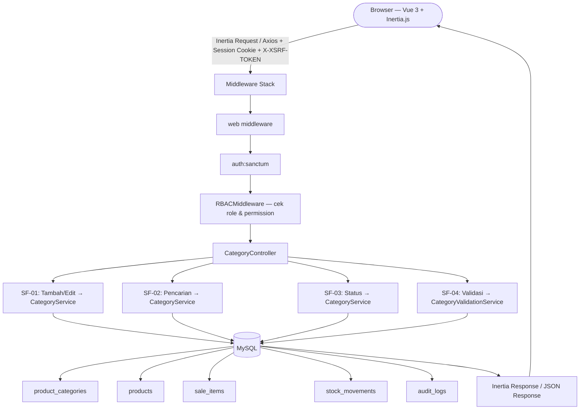
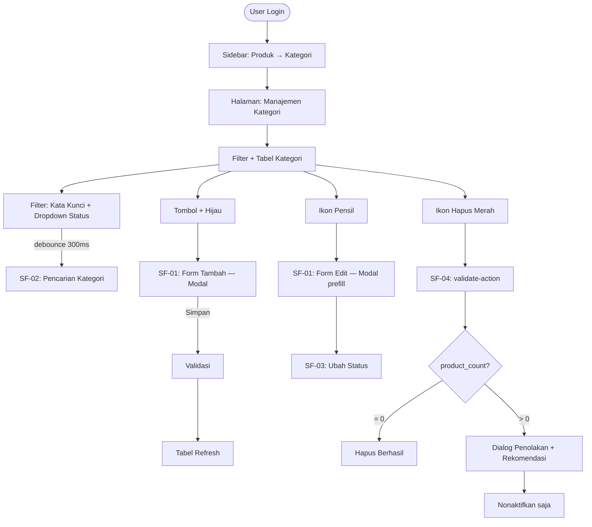
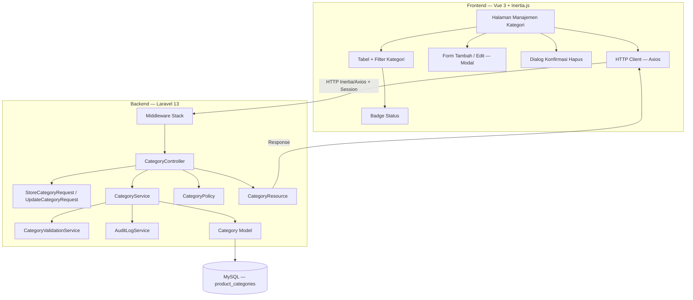
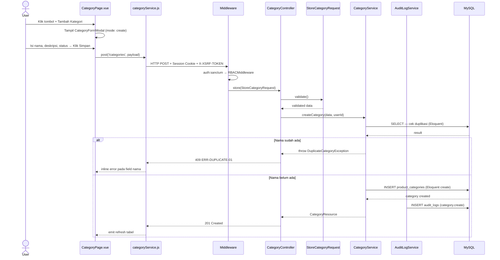
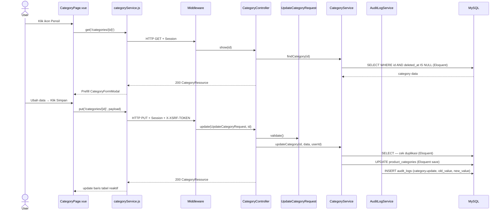
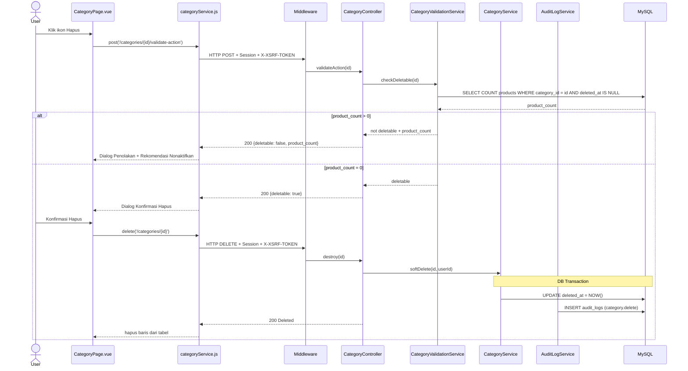
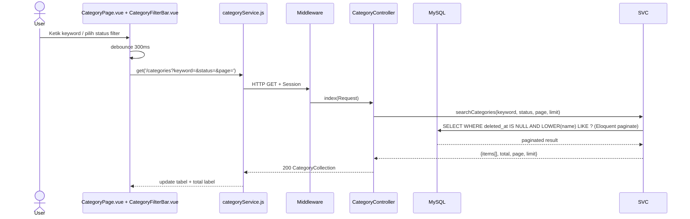
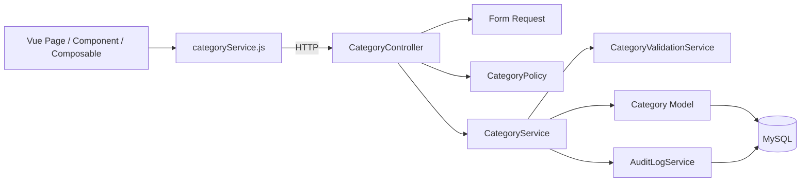
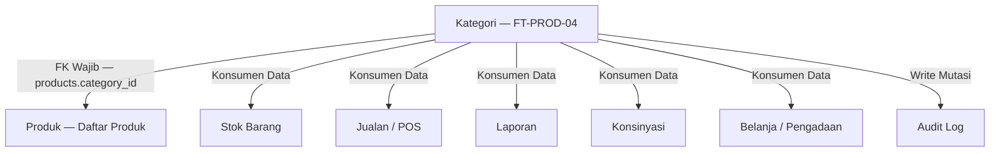

# fitur-kategori

<aside>
🏗️

**Dokumen Arsitektur Sistem (SAD)** — Software Architecture Document untuk fitur FT-PROD-04 Kategori pada sistem Vetail POS **Single-Tenant** (1 toko, 1 owner, tanpa cabang). Dokumen ini menjadi acuan desain arsitektur bagi tim Frontend dan Backend.

</aside>

---

## 📋 Informasi Umum

| Field | Detail |
| --- | --- |
| **Kode Fitur** | FT-PROD-04 |
| **Nama Fitur** | Kategori |
| **Modul Induk** | MOD-PROD — Produk |
| **Arsitektur** | Single-Tenant (store-scoped, tanpa cabang) |
| **Stack Teknologi** | Laravel 13 · Vue 3 · Inertia.js · Tailwind CSS · MySQL |
| **Autentikasi** | Laravel Sanctum — SPA Session Authentication |
| **Versi Dokumen** | v4.0 |
| **Status** | 🔵 In Review |

---

## 1. 🎯 Tujuan Modul

Fitur **Kategori** berfungsi sebagai **master data klasifikasi produk** dalam sistem Vetail POS Single-Tenant. Satu toko memiliki dan mengelola kategorinya sendiri secara terpusat.

**Tujuan utama:**

- Menstandarkan pengelompokan produk dalam lingkup satu toko.
- Menjadi referensi wajib bagi Modul Produk, Jualan, Stok Barang, Laporan, dan Konsinyasi.
- Memudahkan filter produk, analisis laporan, dan pengaturan promosi berbasis kategori.
- Mencegah risiko produk salah klasifikasi yang dapat merusak integritas data transaksi.

**Hak akses berdasarkan role (RBAC):**

<aside>
ℹ️

**Sistem RBAC Vetail didefinisikan per-modul.** Fitur Kategori berada di bawah **Modul Produk** — yang dapat diakses oleh semua role (Kasir, Staf Gudang, Manajer, Owner). Namun, aksi spesifik di dalam fitur Kategori dibatasi lebih lanjut per role melalui `CategoryPolicy`.

</aside>

**Akses Modul Produk (level modul):**

| Role | Akses Modul Produk |
| --- | --- |
| Owner | ✅ |
| Manajer | ✅ |
| Staf Gudang | ✅ |
| Kasir | ✅ |

**Aksi spesifik Fitur Kategori (level fitur — via CategoryPolicy):**

| Role | Lihat | Tambah | Edit | Ubah Status | Hapus |
| --- | --- | --- | --- | --- | --- |
| Owner | ✅ | ✅ | ✅ | ✅ | ✅ |
| Manajer | ✅ | ✅ | ✅ | ✅ | ✅ |
| Staf Gudang | ✅ | ❌ | ❌ | ❌ | ❌ |
| Kasir | ✅ | ❌ | ❌ | ❌ | ❌ |

> Semua role yang berwenang mengakses seluruh kategori dalam satu toko. Tidak ada pembatasan per cabang.
> 

---

## 2. 🔄 Data Flow

<aside>
🔐

**Autentikasi:** Proyek ini menggunakan **Laravel Sanctum SPA Session Authentication**. Tidak menggunakan Bearer JWT. Semua request dari Inertia/Vue dikirim via session cookie yang di-manage Laravel secara otomatis. CSRF dilindungi oleh `X-XSRF-TOKEN` cookie yang dibaca Axios secara otomatis.

</aside>



---

## 3. 🖥️ UI Flow



---

## 4. 🧩 Component Diagram



---

## 5. 🔁 Sequence Diagram

### SF-01: Create Kategori



### SF-01: Update Kategori



### SF-04: Delete Kategori



### SF-02: Search Kategori



---

## 6. 🗂️ Layer Responsibility

| Layer | File / Class | Tanggung Jawab |
| --- | --- | --- |
| **Route** | `routes/web.php` | Mendefinisikan endpoint, menerapkan middleware group (`web`, `auth:sanctum`, RBAC) |
| **Middleware** | `auth:sanctum`, `RBACMiddleware` | Autentikasi session, otorisasi role |
| **Controller** | `CategoryController` | Menerima request, mendelegasikan ke Service, mengembalikan response (Inertia atau JSON) |
| **Form Request** | `StoreCategoryRequest`, `UpdateCategoryRequest` | Validasi dan sanitasi input pada layer request; definisi rules dan messages |
| **Policy** | `CategoryPolicy` | Otorisasi aksi per resource (viewAny, create, update, delete) berbasis role user |
| **Service** | `CategoryService`, `CategoryValidationService` | Business logic + Eloquent langsung: cek duplikasi, filter, sort, pagination, soft delete, update status, audit log |
| **Model** | `Category` (Eloquent) | Mapping tabel `product_categories`, relasi Eloquent, soft delete trait |
| **API Resource** | `CategoryResource`, `CategoryCollection` | Mendefinisikan field response yang dikembalikan ke frontend; tidak pernah return raw Eloquent model |
| **Audit Service** | `AuditLogService` | Mencatat semua mutasi ke tabel `audit_logs` beserta `old_value`, `new_value`, `user_id` |
| **Halaman Kategori** | Inertia Page Component (nama & struktur file bebas, sesuai konvensi tim) | Halaman utama manajemen kategori; mengatur state, memanggil HTTP client, merender seluruh UI kategori |
| **Komponen UI** | Tabel + filter, modal form tambah/edit, dialog konfirmasi hapus, badge status (struktur & nama file bebas) | Elemen UI interaktif; menampilkan data, menerima input user, mengirim event ke parent; tidak langsung memanggil API |
| **HTTP Client** | Wrapper Axios (nama & lokasi file bebas, sesuai konvensi tim) | Menangani semua HTTP call ke backend; XSRF token otomatis, loading state, error normalization |

---

## 7. 🔗 Dependency Antar Layer



<aside>
⚠️

**Aturan Dependency:** Dependency hanya boleh mengalir ke bawah. Controller mendelegasikan ke Service. Service menjalankan query Eloquent langsung ke Model. Service tidak boleh memanggil Controller.

</aside>

---

## 8. 🔌 Relasi Modul



| Modul Terkait | Jenis Relasi | Keterangan |
| --- | --- | --- |
| **Produk (Daftar Produk)** | FK Wajib | `products.category_id` → `product_categories.id`; validasi di layer Service |
| **Stok Barang** | Konsumen Data | Filter dan laporan stok berbasis kategori |
| **Jualan / POS** | Konsumen Data | Pencarian produk saat transaksi menggunakan kategori |
| **Laporan** | Konsumen Data | Laporan dikelompokkan per kategori |
| **Konsinyasi** | Konsumen Data | Produk konsinyasi diklasifikasikan menggunakan master kategori |
| **Belanja / Pengadaan** | Konsumen Data | Filter produk saat membuat PO menggunakan kategori |
| **Audit Log** | Write | Setiap mutasi kategori dicatat ke `audit_logs` |

---

## 9. 🔌 API Endpoint

<aside>
🔐

**Autentikasi:** Semua endpoint menggunakan **Laravel Sanctum SPA Session**. Tidak ada `Authorization: Bearer`. CSRF dilindungi via `X-XSRF-TOKEN` cookie yang dibaca Axios secara otomatis. Semua endpoint berada di bawah middleware `web` + `auth:sanctum`.

</aside>

Semua endpoint tidak memerlukan `branch_id` — sistem single-tenant.

| Method | Endpoint | Controller Method | Sub-Fitur | Keterangan |
| --- | --- | --- | --- | --- |
| `GET` | `/categories` | `index` | SF-02 | List kategori + filter `keyword`, `status`, `page`, `limit`, `sort_by`, `sort_direction` |
| `GET` | `/categories/{id}` | `show` | SF-01 | Detail kategori untuk form edit (prefill) |
| `POST` | `/categories` | `store` | SF-01 | Buat kategori baru |
| `PUT` | `/categories/{id}` | `update` | SF-01 | Update nama/deskripsi kategori |
| `PATCH` | `/categories/{id}/status` | `updateStatus` | SF-03 | Toggle status `active`/`inactive` |
| `POST` | `/categories/{id}/validate-delete` | `validateDelete` | SF-04 | Pre-check sebelum hapus; return `{deletable, product_count}` |
| `DELETE` | `/categories/{id}` | `destroy` | SF-04 | Soft delete kategori (re-validasi di backend) |

> **Catatan Revisi API:** Prefix `/api/v1/` dihapus karena stack menggunakan Inertia.js dengan web routes. Endpoint `validate-action` diubah menjadi `validate-delete` agar naming lebih spesifik dan RESTful. Semua endpoint tetap mengembalikan JSON response (`CategoryResource`).
> 

### Error Response Standar

<aside>
📝

**Review Error Code:** Error codes menggunakan pola `ERR-{ENTITY}-{DESCRIPTOR}`. `ERR-CATEGORY-IN-USE` ditambahkan suffix numerik untuk konsistensi.

</aside>

| Kode Error | HTTP | Penyebab | Perilaku UI |
| --- | --- | --- | --- |
| `ERR-AUTH-01` | 401 | Session tidak valid / expired | Redirect ke halaman login via Inertia |
| `ERR-FORBIDDEN-01` | 403 | Policy menolak aksi (role tidak punya permission) | Tampilkan "Akses ditolak" |
| `ERR-VALIDATION-01` | 422 | Nama kategori kosong atau melebihi 100 karakter | Inline error pada field nama |
| `ERR-DUPLICATE-01` | 409 | Nama kategori sudah ada di toko ini | Inline error duplikasi |
| `ERR-CATEGORY-NOT-FOUND` | 404 | Kategori tidak ditemukan | Tampilkan error data tidak ada |
| `ERR-STATUS-01` | 422 | Nilai status tidak valid (bukan active/inactive) | Tampilkan validasi status |
| `ERR-CATEGORY-IN-USE-01` | 409 | Kategori masih dipakai produk aktif | Dialog penolakan + rekomendasi aksi |
| `ERR-SERVER-01` | 500 | Kesalahan internal server | Tampilkan pesan generik; detail ke log internal |

---

### 9.1 📦 Standar API Request

Seluruh endpoint menggunakan **Laravel Sanctum SPA Session Authentication**. Tidak ada `Authorization: Bearer` header. Autentikasi dilakukan via session cookie yang di-manage Laravel, dan CSRF dilindungi via `X-XSRF-TOKEN` cookie yang dibaca Axios secara otomatis.

#### Request Header

| Header | Wajib | Nilai | Keterangan |
| --- | --- | --- | --- |
| `Accept` | Ya | `application/json` | Memastikan response dikembalikan dalam format JSON |
| `Content-Type` | Ya (POST/PUT/PATCH) | `application/json` | Tipe konten request body; wajib untuk semua request bermutasi |
| `X-XSRF-TOKEN` | Ya (POST/PUT/PATCH/DELETE) | Nilai dari cookie `XSRF-TOKEN` | CSRF protection; dibaca dan dikirim otomatis oleh Axios dari cookie |
| `X-Requested-With` | Opsional | `XMLHttpRequest` | Menandai request sebagai AJAX; direkomendasikan untuk konsistensi |

> **Catatan:** Tidak perlu menambahkan `Authorization: Bearer` header. Laravel Sanctum SPA menggunakan session cookie `laravel_session` yang dikirim otomatis oleh browser.
> 

#### Path Parameter

| Nama | Tipe | Wajib | Keterangan |
| --- | --- | --- | --- |
| `id` | `integer` | Ya (show/update/delete) | ID kategori yang dituju |

#### Query Parameter

| Parameter | Tipe | Default | Validasi | Keterangan |
| --- | --- | --- | --- | --- |
| `page` | `integer` | `1` | `min:1` | Nomor halaman untuk pagination |
| `limit` | `integer` | `15` | `min:1, max:100` | Jumlah item per halaman |
| `keyword` | `string` | `null` | `nullable, max:100` | Kata kunci pencarian nama atau deskripsi; di-trim dan case-insensitive |
| `status` | `string` | `all` | `in:all,active,inactive` | Filter berdasarkan status kategori |
| `sort_by` | `string` | `name` | `in:name,status,created_at` | Kolom pengurutan; allow-list untuk mencegah SQL injection |
| `sort_direction` | `string` | `asc` | `in:asc,desc` | Arah pengurutan |

#### Request Body

**Create Kategori — `POST /categories`**

```json
{
  "name": "Makanan & Minuman",
  "description": "Produk makanan dan minuman untuk konsumsi langsung",
  "status": "active"
}
```

**Update Kategori — `PUT /categories/{id}`**

```json
{
  "name": "Makanan & Minuman",
  "description": "Produk makanan dan minuman termasuk snack",
  "status": "active"
}
```

**Patch Status — `PATCH /categories/{id}/status`**

```json
{
  "status": "inactive"
}
```

---

### 9.2 📤 Standar API Response

Seluruh endpoint wajib menggunakan format response yang konsisten. Response dihasilkan melalui `CategoryResource` dan `CategoryCollection` (Laravel API Resource). Tidak boleh return raw Eloquent model atau array biasa.

**HTTP 200 OK — Single Resource**

```json
{
  "success": true,
  "message": "Kategori berhasil diperbarui.",
  "data": {
    "id": 1,
    "name": "Makanan & Minuman",
    "description": "Produk makanan dan minuman",
    "status": "active",
    "status_label": "Aktif",
    "created_at": "2026-07-28T10:00:00Z",
    "updated_at": "2026-07-28T15:30:00Z"
  }
}
```

**HTTP 201 Created — Create Response**

```json
{
  "success": true,
  "message": "Kategori berhasil dibuat.",
  "data": {
    "id": 12,
    "name": "Elektronik",
    "description": null,
    "status": "active",
    "status_label": "Aktif",
    "created_at": "2026-07-28T10:00:00Z",
    "updated_at": "2026-07-28T10:00:00Z"
  }
}
```

**HTTP 204 No Content — Delete Response**

Tidak ada response body. Status 204 menandakan soft delete berhasil dieksekusi.

**HTTP 200 OK — Collection Response (List + Pagination)**

```json
{
  "success": true,
  "message": "Daftar kategori berhasil dimuat.",
  "data": [
    {
      "id": 1,
      "name": "Makanan & Minuman",
      "description": "Produk makanan dan minuman",
      "status": "active",
      "status_label": "Aktif",
      "created_at": "2026-07-28T10:00:00Z",
      "updated_at": "2026-07-28T10:00:00Z"
    }
  ],
  "meta": {
    "total": 25,
    "per_page": 15,
    "current_page": 1,
    "last_page": 2,
    "from": 1,
    "to": 15
  }
}
```

**Error Response — 400 Bad Request**

```json
{
  "success": false,
  "code": "ERR-QUERY-01",
  "message": "Parameter filter atau sort tidak valid."
}
```

**Error Response — 401 Unauthorized**

```json
{
  "success": false,
  "code": "ERR-AUTH-01",
  "message": "Sesi tidak valid atau telah berakhir. Silakan login kembali."
}
```

**Error Response — 403 Forbidden**

```json
{
  "success": false,
  "code": "ERR-FORBIDDEN-01",
  "message": "Anda tidak memiliki izin untuk melakukan aksi ini."
}
```

**Error Response — 404 Not Found**

```json
{
  "success": false,
  "code": "ERR-CATEGORY-NOT-FOUND",
  "message": "Kategori tidak ditemukan."
}
```

**Error Response — 409 Conflict**

```json
{
  "success": false,
  "code": "ERR-DUPLICATE-01",
  "message": "Nama kategori sudah ada di toko ini."
}
```

**Error Response — 422 Validation Error**

```json
{
  "success": false,
  "code": "ERR-VALIDATION-01",
  "message": "Data yang diberikan tidak valid.",
  "errors": {
    "name": ["Nama kategori wajib diisi."],
    "status": ["Nilai status tidak valid."]
  }
}
```

**Error Response — 500 Internal Server Error**

```json
{
  "success": false,
  "code": "ERR-SERVER-01",
  "message": "Terjadi kesalahan pada server. Silakan coba beberapa saat lagi."
}
```

> **Aturan:** Field `errors` hanya muncul pada response 422. Field `code` hanya muncul pada response error (4xx/5xx). Field `data` tidak ada pada response error. Response 204 tidak memiliki body.
> 

---

### 9.3 📑 API Response Contract

| HTTP | Success | Message | Data | Meta | Errors | Code |
| --- | --- | --- | --- | --- | --- | --- |
| **200** | `true` | Pesan sukses operasi | Object / Array | Ada (jika collection) | — | — |
| **201** | `true` | "...berhasil dibuat." | Object (resource baru) | — | — | — |
| **204** | — | — | — | — | — | — |
| **400** | `false` | "Parameter tidak valid." | — | — | — | `ERR-QUERY-01` |
| **401** | `false` | "Sesi tidak valid..." | — | — | — | `ERR-AUTH-01` |
| **403** | `false` | "Akses ditolak." | — | — | — | `ERR-FORBIDDEN-01` |
| **404** | `false` | "...tidak ditemukan." | — | — | — | `ERR-CATEGORY-NOT-FOUND` |
| **409** | `false` | Pesan konflik bisnis | — | — | — | `ERR-DUPLICATE-01` / `ERR-CATEGORY-IN-USE-01` |
| **422** | `false` | "Data tidak valid." | — | — | Object per field | `ERR-VALIDATION-01` / `ERR-STATUS-01` |
| **500** | `false` | Pesan generik | — | — | — | `ERR-SERVER-01` |

---

### 9.4 🔄 Mapping Laravel Implementation

| Konsep | Implementasi Laravel 13 |
| --- | --- |
| **Form Request** | `StoreCategoryRequest`, `UpdateCategoryRequest` — definisi `rules()`, `messages()`, `authorize()`; validasi dijalankan otomatis sebelum masuk controller |
| **API Resource** | `CategoryResource extends JsonResource` — format single object response via `toArray()`; wajib sertakan `success`, `message`, `data` |
| **Resource Collection** | `CategoryCollection extends ResourceCollection` — format paginated list response; override `toArray()` untuk sertakan `meta` dari `$this->resource->toArray()` |
| **Exception Handler** | `app/Exceptions/Handler.php` — intercept `AuthenticationException` → 401, `AuthorizationException` → 403, `ValidationException` → 422, `ModelNotFoundException` → 404; return JSON response konsisten |
| **Service** | `CategoryService` — business logic murni; lempar custom exception (bukan `abort()`); tidak return HTTP response secara langsung |
| **Model** | `Category extends Model` — gunakan `SoftDeletes` trait; definisikan `$fillable`, `$casts`; tidak berisi business logic |
| **Pagination** | `$query->paginate($limit)` — dikonversi `CategoryCollection` ke format `meta` standar; gunakan `appends(request()->query())` untuk preserve query params |
| **Validation** | `Form Request` sebagai primary layer; gunakan rule `bail` untuk stop-on-first-failure; pesan error dalam Bahasa Indonesia; sanitasi input via `prepareForValidation()` |

---

### 9.5 📌 Standar HTTP Status Code

| Status | Method | Digunakan Untuk |
| --- | --- | --- |
| **200 OK** | GET, PUT, PATCH, POST | Request berhasil; kembalikan resource atau confirmation message |
| **201 Created** | POST | Resource baru berhasil dibuat; kembalikan resource yang dibuat beserta ID-nya |
| **204 No Content** | DELETE | Resource berhasil dihapus (soft delete); tidak ada body response |
| **400 Bad Request** | GET | Parameter query tidak valid (nilai `sort_by` atau `status` di luar allow-list) |
| **401 Unauthorized** | Semua | Session tidak valid, expired, atau belum login; frontend harus redirect ke halaman login |
| **403 Forbidden** | Semua | Terautentikasi tetapi tidak memiliki izin — Policy menolak aksi (RBAC) |
| **404 Not Found** | GET, PUT, PATCH, DELETE | Resource tidak ditemukan |
| **409 Conflict** | POST, PUT, PATCH, DELETE | Konflik data bisnis: nama kategori duplikat, atau kategori masih digunakan produk |
| **422 Unprocessable Entity** | POST, PUT, PATCH | Validasi input gagal; kembalikan `errors` per field dalam Bahasa Indonesia |
| **500 Internal Server Error** | Semua | Kesalahan server tidak terduga; kembalikan pesan generik; jangan bocorkan stack trace |

<aside>
⚠️

**Aturan Penting:** Gunakan **422** untuk validation error (bukan 400). Gunakan **409** untuk konflik bisnis (bukan 422). Gunakan **403** untuk authorization error (bukan 401). Gunakan **401** hanya untuk authentication error (session invalid/expired).

</aside>

---

## 10. 🗄️ Database Design

### 10.1 🗃️ Tabel `product_categories`

| Kolom | Tipe Data | Null | Default | Keterangan |
| --- | --- | --- | --- | --- |
| `id` | `BIGINT UNSIGNED` | NO | AUTO_INCREMENT | Primary Key |
| `name` | `VARCHAR(100)` | NO | — | Nama kategori; UNIQUE per toko |
| `description` | `TEXT` | YES | NULL | Deskripsi kategori; opsional |
| `status` | `ENUM('active','inactive')` | NO | `'active'` | Status kategori |
| `created_by` | `BIGINT UNSIGNED` | NO | — | FK → `users.id`; ON DELETE RESTRICT |
| `updated_by` | `BIGINT UNSIGNED` | YES | NULL | FK → `users.id`; ON DELETE SET NULL |
| `created_at` | `TIMESTAMP` | YES | CURRENT_TIMESTAMP | Waktu dibuat (otomatis) |
| `updated_at` | `TIMESTAMP` | YES | CURRENT_TIMESTAMP ON UPDATE | Waktu diubah (otomatis) |
| `deleted_at` | `TIMESTAMP` | YES | NULL | Soft delete; NULL = aktif / belum dihapus |

**DDL Lengkap:**

```sql
CREATE TABLE product_categories (
    id          BIGINT UNSIGNED AUTO_INCREMENT PRIMARY KEY,
    name        VARCHAR(100)    NOT NULL,
    description TEXT            NULL,
    status      ENUM('active', 'inactive') NOT NULL DEFAULT 'active',
    created_by  BIGINT UNSIGNED NOT NULL,
    updated_by  BIGINT UNSIGNED NULL,
    created_at  TIMESTAMP DEFAULT CURRENT_TIMESTAMP,
    updated_at  TIMESTAMP DEFAULT CURRENT_TIMESTAMP ON UPDATE CURRENT_TIMESTAMP,
    deleted_at  TIMESTAMP NULL,

    UNIQUE KEY uq_category_name (name),
    INDEX idx_status (status),
    INDEX idx_deleted_at (deleted_at),

    FOREIGN KEY (created_by) REFERENCES users(id) ON DELETE RESTRICT,
    FOREIGN KEY (updated_by) REFERENCES users(id) ON DELETE SET NULL
);
```

**Catatan desain & rekomendasi:**

- `UNIQUE (name)` — nama kategori unik dalam satu toko; tangani logika status di layer Service.
- `deleted_at` → soft delete menggunakan Laravel `SoftDeletes` trait agar histori kategori pada laporan tetap terbaca.
- Tambahkan `INDEX idx_deleted_at (deleted_at)` untuk efisiensi query `WHERE deleted_at IS NULL`.

### Tabel `audit_logs` (relevan untuk kategori)

```sql
CREATE TABLE audit_logs (
    id           BIGINT UNSIGNED AUTO_INCREMENT PRIMARY KEY,
    user_id      BIGINT UNSIGNED NOT NULL,
    action       VARCHAR(50)     NOT NULL,
    entity_type  VARCHAR(50)     NOT NULL,
    entity_id    BIGINT UNSIGNED NOT NULL,
    old_value    JSON NULL,
    new_value    JSON NULL,
    ip_address   VARCHAR(45)     NULL,
    created_at   TIMESTAMP DEFAULT CURRENT_TIMESTAMP,

    INDEX idx_entity  (entity_type, entity_id),
    INDEX idx_user    (user_id)
);
```

**Nilai `action` untuk entitas kategori:**

| Action | Keterangan |
| --- | --- |
| `category.create` | Kategori baru dibuat |
| `category.update` | Nama/deskripsi diubah |
| `category.update_status` | Status diubah |
| `category.delete` | Kategori dihapus (soft delete) |
| `category.delete_rejected` | Upaya hapus ditolak karena masih dipakai produk |

### Query Kunci

**Cek duplikasi nama dalam toko:**

```sql
SELECT id FROM product_categories
WHERE LOWER(name) = LOWER(:name)
  AND deleted_at IS NULL
  AND (:category_id IS NULL OR id <> :category_id)
LIMIT 1;
```

**Cek produk yang memakai kategori sebelum hapus:**

```sql
SELECT
  c.id, c.name,
  COUNT(p.id)                                          AS product_count,
  SUM(CASE WHEN p.status = 'active' THEN 1 ELSE 0 END) AS active_product_count
FROM product_categories c
LEFT JOIN products p ON p.category_id = c.id AND p.deleted_at IS NULL
WHERE c.id = :category_id
  AND c.deleted_at IS NULL
GROUP BY c.id, c.name;
```

**List kategori dengan filter:**

```sql
SELECT
  c.id, c.name,
  COALESCE(c.description, '-') AS description,
  c.status,
  CASE WHEN c.status = 'active' THEN 'Aktif' ELSE 'Nonaktif' END AS status_label
FROM product_categories c
WHERE c.deleted_at IS NULL
  AND (:status = 'all' OR c.status = :status)
  AND (
    :keyword IS NULL OR :keyword = ''
    OR LOWER(c.name) LIKE LOWER(:keyword_like)
    OR LOWER(COALESCE(c.description, '')) LIKE LOWER(:keyword_like)
  )
ORDER BY c.name ASC;
```

---

---

---

## 13. 🔒 Standar Keamanan

<aside>
⚠️

Seluruh item pada seksi ini bersifat **WAJIB** dan menjadi syarat minimum sebelum fitur dinyatakan siap produksi. Mengabaikan standar ini berisiko menimbulkan celah keamanan kritis (OWASP Top 10).

</aside>

### 13.1 Authentication & Authorization

| Kategori | Standar | Implementasi |
| --- | --- | --- |
| **Authentication** | Session-based via Laravel Sanctum SPA | Gunakan `auth:sanctum` middleware; session cookie `HttpOnly`; tidak ada Bearer JWT di stack ini |
| **Authorization** | Policy-based RBAC per aksi | Gunakan `CategoryPolicy` di controller via `$this->authorize()`; definisi permission per role |
| **CSRF Protection** | Proteksi semua request state-changing | Axios membaca `XSRF-TOKEN` cookie dan mengirim `X-XSRF-TOKEN` header secara otomatis; pastikan `VerifyCsrfToken` middleware aktif |
| **IDOR / BOLA** | Autentikasi ≠ otorisasi atas data spesifik | Setiap query berdasarkan `{id}` wajib disertai `AND deleted_at IS NULL`; validasi dilakukan di layer Service dan Policy |

### 13.2 Frontend Security

| Kategori | Standar | Implementasi |
| --- | --- | --- |
| **XSS Prevention** | Jangan gunakan `innerHTML` untuk output data user | Gunakan `textContent` atau Vue data binding; gunakan `DOMPurify` jika harus render HTML dari input user |
| **Secure Storage** | Token sensitif tidak boleh di `localStorage`/`sessionStorage` | Gunakan `HttpOnly` cookie yang di-manage Laravel |
| **Data Filtering** | Jangan expose field sensitif ke state frontend | Strip `password`, `api_token`, `remember_token` dari response sebelum disimpan ke state |
| **Layered Defense** | Frontend validation = UX saja, bukan keamanan | Backend adalah satu-satunya sumber kebenaran validasi; jangan mengandalkan validasi frontend untuk keamanan |
| **SRI** | Aset CDN eksternal wajib dilindungi | Gunakan atribut `integrity="sha384-..."` dan `crossorigin="anonymous"` |
| **Clickjacking** | Cegah halaman di-embed di iframe pihak ketiga | Aktifkan Laravel `FrameGuard` (`X-Frame-Options: SAMEORIGIN`) |
| **Referrer Policy** | Batasi informasi yang bocor saat navigasi ke domain lain | Gunakan `<meta name="referrer" content="strict-origin-when-cross-origin">` |

### 13.3 Backend Security

| Kategori | Standar | Implementasi |
| --- | --- | --- |
| **SQL Injection** | Dilarang konkatenasi string dengan input user | Wajib parameterized query / Eloquent binding pada semua query; gunakan Laravel Form Request untuk sanitasi awal |
| **Input Validation** | Zero-Trust: semua input eksternal dianggap berbahaya | Validasi dengan `Form Request` di awal controller; allow-list tipe, panjang, format |
| **Error Handling** | Stack trace tidak boleh bocor ke response production | Pesan error generik ke client; detail error ke log internal saja (`storage/logs`) |
| **Log Masking** | Data sensitif tidak boleh tercatat di log | Masking otomatis untuk password, token di log handler |
| **Rate Limiting** | Cegah brute force pada endpoint auth | Gunakan Laravel `throttle` middleware; konfigurasi di `RouteServiceProvider` |
| **Secrets Management** | Dilarang hardcode credentials di source code | Gunakan `.env` untuk lokal; Secrets Manager untuk production; `.env` di `.gitignore` |
| **DB Least Privilege** | Akun DB tidak boleh `root`/superuser | Akun aplikasi hanya diberi hak SELECT, INSERT, UPDATE pada tabel yang diperlukan |
| **API Resource** | Jangan return raw Eloquent model/DB object | Selalu wrap response dengan `CategoryResource` atau `CategoryCollection` |

---

## 📌 Catatan Arsitektur

<aside>
⚠️

**Integritas Data:** `products.category_id` hanya boleh merujuk kategori aktif. Validasi ini wajib dilakukan di layer **Service** (bukan hanya di database constraint) agar pesan error dapat dikomunikasikan dengan jelas ke pengguna.

</aside>

<aside>
🔒

**Defense in Depth:** Keamanan bersifat berlapis. Frontend memberikan validasi UX sebagai lapisan pertama, tetapi **backend adalah lapisan final dan satu-satunya sumber kebenaran**. Jangan pernah mengandalkan validasi frontend saja untuk keamanan data.

</aside>

<aside>
🔄

**Autentikasi Stack:** Proyek ini menggunakan Laravel + Vue 3 + Inertia.js. Mekanisme autentikasi yang digunakan adalah **Laravel Sanctum SPA Session** (bukan Bearer JWT). Jangan mencampur dua mekanisme autentikasi. Seluruh Data Flow, Middleware, dan Security telah disesuaikan.

</aside>

---

## 📎 Lampiran: Implementation Checklist

> Bagian ini berisi checklist implementasi untuk developer. Bukan bagian dari desain arsitektur.
> 

### 1. Frontend Checklist

**SF-01 — Tambah / Edit Kategori:**

- [ ]  Form modal dengan dua mode: **tambah** (kosong) dan **edit** (prefill data dari `GET /categories/{id}`)
- [ ]  Pre-fill data dari `GET /categories/{id}` saat mode edit
- [ ]  Validasi client-side: nama wajib diisi
- [ ]  Inline error handling per field (response 422, 409)
- [ ]  Sembunyikan tombol + dan ikon pensil jika role tidak punya permission
- [ ]  Disable tombol Simpan saat request in-flight
- [ ]  Emit event refresh tabel setelah simpan berhasil

**SF-02 — Pencarian Kategori:**

- [ ]  Debounce 300ms pada input keyword
- [ ]  Sinkronisasi filter keyword + status dalam satu request
- [ ]  State: `keyword`, `statusFilter`, `currentPage`
- [ ]  Reset ke halaman 1 saat filter berubah
- [ ]  Teks dinamis: `Total kategori yang ditemukan: {total}`
- [ ]  Skeleton loading saat request berlangsung
- [ ]  Empty state component saat hasil = 0

**SF-03 — Status Kategori:**

- [ ]  Badge status dengan warna dinamis: hijau untuk Aktif, abu untuk Nonaktif
- [ ]  Dropdown filter: Semua / Aktif / Nonaktif
- [ ]  Update baris tabel secara reaktif setelah PATCH status (tanpa full reload)
- [ ]  Tampilkan konfirmasi jika ubah status ke nonaktif

**SF-04 — Validasi Kategori Produk:**

- [ ]  Dialog konfirmasi hapus dengan dua state: *dapat dihapus* (lanjut delete) dan *ditolak* (tampilkan info produk terdampak)
- [ ]  Panggil `validate-delete` sebelum tampilkan dialog konfirmasi final
- [ ]  Tampilkan jumlah produk terdampak pada dialog penolakan
- [ ]  Sediakan tombol shortcut "Nonaktifkan saja" pada dialog penolakan
- [ ]  Loading state pada tombol aksi selama validasi berlangsung
- [ ]  Disable ikon hapus untuk role tanpa permission delete

**Keamanan Frontend:**

- [ ]  Hindari `innerHTML` saat merender data dari API; gunakan `textContent` atau Vue data binding
- [ ]  Gunakan `DOMPurify` jika ada kebutuhan merender konten HTML dari input user
- [ ]  Jangan simpan token sensitif di `localStorage` atau `sessionStorage`
- [ ]  Jangan tampilkan atau simpan field sensitif dari response API ke state frontend
- [ ]  Aset CDN eksternal wajib menggunakan atribut `integrity` (SRI)
- [ ]  Pastikan `X-Frame-Options: SAMEORIGIN` aktif melalui Laravel FrameGuard middleware

### 2. Backend Checklist

**Middleware:**

- [ ]  `auth:sanctum` — validasi session, return 401 jika tidak terautentikasi
- [ ]  `RBACMiddleware` — cek permission per endpoint, return 403 jika ditolak

**SF-01 — Tambah / Edit Kategori:**

- [ ]  `POST /categories` — store kategori baru
- [ ]  `PUT /categories/{id}` — update kategori
- [ ]  `GET /categories/{id}` — load detail
- [ ]  Validasi: nama wajib, max 100 karakter, sanitasi input
- [ ]  Cek duplikasi nama secara global (case-insensitive)
- [ ]  Tulis `audit_logs` pada setiap create/update
- [ ]  Return response via `CategoryResource`

**SF-02 — Pencarian Kategori:**

- [ ]  Query params: `keyword`, `status`, `page`, `limit`, `sort_by`, `sort_direction`
- [ ]  Trim dan sanitasi `keyword` sebelum LIKE query
- [ ]  Parameterized query (cegah SQL injection)
- [ ]  Validasi `status` dari enum `['all', 'active', 'inactive']`
- [ ]  Validasi `sort_by` dari daftar kolom yang diizinkan
- [ ]  Semua query wajib filter `WHERE deleted_at IS NULL`
- [ ]  Return paginated via `CategoryCollection`: `{ items[], total, page, limit }`

**SF-03 — Status Kategori:**

- [ ]  Validasi nilai status: hanya `active` atau `inactive`
- [ ]  Jika nonaktifkan: cek jumlah produk aktif yang masih memakai kategori (beri warning)
- [ ]  Tulis `audit_logs` dengan `old_value` dan `new_value`
- [ ]  Guard via `CategoryPolicy`: hanya Owner / Manajer

**SF-04 — Validasi & Delete Kategori:**

- [ ]  `validate-delete` — pre-check, return `{deletable, product_count}`
- [ ]  Re-validasi di backend meski FE sudah check
- [ ]  Jika `product_count > 0` → return 409
- [ ]  Jika `product_count = 0` → soft delete (`deleted_at = NOW()`)
- [ ]  Gunakan **database transaction** saat delete + insert audit log
- [ ]  Catat aksi yang ditolak ke `audit_logs` (`action: category.delete_rejected`)
- [ ]  Guard via `CategoryPolicy`: hanya Owner / Manajer

**Keamanan Backend:**

- [ ]  Seluruh query wajib parameterized / Eloquent binding; dilarang konkatenasi string
- [ ]  Semua input divalidasi via Form Request di awal controller
- [ ]  Setiap query by `{id}` wajib disertai `AND deleted_at IS NULL`
- [ ]  Jangan kembalikan stack trace ke response API pada production
- [ ]  Masking nilai sensitif sebelum ditulis ke log
- [ ]  Rate limiting pada endpoint auth via Laravel `throttle` middleware
- [ ]  Kredensial DB, Sanctum secret, API Key wajib dari `.env`; dilarang hardcode
- [ ]  Akun DB tidak menggunakan `root`; hanya hak akses minimum yang diperlukan
- [ ]  Selalu return response via `CategoryResource`; jangan pass raw Eloquent model

---