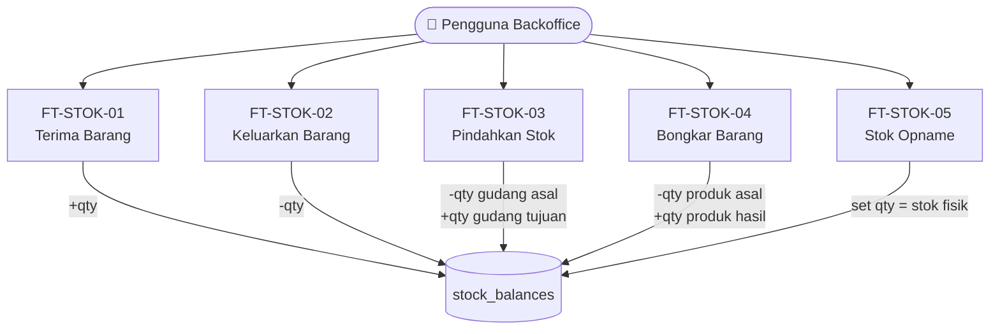
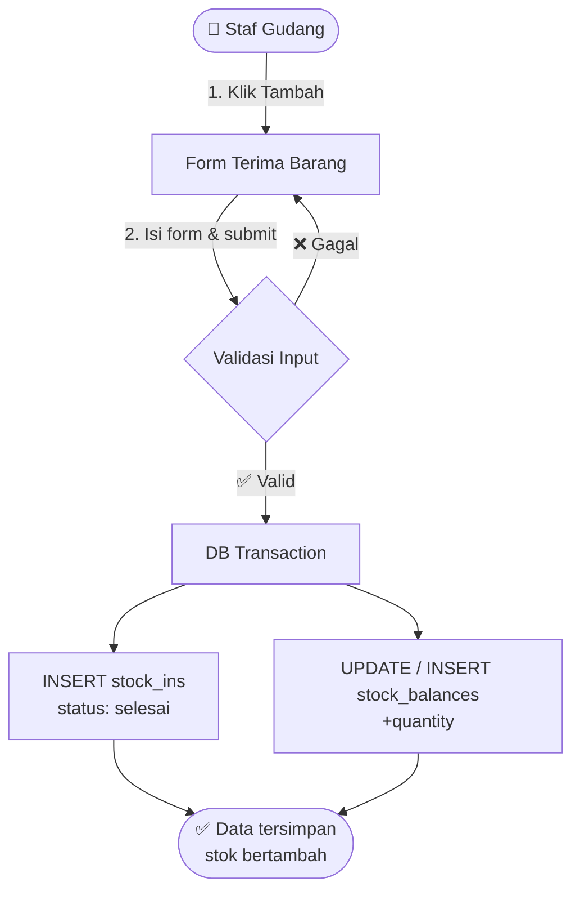
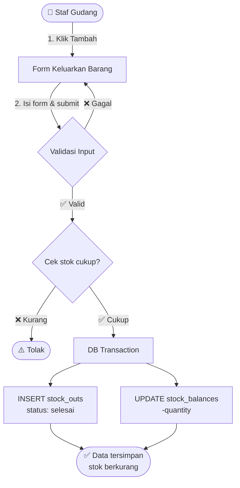
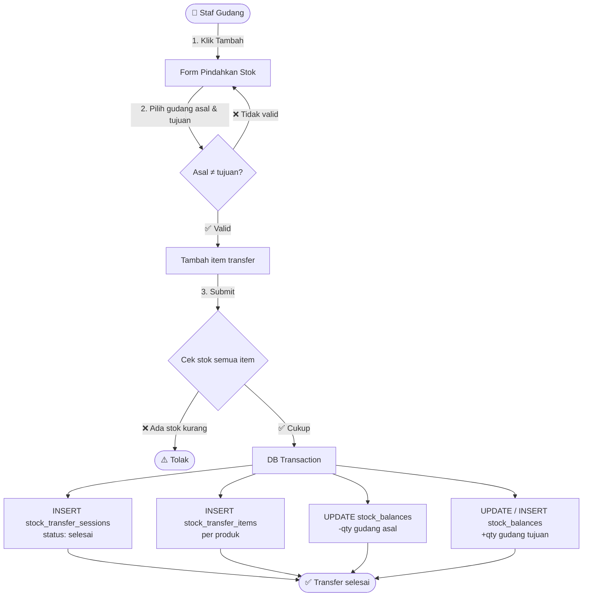
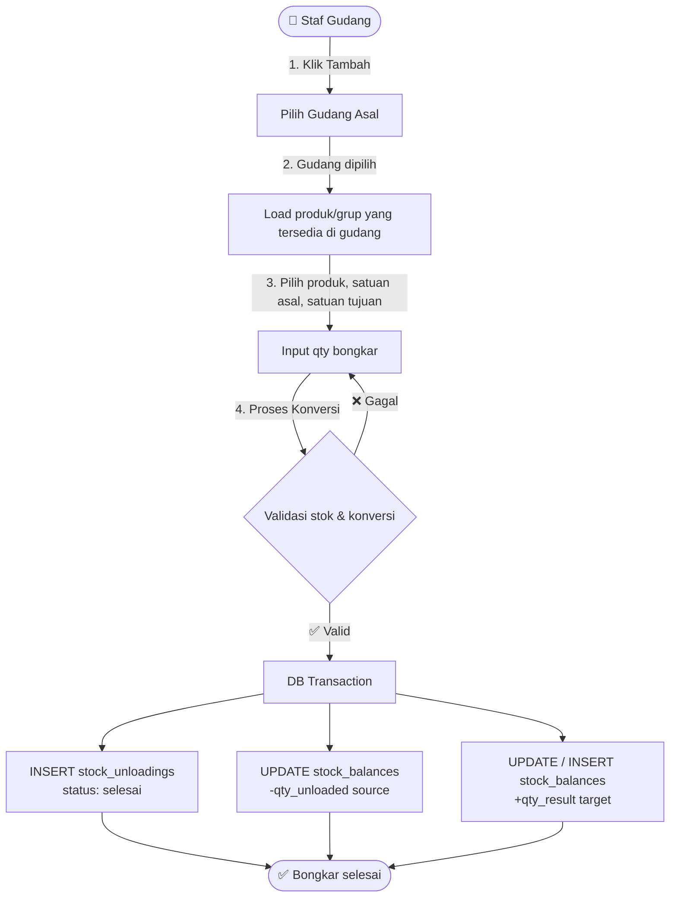
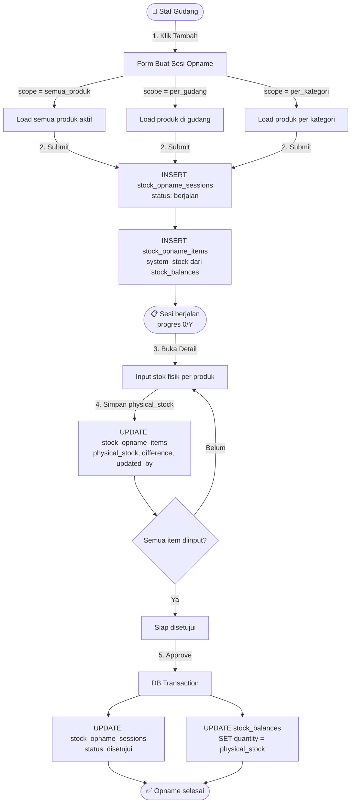

# Data Flow — Stok Barang Per Fitur

<aside>
🔀

**Data Flow per Fitur — Modul Stok Barang**

Stack: Laravel 13 · MySQL · Single-Tenant

Setiap heading = satu fitur. Alur mencakup: Aktor → Request → Validasi → DB Operations → Response.

</aside>

---

## 🗺️ Gambaran Umum Alur Modul Stok Barang



> **Prinsip Utama:** Versi sederhana modul stok hanya memakai `stock_balances` sebagai tabel shared. Semua fitur stok langsung memperbarui `stock_balances`. Tabel `stock_movements` tidak digunakan.
> 

---

## FT-STOK-01 — Terima Barang

<aside>
📥

Pengguna mencatat barang masuk dari pemasok ke gudang. Versi sederhana memakai **satu tabel utama**, yaitu `stock_ins`.

</aside>

### Aktor & Trigger

- **Aktor:** Staf Gudang, Manajer, Owner
- **Trigger:** Barang fisik tiba dari pemasok, pengguna membuka menu Terima Barang → klik ➕ Tambah

### Alur Lengkap



### Detail Operasi Database

| Langkah | Aksi | Tabel | Operasi | Keterangan |
| --- | --- | --- | --- | --- |
| 1 | Simpan Terima Barang | `stock_ins` | INSERT | stock_in_code, product_id, warehouse_id, supplier_id, quantity, purchase_price, payment_status, reference_no, received_date, status=selesai, notes, created_by |
| 2 | Tambah Stok | `stock_balances` | UPSERT | Tambah quantity produk pada warehouse tujuan. Jika belum ada baris, buat baris baru. |

### Validasi

- `product_id` harus ada dan status `aktif`
- `warehouse_id` harus ada
- `supplier_id` opsional; jika diisi harus valid
- `quantity` > 0
- `payment_status` wajib: lunas / belum_lunas
- `received_date` wajib
- Stok langsung bertambah saat data disimpan

### State Transition

```
[form submit] ──► [selesai]
```

---

## FT-STOK-02 — Keluarkan Barang

<aside>
📤

Pengguna mencatat pengeluaran stok non-penjualan: barang rusak, expired, pemakaian internal, koreksi, atau lainnya. Versi sederhana memakai **satu tabel utama**, yaitu `stock_outs`.

</aside>

### Aktor & Trigger

- **Aktor:** Staf Gudang, Manajer, Owner
- **Trigger:** Ada barang yang perlu dikeluarkan dari gudang

### Alur Lengkap



### Detail Operasi Database

| Langkah | Aksi | Tabel | Operasi | Keterangan |
| --- | --- | --- | --- | --- |
| 1 | Cek Stok | `stock_balances` | SELECT | Pastikan quantity produk di gudang asal mencukupi. |
| 2 | Simpan Barang Keluar | `stock_outs` | INSERT | stock_out_code, product_id, warehouse_id, quantity, reason, reference_no, out_date, status=selesai, notes, created_by |
| 3 | Kurangi Stok | `stock_balances` | UPDATE | Kurangi quantity produk pada warehouse asal. |

### Validasi

- `product_id` harus valid
- `warehouse_id` wajib
- `quantity` > 0
- `reason` wajib: rusak / expired / pemakaian_internal / koreksi / lainnya
- Stok pada `stock_balances` harus >= quantity keluar
- Stok langsung berkurang saat data disimpan

### State Transition

```
[form submit] ──► [selesai]
```

---

## FT-STOK-03 — Pindahkan Stok

<aside>
🔄

Transfer stok antar gudang. Karena form mendukung **+ Tambah item**, fitur ini memakai pola **sesi + items**: `stock_transfer_sessions` dan `stock_transfer_items`.

</aside>

### Aktor & Trigger

- **Aktor:** Staf Gudang, Manajer, Owner
- **Trigger:** Ada kebutuhan memindahkan stok antar gudang/lokasi

### Alur Lengkap



### Detail Operasi Database

| Langkah | Aksi | Tabel | Operasi | Keterangan |
| --- | --- | --- | --- | --- |
| 1 | Cek Gudang | `warehouses` | SELECT | Pastikan gudang asal dan tujuan valid serta berbeda. |
| 2 | Cek Stok Item | `stock_balances` | SELECT | Pastikan stok di gudang asal cukup untuk setiap item. |
| 3 | Simpan Header Transfer | `stock_transfer_sessions` | INSERT | transfer_code, from_warehouse_id, to_warehouse_id, transfer_date, status=selesai, notes, total_items, created_by |
| 4 | Simpan Item Transfer | `stock_transfer_items` | INSERT | transfer_id, product_id, quantity, notes |
| 5 | Kurangi Gudang Asal | `stock_balances` | UPDATE | Kurangi quantity di from_warehouse_id per produk. |
| 6 | Tambah Gudang Tujuan | `stock_balances` | UPSERT | Tambah quantity di to_warehouse_id per produk. Jika belum ada baris, buat baris baru. |

### Validasi

- `from_warehouse_id` ≠ `to_warehouse_id`
- Minimal 1 item transfer
- Setiap `product_id` harus valid
- Quantity tiap item > 0
- Stok gudang asal harus mencukupi untuk semua item
- `UNIQUE(transfer_id, product_id)` untuk mencegah produk dobel dalam satu transfer

### State Transition

```
[form submit] ──► [selesai]
```

---

## FT-STOK-04 — Bongkar Barang

<aside>
📦

Konversi stok antar satuan dalam satu grup produk, misalnya dari DUS ke PCS. Versi sederhana memakai **satu tabel utama**, yaitu `stock_unloadings`.

</aside>

### Aktor & Trigger

- **Aktor:** Staf Gudang, Manajer, Owner
- **Trigger:** Ada produk satuan besar yang perlu dipecah menjadi satuan kecil

### Alur Lengkap



### Detail Operasi Database

| Langkah | Aksi | Tabel | Operasi | Keterangan |
| --- | --- | --- | --- | --- |
| 1 | Load Produk | `stock_balances` · `products` | SELECT | Ambil produk yang memiliki stok > 0 di gudang yang dipilih. |
| 2 | Validasi Konversi | `products` | SELECT | Pastikan source_product_id dan target_product_id berada dalam grup produk yang sama. |
| 3 | Cek Stok Source | `stock_balances` | SELECT | Pastikan stok source_product_id di gudang asal >= qty_unloaded. |
| 4 | Simpan Bongkar | `stock_unloadings` | INSERT | stock_unloading_code, warehouse_id, source_product_id, target_product_id, unloading_date, qty_unloaded, qty_result, conversion_ratio, reason, status=selesai, notes, created_by |
| 5 | Kurangi Produk Asal | `stock_balances` | UPDATE | Kurangi quantity source_product_id di warehouse_id. |
| 6 | Tambah Produk Hasil | `stock_balances` | UPSERT | Tambah quantity target_product_id di warehouse_id. Jika belum ada baris, buat baris baru. |

### Alur Edit & Hapus

```
Edit Data
1. Rollback stok lama:
   - source_product_id lama + qty_unloaded lama
   - target_product_id lama - qty_result lama
2. Update stock_unloadings dengan data baru
3. Apply stok baru:
   - source_product_id baru - qty_unloaded baru
   - target_product_id baru + qty_result baru

Hapus Data
1. Rollback stok lama:
   - source_product_id + qty_unloaded
   - target_product_id - qty_result
2. DELETE stock_unloadings
```

### Validasi

- `warehouse_id` wajib
- `source_product_id` ≠ `target_product_id`
- Source dan target harus dalam grup produk yang sama
- Stok source di gudang asal harus >= `qty_unloaded`
- `conversion_ratio` disimpan sebagai snapshot
- Aksi Edit dan Hapus wajib rollback/update `stock_balances`

### State Transition

```
[form submit] ──► [selesai]
[selesai] ──(edit)──► rollback stok lama + apply stok baru
[selesai] ──(hapus)──► rollback stok lama + delete data
```

---

## FT-STOK-05 — Stok Opname

<aside>
🔍

Pencocokan stok fisik dengan stok sistem. Fitur ini tetap memakai **2 tabel**: `stock_opname_sessions` untuk sesi dan `stock_opname_items` untuk daftar produk yang dicek.

</aside>

### Aktor & Trigger

- **Aktor Buat Sesi:** Staf Gudang, Manajer, Owner
- **Aktor Input Fisik:** Staf Gudang, Manajer, Owner
- **Aktor Approve:** Owner, Manajer
- **Trigger:** Jadwal pencocokan stok berkala atau permintaan validasi stok

### Alur Lengkap



### Detail Operasi Database

| Langkah | Aksi | Tabel | Operasi | Keterangan |
| --- | --- | --- | --- | --- |
| 1 | Buat Sesi | `stock_opname_sessions` | INSERT | session_code, session_name, scope_type, warehouse_id/category_id sesuai scope, status=berjalan, notes, created_by |
| 2 | Snapshot Stok | `stock_opname_items` | INSERT bulk | Untuk setiap produk dalam scope: system_stock = current stock dari stock_balances, physical_stock=NULL |
| 3 | Input Fisik | `stock_opname_items` | UPDATE | physical_stock, difference = physical_stock - system_stock, updated_by |
| 4 | Approve Sesi | `stock_opname_sessions` | UPDATE | status=disetujui, approved_by, approved_at |
| 5 | Set Stok Aktual | `stock_balances` | UPDATE / UPSERT | SET quantity = physical_stock untuk item yang sudah diinput. Jika belum ada baris, buat baris baru. |

### Query Progres Opname

```sql
SELECT
    session_id,
    COUNT(*) AS total_items,
    COUNT(physical_stock) AS filled_items,
    CONCAT(COUNT(physical_stock), ' dari ', COUNT(*)) AS progres
FROM stock_opname_items
WHERE session_id = ?
GROUP BY session_id;
```

### Validasi

- `scope_type` = per_gudang wajib isi `warehouse_id`
- `scope_type` = per_kategori wajib isi `category_id`
- Sesi berjalan bisa menerima input stok fisik
- Hanya Owner/Manajer yang bisa approve
- Sesi yang sudah `disetujui` bersifat final
- Tidak ada edit/hapus setelah disetujui

### State Transition

```
[berjalan] ──(input physical_stock bertahap)──► [berjalan]
[berjalan] ──(approve)──► [disetujui]
[disetujui] ──► final
```

---

## 📊 Perbandingan Alur Antar Fitur

| Aspek | FT-01 Terima | FT-02 Keluar | FT-03 Transfer | FT-04 Bongkar | FT-05 Opname |
| --- | --- | --- | --- | --- | --- |
| **Tabel utama** | `stock_ins` | `stock_outs` | `stock_transfer_sessions`  • `stock_transfer_items` | `stock_unloadings` | `stock_opname_sessions`  • `stock_opname_items` |
| **Tabel shared** | `stock_balances` | `stock_balances` | `stock_balances` | `stock_balances` | `stock_balances` |
| **Pola** | 1 tabel | 1 tabel | Sesi + Items | 1 tabel | Sesi + Items |
| **Status** | selesai | selesai | selesai | selesai | berjalan → disetujui |
| **Arah Stok** | +qty masuk | -qty keluar | -asal / +tujuan | -source / +target | set = fisik |
| **Cek Stok** | ❌ | ✅ | ✅ | ✅ | Snapshot saat buat sesi |
| **Edit/Hapus** | Sesuai kebutuhan aplikasi | Sesuai kebutuhan aplikasi | Sesuai kebutuhan aplikasi | ✅ rollback stok | ❌ setelah disetujui |

---

## ⚙️ Mekanisme Shared — DB Transaction & Locking

<aside>
⚠️

Semua operasi yang mengubah stok wajib dijalankan dalam satu **DB Transaction**. Gunakan pessimistic locking (`SELECT ... FOR UPDATE`) pada `stock_balances` untuk mencegah race condition.

</aside>

```php
DB::transaction(function () use ($item) {
    $balance = StockBalance::where('product_id', $item->product_id)
        ->where('warehouse_id', $item->warehouse_id)
        ->lockForUpdate()
        ->first();

    $quantityBefore = $balance?->quantity ?? 0;
    $quantityAfter = $quantityBefore + $item->quantity_change;

    StockBalance::updateOrCreate(
        [
            'product_id' => $item->product_id,
            'warehouse_id' => $item->warehouse_id,
        ],
        [
            'quantity' => $quantityAfter,
            'last_movement_type' => $item->movement_type,
            'last_reference_no' => $item->reference_no,
            'last_quantity_change' => $item->quantity_change,
            'last_changed_by' => auth()->id(),
            'last_changed_at' => now(),
        ]
    );
});
```

---

## 🔎 Review Kelengkapan Dokumentasi Production

<aside>
🧭

Bagian ini adalah catatan design review backend sebelum implementasi production. Tidak mengubah flow bisnis yang sudah disetujui; hanya menambahkan guardrail teknis agar Data Flow, API, Database, Policy, Service, Repository, FormRequest, dan QA lebih konsisten.

</aside>

### Checklist Kelengkapan Komponen Backend

| Komponen | Status Review | Tambahan Production-Ready |
| --- | --- | --- |
| Data Flow | ✅ Sudah jelas per fitur | Tambahkan error flow, audit stok, duplicate submit prevention, dan low stock warning. |
| API Endpoint | ✅ Sudah mengikuti pola Inertia + JSON AJAX | Pastikan endpoint detail, current stock, low stock, stock card, export, master data, search produk, reference number, dan dashboard terdokumentasi di dokumen API. |
| Business Rules | ✅ Sudah mencakup flow utama | Tambahkan aturan audit trail, idempotency, validasi master aktif, dan minimum stock. |
| Validation Rules | ⚠️ Perlu diperketat | Warehouse/produk/supplier wajib aktif dan tidak soft delete; reason `lainnya` mewajibkan notes. |
| Database Design | ✅ Tabel utama sudah konsisten | Tambahkan index recommendation dan unique constraint untuk reference_no/request_uuid. |
| Controller | ✅ Controller tipis | Controller hanya menerima request, memanggil service, dan mengembalikan Inertia/JSON response. |
| Service | ✅ Tempat business logic | Service wajib menjadi boundary `DB::transaction()`, audit log, idempotency, dan retry deadlock. |
| Repository | ✅ Akses data terpisah | Repository wajib selalu scoped `store_id`, memakai `lockForUpdate()` saat mutasi stok, dan tidak berisi business decision. |
| Policy | ✅ RBAC dipakai | Policy harus selaras dengan RBAC Matrix pada dokumen ini. |
| Form Request | ⚠️ Perlu standardisasi | Tambahkan validasi active/non-deleted, request_uuid/idempotency_key, dan conditional notes. |
| API Resource | ✅ Response dapat distandarkan | Gunakan Resource agar field response sama antara list, detail, print, export, dan AJAX. |
| Error Response | ⚠️ Perlu error flow eksplisit | 422 validation, 403 RBAC, 404 not found/IDOR, 409 conflict, 500 database/exception. |
| Route Laravel | ✅ Route modular | Pastikan route write memakai throttle dan route delete/approve memakai role Owner/Manajer. |

---

## 🧾 Audit Perubahan Stok

<aside>
🧾

Setiap perubahan pada `stock_balances` wajib memiliki jejak audit. Karena versi sederhana tidak memakai `stock_movements`, audit perubahan stok dicatat melalui metadata `stock_balances` dan `audit_logs` jika modul audit global sudah tersedia.

</aside>

### Data Audit Minimum

| Field | Keterangan | Sumber |
| --- | --- | --- |
| `product_id` | Produk yang stoknya berubah | Request item / transaksi |
| `warehouse_id` | Gudang yang stoknya berubah | Request transaksi |
| `movement_type` | Jenis perubahan stok | receipt_in, output_out, transfer_out, transfer_in, unloading_out, unloading_in, opname_adjustment_plus/minus, reversal_* |
| `quantity_before` | Qty sebelum perubahan | Nilai `stock_balances.quantity` sebelum update dan setelah `lockForUpdate()` |
| `quantity_change` | Selisih qty: positif untuk tambah, negatif untuk kurang | Perhitungan Service |
| `quantity_after` | Qty setelah perubahan | `quantity_before + quantity_change` atau `physical_stock` saat opname |
| `reference_no` | Nomor transaksi | reference_no / stock_in_code / transfer_code / session_code |
| `transaction_type` | Nama model transaksi | stock_in, stock_out, stock_transfer, stock_unloading, stock_opname |
| `transaction_id` | ID transaksi sumber | ID row header transaksi |
| `user_id` | User yang melakukan perubahan | Auth::id() |
| `created_at` | Waktu perubahan dicatat | now() |

### Strategi Audit Tanpa Menambah Tabel Baru

Jika sistem sudah memiliki tabel global `audit_logs`, perubahan stok dicatat sebagai event audit:

```json
{
  "event": "stock_balance_changed",
  "auditable_type": "stock_balances",
  "auditable_id": "uuid-balance",
  "old_values": {
    "quantity": 10
  },
  "new_values": {
    "quantity": 15
  },
  "metadata": {
    "product_id": "uuid-product",
    "warehouse_id": "uuid-warehouse",
    "movement_type": "receipt_in",
    "quantity_before": 10,
    "quantity_change": 5,
    "quantity_after": 15,
    "reference_no": "RET-20260805-0001",
    "transaction_type": "stock_in",
    "transaction_id": "uuid-stock-in"
  },
  "user_id": "uuid-user",
  "created_at": "2026-08-05T13:42:00+07:00"
}
```

### Business Rules — Audit Trail

- Setiap `INSERT`, `UPDATE`, `UPSERT`, `DECREMENT`, `INCREMENT`, dan reversal pada `stock_balances` wajib membuat audit log.
- Audit log dibuat di dalam `DB::transaction()` yang sama dengan perubahan stok agar atomic.
- Jika audit log gagal dibuat, transaksi stok ikut rollback kecuali ada keputusan eksplisit bahwa audit memakai queue async.
- Nilai `quantity_before` harus diambil setelah row dikunci dengan `lockForUpdate()`.
- Nilai `quantity_after` tidak boleh negatif. Jika hasil perhitungan negatif, return 409 dan rollback.
- Metadata terakhir pada `stock_balances` tetap diperbarui untuk akses cepat.
- `audit_logs` menjadi sumber riwayat perubahan detail; `stock_balances` menjadi state terkini.

---

## 🛡️ Pencegahan Duplicate Submit

<aside>
🛡️

Semua endpoint write wajib aman dari double submit karena user dapat menekan tombol Submit berkali-kali atau browser mengirim request ulang.

</aside>

### Pendekatan yang Digunakan

| Mekanisme | Implementasi | Catatan |
| --- | --- | --- |
| `UNIQUE reference_no` | Tambahkan unique index per `store_id`  • `reference_no` pada tabel transaksi | Mencegah nomor dokumen ganda |
| `request_uuid` | Frontend mengirim UUID sekali per submit form | Disimpan pada tabel transaksi jika kolom tersedia |
| `Idempotency-Key` | Header opsional untuk endpoint POST/DELETE/APPROVE | Disimpan di cache atau audit_logs selama window tertentu |

### Validation

- `reference_no` wajib unik per toko jika diisi manual.
- `request_uuid` wajib format UUID untuk endpoint transaksi create bila frontend menyediakan field ini.
- Jika `Idempotency-Key` dikirim, format minimal string 20–100 karakter dan dicek terhadap store/user/endpoint yang sama.
- Jika request dengan idempotency key yang sama sudah berhasil, backend mengembalikan response sukses yang sama tanpa membuat transaksi baru.

### Backend Process

```
Request submit
↓
Validasi FormRequest
↓
Cek idempotency_key / request_uuid / reference_no
↓
Jika sudah pernah sukses → return response sukses existing
↓
Jika belum ada → proses DB::transaction()
↓
Simpan transaksi + update stock_balances + audit_logs
↓
Simpan idempotency result
↓
Return success
```

### Business Rules

- Duplicate submit tidak boleh menyebabkan stok bertambah/berkurang dua kali.
- `reference_no` tidak boleh duplikat untuk transaksi aktif dalam store yang sama.
- Tombol submit tetap harus disabled di frontend, tetapi backend tetap wajib melakukan proteksi.
- Jika duplicate terdeteksi saat transaksi pertama masih berjalan, return 409 atau tunggu hasil sesuai strategi idempotency.
- Jika terjadi unique constraint violation karena race condition, mapping error menjadi 409 Conflict dengan pesan ramah.

---

## ✅ Standar Validasi Master Data

### Validasi Warehouse

- `warehouse_id` wajib ada untuk transaksi yang membutuhkan gudang.
- Warehouse harus milik `store_id` user aktif.
- Warehouse harus status `aktif`.
- Warehouse tidak boleh soft deleted (`deleted_at IS NULL`).
- Untuk transfer, gudang asal dan gudang tujuan wajib berbeda.

### Validasi Produk

- `product_id`, `source_product_id`, dan `target_product_id` harus ada.
- Produk harus milik `store_id` user aktif.
- Produk harus status `aktif`.
- Produk tidak boleh soft deleted (`deleted_at IS NULL`).
- Untuk Bongkar Barang, produk asal dan produk hasil wajib berbeda dan berada dalam grup/konversi yang valid.

### Validasi Supplier

- `supplier_id` opsional pada Terima Barang.
- Jika diisi, supplier harus ada, aktif, milik store yang sama, dan tidak soft deleted.

### Validasi Quantity

- Semua quantity transaksi wajib numeric dan lebih dari 0.
- Quantity hasil perhitungan tidak boleh menghasilkan `stock_balances.quantity` negatif.
- Untuk Opname, `physical_stock` boleh 0 tetapi tidak boleh negatif.

### Validasi Reason & Notes

- `reason` wajib untuk Keluarkan Barang dan Bongkar Barang jika digunakan oleh form.
- Jika `reason = lainnya`, maka `notes` wajib diisi.
- `notes` maksimal 500 karakter kecuali modul membutuhkan batas lebih panjang.

---

## ⚠️ Low Stock Rules

### Prinsip Minimum Stock

- `minimum_stock` disimpan pada master produk atau konfigurasi produk per gudang jika tersedia.
- Jika konfigurasi per gudang tersedia, gunakan minimum stok per gudang sebagai prioritas.
- Jika tidak tersedia, gunakan `products.minimum_stock`.
- Produk dianggap low stock jika `stock_balances.quantity <= minimum_stock`.

### Data Flow Low Stock Warning

```
Transaksi stok berhasil
↓
Update stock_balances
↓
Hitung quantity_after
↓
Bandingkan dengan minimum_stock
↓
Jika quantity_after <= minimum_stock
↓
Tambahkan warning ke response / flash message
↓
Data tetap tersimpan
```

### Business Rules

- Low stock warning tidak membatalkan transaksi yang valid.
- Endpoint Low Stock wajib memakai nilai `minimum_stock` yang sama dengan warning transaksi.
- Warning low stock ditampilkan setelah transaksi keluar, transfer keluar, bongkar source, dan opname adjustment minus.
- Terima Barang dapat menghilangkan status low stock jika quantity_after sudah di atas minimum.
- Low stock tidak boleh dihitung dari data soft deleted.

**Contoh Response Warning:**

```json
{
  "success": true,
  "message": "Pengeluaran barang berhasil disimpan.",
  "warnings": [
    {
      "type": "low_stock",
      "message": "Stok Produk A di Stok Di Toko berada di bawah minimum stock.",
      "quantity": 3,
      "minimum_stock": 5
    }
  ]
}
```

---

## 🚨 Error Flow Standar

### Flow Error Umum

```
Request
↓
FormRequest Validation
↓
Jika validation error → Return 422
↓
Policy / RBAC
↓
Jika forbidden → Return 403
↓
Repository lookup scoped by store_id
↓
Jika tidak ditemukan → Return 404
↓
DB::transaction()
↓
Jika conflict bisnis → Rollback → Return 409
↓
Jika database error / deadlock → Retry terbatas
↓
Jika tetap gagal → Rollback → Audit error → Return 500
```

### Mapping Response Error

| Kondisi | HTTP Status | Response | Catatan |
| --- | --- | --- | --- |
| Validation Error | 422 | `errors` per field | Dari FormRequest / Inertia errors |
| Unauthorized | 401 | Belum login | Sanctum SPA |
| Forbidden | 403 | Tidak punya izin | Policy / RBAC |
| Not Found / IDOR | 404 | Data tidak ditemukan | Jangan expose data store lain |
| Stok Kurang | 409 | Conflict stok | Rollback transaksi |
| Duplicate Submit | 409 / 200 existing | Conflict atau response idempotent | Sesuai strategi idempotency |
| Deadlock | 500 jika retry gagal | Database sedang sibuk | Retry 2–3 kali sebelum gagal |
| Unhandled Exception | 500 | Terjadi kesalahan sistem | Log detail ke server, jangan expose stack trace |

### Business Rules Error Handling

- Semua error dalam `DB::transaction()` wajib rollback.
- Deadlock boleh retry maksimal 2–3 kali dengan backoff singkat.
- Error 500 wajib dicatat ke log aplikasi dan audit error jika tersedia.
- Response error tidak boleh membocorkan SQL query, stack trace, path server, atau data store lain.

---

## 🔐 RBAC Matrix — Modul Stok Barang

| Fitur / Action | Owner | Manajer | Staf Gudang |
| --- | --- | --- | --- |
| FT-STOK-01 Terima Barang — View/Create | ✅ | ✅ | ✅ |
| FT-STOK-01 Terima Barang — Delete/Reversal | ✅ | ✅ | ❌ |
| FT-STOK-02 Keluarkan Barang — View/Create | ✅ | ✅ | ✅ |
| FT-STOK-02 Keluarkan Barang — Delete/Reversal | ✅ | ✅ | ❌ |
| FT-STOK-03 Pindahkan Stok — View/Create | ✅ | ✅ | ✅ |
| FT-STOK-03 Pindahkan Stok — Delete/Reversal | ✅ | ✅ | ❌ |
| FT-STOK-04 Bongkar Barang — View/Create/Update | ✅ | ✅ | ✅ |
| FT-STOK-04 Bongkar Barang — Delete/Reversal | ✅ | ✅ | ❌ |
| FT-STOK-05 Opname — View/Create/Input Fisik | ✅ | ✅ | ✅ |
| FT-STOK-05 Opname — Approve | ✅ | ✅ | ❌ |
| FT-STOK-05 Opname — Edit setelah Disetujui | ❌ | ❌ | ❌ |
| FT-STOK-06/07/08/09 Reporting — View | ✅ | ✅ | ✅ |

---

## 🗄️ Rekomendasi Database Index

| Tabel | Index | Alasan |
| --- | --- | --- |
| `stock_balances` | `UNIQUE(store_id, product_id, warehouse_id, unit_id)`; `INDEX(product_id, warehouse_id)` | Mencegah row stok duplikat dan mempercepat lookup stok saat transaksi, stock check, low stock, dan stock card. |
| `stock_ins` | `UNIQUE(store_id, reference_no)`; `INDEX(received_date)`; `INDEX(warehouse_id)` | Mencegah duplicate submit serta mempercepat daftar penerimaan dan export. |
| `stock_outs` | `UNIQUE(store_id, reference_no)`; `INDEX(out_date)`; `INDEX(warehouse_id)` | Mencegah pengeluaran ganda serta mempercepat daftar pengeluaran. |
| `stock_transfer_sessions` | `UNIQUE(store_id, transfer_code)`; `INDEX(transfer_date)`; `INDEX(from_warehouse_id, to_warehouse_id)` | Mencegah transfer ganda dan mempercepat filter transfer. |
| `stock_transfer_items` | `UNIQUE(transfer_id, product_id)`; `INDEX(product_id)` | Mencegah produk dobel dalam satu transfer dan mempercepat riwayat produk. |
| `stock_unloadings` | `UNIQUE(store_id, stock_unloading_code)`; `INDEX(unloading_date)`; `INDEX(warehouse_id)`; `INDEX(source_product_id, target_product_id)` | Mencegah transaksi bongkar ganda dan mempercepat daftar/stock card. |
| `stock_opname_sessions` | `UNIQUE(store_id, session_code)`; `INDEX(status)`; `INDEX(created_at)` | Mencegah kode sesi ganda dan mempercepat daftar/filter status. |
| `stock_opname_items` | `UNIQUE(session_id, product_id)`; `INDEX(product_id)` | Mencegah item opname dobel dan mempercepat detail/stock card. |
| `audit_logs` | `INDEX(auditable_type, auditable_id)`; `INDEX(created_at)`; `INDEX(user_id)` | Audit trail perubahan stok dan investigasi incident. |

---

## 🧪 Acceptance Test

| ID | Fitur | Skenario | Expected Result |
| --- | --- | --- | --- |
| AT-STOK-01-01 | Terima Barang | Submit penerimaan dengan data valid | `stock_ins` terbuat; `stock_balances` bertambah; audit log tercatat. |
| AT-STOK-01-02 | Terima Barang | Submit quantity 0 atau produk tidak aktif | Return 422; tidak ada insert; stok tidak berubah. |
| AT-STOK-01-03 | Terima Barang | Database error setelah insert transaksi sebelum update stok | Rollback penuh; return 500; audit error tercatat. |
| AT-STOK-02-01 | Keluarkan Barang | Stok cukup lalu submit pengeluaran | `stock_outs` terbuat; `stock_balances` berkurang; audit log tercatat. |
| AT-STOK-02-02 | Keluarkan Barang | Stok kurang dari quantity keluar | Return 409; tidak ada insert; stok tidak berubah. |
| AT-STOK-03-01 | Transfer | Gudang asal sama dengan gudang tujuan | Return 422/409; tidak ada session transfer; stok tidak berubah. |
| AT-STOK-03-02 | Transfer | Salah satu item stoknya kurang | Return 409; tidak ada item tersimpan; semua stok tetap. |
| AT-STOK-03-03 | Transfer | Transfer berhasil multi item | Session dan items tersimpan; stok asal berkurang; stok tujuan bertambah; audit log per item tercatat. |
| AT-STOK-04-01 | Bongkar | Produk asal dan hasil beda grup / konversi tidak valid | Return 422/409; stok tidak berubah. |
| AT-STOK-04-02 | Bongkar | Stok produk asal kurang | Return 409; `stock_unloadings` tidak tersimpan. |
| AT-STOK-04-03 | Bongkar | Bongkar berhasil dengan conversion_ratio valid | Produk asal berkurang; produk hasil bertambah; audit log out dan in tercatat. |
| AT-STOK-05-01 | Opname | Manajer approve sesi berjalan dengan item sudah diinput | Status menjadi disetujui; `stock_balances` disesuaikan; audit log tercatat. |
| AT-STOK-05-02 | Opname | Staf Gudang mencoba approve | Return 403; status sesi tetap berjalan; stok tidak berubah. |
| AT-STOK-05-03 | Opname | Input/edit stok fisik setelah sesi disetujui | Return 409; data final tidak berubah. |
| AT-STOK-06-01 | Duplicate Submit | Kirim request yang sama dua kali dengan reference_no/request_uuid sama | Hanya satu transaksi tersimpan; stok hanya berubah sekali. |
| AT-STOK-07-01 | Low Stock | Transaksi membuat stok berada di bawah minimum_stock | Transaksi sukses; response membawa warning; endpoint Low Stock menampilkan produk tersebut. |

---

## 🧩 Catatan Konsistensi Implementasi

### Konsistensi Nama Field

- Dokumen API boleh memakai label UI `Terima/Keluar/Pindah/Bongkar/Opname`, tetapi database tetap konsisten memakai `stock_ins`, `stock_outs`, `stock_transfer_sessions`, `stock_transfer_items`, `stock_unloadings`, `stock_opname_sessions`, `stock_opname_items`, dan `stock_balances`.
- Gunakan satu standar tanggal per tabel: `received_date`, `out_date`, `transfer_date`, `unloading_date`, dan `approved_at`.
- Gunakan satu standar status transaksi: `selesai` untuk transaksi stok langsung dan `berjalan → disetujui` untuk stok opname.

### Konsistensi Layer

- Controller tidak boleh melakukan query stok langsung kecuali validasi ringan via FormRequest.
- Service bertanggung jawab untuk business rules, transaction boundary, audit trail, idempotency, dan low stock warning.
- Repository bertanggung jawab untuk query scoped `store_id`, `lockForUpdate()`, insert/update, dan pagination.
- Policy mengikuti RBAC Matrix.
- API Resource menjadi sumber final shape response.

---

## ✅ Hasil Design Review

### Kelebihan Desain Saat Ini

- Flow bisnis per fitur sudah jelas dan mudah diikuti oleh backend, frontend, dan QA.
- Pemisahan fitur sudah rapi: Terima, Keluar, Transfer, Bongkar, dan Opname memiliki tanggung jawab masing-masing.
- Penggunaan `stock_balances` sebagai state terkini membuat query current stock cepat dan sederhana.
- Fitur yang membutuhkan multi item sudah memakai pola sesi + items.
- Stok Opname sudah memiliki state transition yang jelas dan final.

### Kekurangan yang Berhasil Diperbaiki

- Audit perubahan stok diperjelas tanpa memaksa penambahan tabel baru.
- Duplicate submit prevention ditambahkan melalui `reference_no`, `request_uuid`, dan `Idempotency-Key`.
- Validation rules diperketat untuk master data aktif dan tidak soft deleted.
- Low stock rules ditambahkan agar warning dan endpoint Low Stock memakai definisi yang sama.
- Error flow production ditambahkan untuk validation error, conflict, rollback, deadlock, dan exception.
- RBAC Matrix ditambahkan agar Policy, Route middleware, dan QA test case selaras.
- Rekomendasi index database ditambahkan untuk performa query list, detail, stock check, stock card, export, dan audit.
- Acceptance test ditambahkan sebagai acuan QA dan automated feature test Laravel.

### Rekomendasi Peningkatan di Masa Depan

- Pertimbangkan tabel ledger `stock_movements` jika kebutuhan audit stok detail, rekonsiliasi, dan laporan historis semakin kompleks.
- Pertimbangkan queue untuk export besar agar request HTTP tidak timeout.
- Pertimbangkan cache read-only untuk dashboard jika volume transaksi tinggi.
- Pertimbangkan optimistic UI + idempotency key standar di seluruh form Inertia.
- Pertimbangkan alert otomatis untuk low stock melalui notifikasi internal.

### Hal yang Sengaja Tidak Diubah

- Tidak menambahkan `stock_movements` karena dokumen saat ini menetapkan versi sederhana memakai `stock_balances` sebagai shared state.
- Tidak mengubah flow bisnis yang sudah disetujui: transaksi langsung berstatus `selesai`, sedangkan Opname tetap `berjalan → disetujui`.
- Tidak mengubah struktur fitur dan penomoran FT-STOK yang sudah ada.
- Tidak menghapus endpoint, tabel, atau pola yang sudah terdokumentasi sebelumnya.